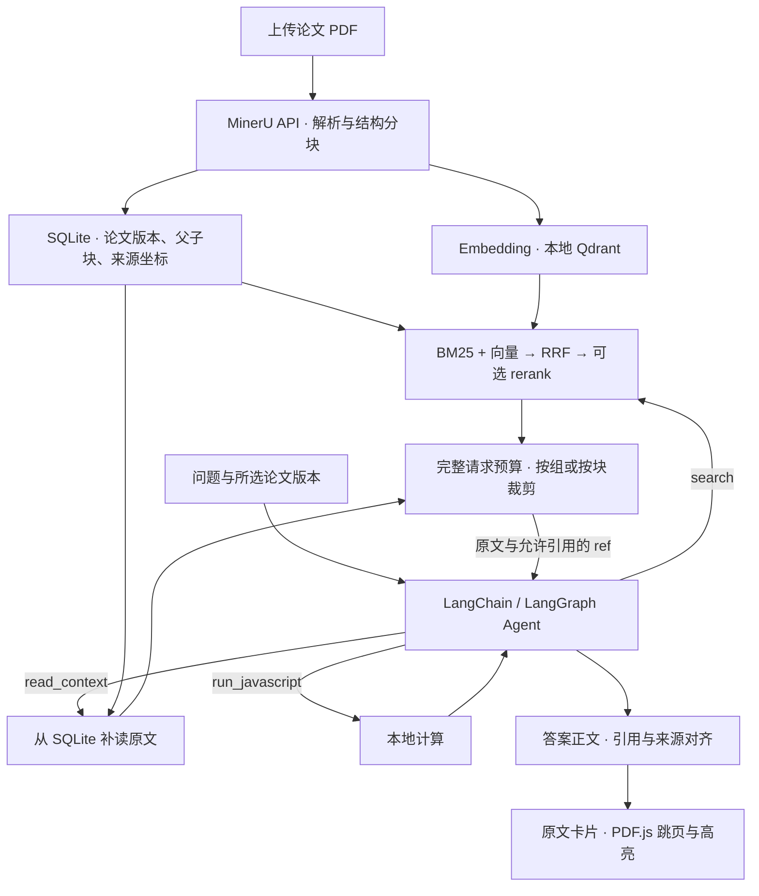
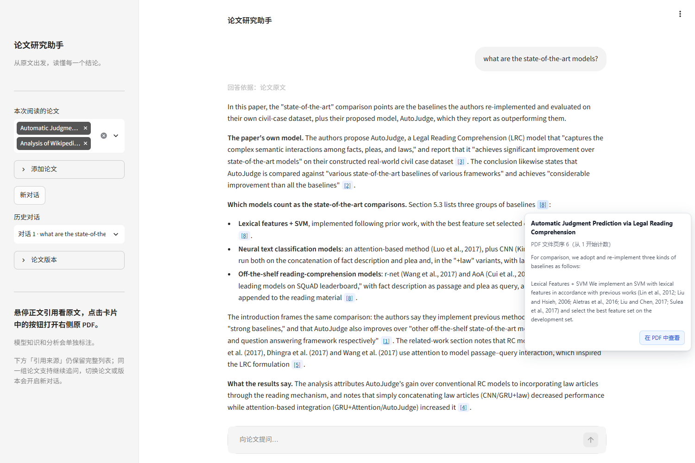
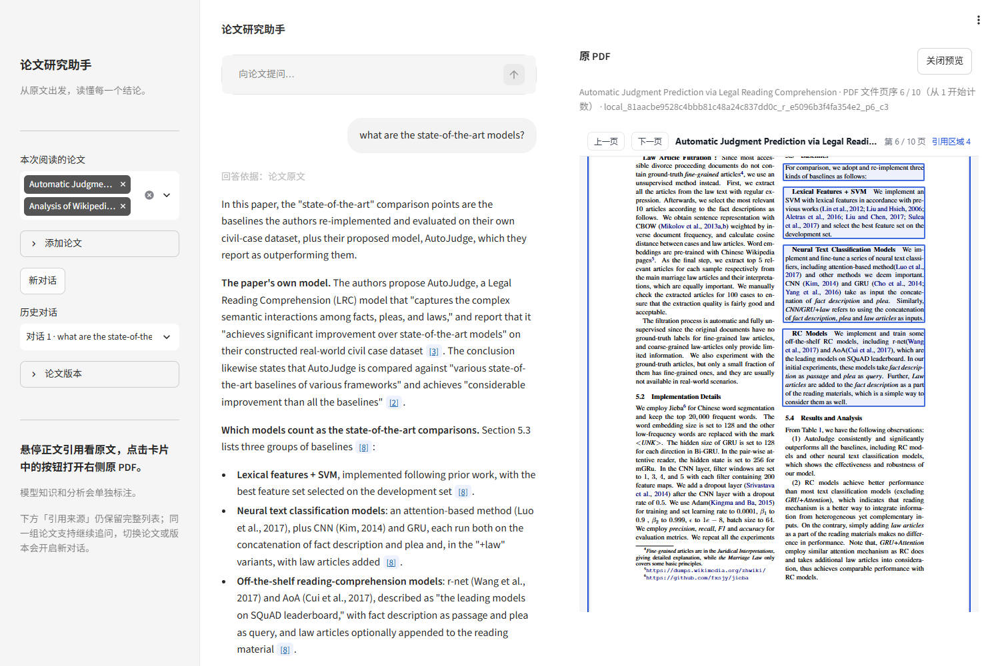

# 论文研究助手 · Paper Research Assistant

A local research assistant for asking questions about academic PDFs.<br>
It helps readers verify answers against the passages and tables they rely on.<br>
It combines structured parsing, hybrid retrieval, and a tool-using agent with citations linked to the original PDF.

[快速开始](#快速开始) · [评测](#评测)

上传论文 PDF，围绕所选版本问答、比较或追问，并从答案引用回到原文所在的 PDF 版面。

## 架构



## 核心设计

### 文档结构化

页面上传默认使用 MinerU API 提取正文、表格、公式和版面信息。子块用于检索，父块保留局部章节或表格的关联结构，需要上下文时可以按父块补读。SQLite 保存论文版本、原文和 `source_spans`，包括 PDF 文件页序与可用的归一化区域坐标，向量写入本地 Qdrant。这种分工让检索可以定位到较小的片段，同时保留回读表头、相邻段落和原始版面的路径。

### 混合检索

BM25 匹配关键词，向量检索处理语义相近的表述，两路都限定在所选论文和解析版本内。RRF 按排名融合两路结果，避免直接校准 BM25 与向量相似度的分数。D6 对照了纯 BM25、纯向量、RRF 以及对同一融合候选池做 rerank，按选入上下文的原文覆盖衡量，结果支持保留 RRF 作为基础排序。RRF 基础路径省去额外重排请求，配置了 rerank 时可以在截取结果前对融合池重排，重排失败时沿用 RRF 顺序。

### Agent 取证

页面在问题理解后进入由 LangChain `create_agent` 和 LangGraph 调度的模型与工具循环。`search` 找候选，`read_context` 读取已知子块或目录中的父块，`run_javascript` 对已取得的值做本地计算，计算所用的论文事实仍引用原文。工具反馈分别记录检索命中、纳入的原文和本轮新增证据，实际送入模型的原文以预算拟合后的请求为准。模型可以沿线索继续补读，也可以基于已取得的原文收尾，因此每题的取证路径和调用用量会随问题变化。

### 上下文预算与引用对齐

系统把消息、原文与工具定义一并计入请求容量，并为输出留出空间。超预算时裁剪完整消息组或原文块，保留的原文决定当轮允许引用的范围。同一次问答中相同原文沿用稳定的 `ref`，交付时将正文中的 `[ID:n]` 映射到最终请求里可引用的片段。悬停引用可查看论文标题、原文和 PDF 文件页序，从卡片打开右侧预览后可以在原版面核对来源。





## 评测

### 检索与上下文覆盖

D6 从 QASPER dev 首批 50 题中选取 41 道有正向证据标注的题，四种配置共用其中 40 道有效题。一道题因评测脚本的上下文字段错误缺失结果。下表先计算每题必要证据组的覆盖率，再对有效题取平均。`Returned` 按排名返回的候选计算，`Shown` 按 8,192-token 证据窗口实际选入的原文计算。

| 检索配置 | Returned@5 | Shown@5 | Returned@10 | Shown@10 |
|---|---:|---:|---:|---:|
| 纯 BM25 | 61.50% | 53.35% | 83.88% | 54.47% |
| 纯向量 | 77.54% | 62.79% | 90.54% | 65.29% |
| BM25＋向量＋RRF | 78.67% | 74.92% | 83.88% | 75.54% |
| 同一 RRF 候选池＋rerank | 74.17% | 64.35% | 83.00% | 64.97% |

[样本与评分规则](docs/v3/d6-plan.md#63-评分口径) · [四组执行结果](docs/v3/d6-plan.md#125-四组结果共同有效题集)

### 固定 RAG 与 Agent 同题对照

D7 使用 11 篇论文的 50 道 QASPER dev 原题，每题单篇、单轮。两组共享同一原题、PDF 文件及解析版本、`deepseek-flash`、embedding 与 rerank 配置，均以空会话历史提交。完整请求共享 1,048,576 tokens 的模型上下文和 4,096 tokens 的输出上限，计算后的输入上限为 1,017,118 tokens。固定 RAG 做一次混合检索和既有父块补读，Agent 按需调用工具，两组各自记录实际送入的证据、调用和耗时。

两组各正常交付 50 份答案。V50-009 的官方参考与 PDF 的带条件建议存在冲突，冻结评分单列该题，共保留 49 个可评分配对。完整表示满足评分规则的全部核心要求，部分正确表示核心要求只满足一部分或仍有实质歧义。

| 指标 | 固定 RAG | Agent |
|---|---:|---:|
| 正常交付 | 50/50 | 50/50 |
| 完整 | 39/49（79.6%） | 44/49（89.8%） |
| 部分正确 | 3/49 | 2/49 |
| 未通过 | 7/49 | 3/49 |
| 完整或部分正确 | 42/49（85.7%） | 46/49（93.9%） |
| Chat 请求 | 100 | 155 |
| Chat tokens | 666,522 | 1,095,809 |
| 单题耗时中位数 | 18.438 秒 | 20.445 秒 |

同题配对中，仅 Agent 完整的有 6 题，仅固定 RAG 完整的有 1 题。用量与耗时按各组 50 次正式问答统计，论文入库单独计量。 [运行条件与交付](docs/v3/d7-plan.md#992-服务窗口与完成度) · [冻结评分](docs/v3/d7-plan.md#993-同题配对内容结果) · [用量明细](docs/v3/d7-plan.md#995-用量与成本)

## 快速开始

### 安装与配置

以下命令在项目根目录的 Windows PowerShell 中运行，使用 Python 3.11。

```powershell
py -3.11 -m venv .venv
.\.venv\Scripts\python.exe -m pip install -r requirements.txt

if (-not (Test-Path -LiteralPath '.env')) {
    Copy-Item -LiteralPath '.env.example' -Destination '.env'
}
```

在本机 `.env` 填写服务配置。模板包含项目使用过的模型参数，可按实际服务账户填写密钥和地址。

| 用途 | 配置项 |
|---|---|
| 聊天 | `LLM_PROVIDER`、`LLM_MODEL_ID`、`LLM_API_KEY`、`LLM_BASE_URL`、`LLM_TIMEOUT`、`LLM_CONTEXT_LENGTH` |
| 向量 | `EMBEDDING_BACKEND=dashscope`、`EMBEDDING_MODEL`、`EMBEDDING_API_KEY`、`EMBEDDING_BASE_URL`、`EMBEDDING_DIMENSION` |
| PDF 解析 | `MINERU_API_TOKEN`，填写 MinerU API token |
| 可选重排 | 同时填写 `RERANK_MODEL` 和 `RERANK_BASE_URL`。可配置 `RERANK_TIMEOUT`，`RERANK_API_KEY` 留空时复用向量密钥 |

### 初始化本地索引

全新克隆首次入库前，使用已配置的 embedding 参数生成索引 profile 和空 SQLite。下面的命令只读取本机配置和初始化本地文件。已有索引沿用原 profile，并使用与该 profile 匹配的 embedding 配置。

```powershell
@'
from pathlib import Path

from paper_assistant.config import load_embedding_settings
from paper_assistant.indexing import atomic_json, make_index_profile, save_index_profile
from paper_assistant.storage import PaperStore

index_dir = Path("data/index")
current_profile = index_dir / "current_profile.json"
if not current_profile.is_file():
    profile = make_index_profile(load_embedding_settings())
    save_index_profile(index_dir, profile)
    atomic_json(current_profile, profile)

with PaperStore(index_dir / "papers.sqlite3"):
    pass
'@ | .\.venv\Scripts\python.exe -X utf8 -
```

### 启动与首次入库

```powershell
.\.venv\Scripts\python.exe -m streamlit run app.py --server.address 127.0.0.1 --server.port 8501 --server.headless true
```

1. 打开 [本地页面](http://127.0.0.1:8501)，在侧栏「添加论文」上传一份可直接打开、正文可提取的 PDF。
2. 点击「开始入库」。首次结构分块会在缺少缓存时从 ModelScope 下载 tokenizer，入库过程调用 MinerU API 和 embedding 服务。
3. 等待入库就绪，在「本次阅读的论文」选中该版本，然后提问。可试问「这篇论文的方法和基线有什么不同？请引用原文。」
4. 悬停正文中的引用查看原文，再点「在 PDF 中查看」核对版面。回答详情中可下载 JSON 或 Markdown。

## 已知限制

- 量化问答对照覆盖单篇、单轮。页面支持跨论文比较和连续追问，这两类场景目前主要有个案观察。
- 表头、表行或比较条件分散在多个块时，Agent 仍可能漏读必要原文，导致答案不完整。
- PDF 高亮依赖保存的区域坐标。缺少可用坐标时，预览定位到对应文件页。
- 对话历史保存在当前页面会话中。关闭页面后可借助已下载的记录回看。

## 数据来源

| README 内容 | 仓库文件 |
|---|---|
| D6 检索样本、证据窗口与四种排序的覆盖率 | [冻结题目与证据](eval/qasper/d6-new50-v1/sample.json) · [D6 检索设置和结果](docs/v3/d6-plan.md#124-四组检索设置与输入冻结) |
| D7 样本量、论文和解析版本 | [冻结题目](eval/qasper/d7-new50-v1/sample.json) · [论文版本映射](eval/qasper/d7-new50-v1/papers.json) |
| D7 同题条件、容量、交付与质量评分 | [实际运行配置](docs/v3/d7-plan.md#992-服务窗口与完成度) · [请求预算计算](paper_assistant/message_fit.py#L25-L29) · [冻结配对评分](docs/v3/d7-plan.md#993-同题配对内容结果) |
| D7 Chat 请求、tokens 与单题耗时 | [用量和成本](docs/v3/d7-plan.md#995-用量与成本) |
| Python 环境、服务配置与本地端口 | [Python 环境记录](docs/v3/d3-plan.md#131-实际改动) · [配置模板](.env.example) · [启动记录](docs/v3/d8-plan.md#62-组件依赖构建与启动) |
| 首次入库、索引 profile 与预览截图 | [入库实现](paper_assistant/import_runtime.py) · [索引配置实现](paper_assistant/indexing.py) · [D8 浏览器回放](docs/v3/d8-plan.md#1242-浏览器结果) |

逐题运行明细保存在本地的 `artifacts/v3/d6-retrieval-new50-20261103/results.json` 和 `artifacts/v3/d7-qa-paired-new50-20261105/`。仓库的评测文档保留可随源码发布的汇总与评分口径。
