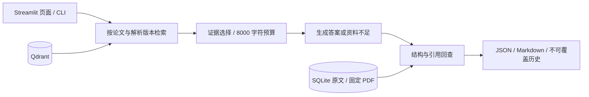

# D6 任务 G：完成范围与 D7 交接

审核日期：2026-10-04（Asia/Shanghai）。D6 A–G 已完成各自记录中的工程范围；生成答案的全量人审、D7 交付、D8 Agent 和最终验收仍待做。G 汇总已有证据，不新增付费实验。F 列出的 35 份本地运行记录中未发现验收执行证据，结论不覆盖项目外或未留记录的运行；验收问答按计划留到 D11。

入口：[D6 总计划](/D:/course/paper-research-assistant/docs/v1/d6/d6-ABCDEFG-plan.md)、[G 阶段记录](/D:/course/paper-research-assistant/artifacts/d6/task_g.md)、[本次 G 审核](/D:/course/paper-research-assistant/artifacts/d6/task_g_audit.md)、[F 核对](/D:/course/paper-research-assistant/artifacts/d6/validation.md)、[目录说明](/D:/course/paper-research-assistant/docs/v1/00-directory-guide.md)。

## 1. D6 已完成的范围

| 任务 | 实际结果 | 依据 |
|---|---|---|
| A 六题合并与抽审 | 六题标注人审通过，dev 10→16；新六题首跑 4 answered、2 insufficient_evidence，无答案标签下程序拒答 2/2；新答案独立语义评价待补 | [A 指南](/D:/course/paper-research-assistant/docs/v1/d6/d6-A-dev-merge-guide.md) |
| B 验收冻结 | 20 题及评分规则已人审冻结；10/4/3/3 分布，17 可答、3 无答案；D11 前不用于运行或优化 | [B 指南](/D:/course/paper-research-assistant/docs/v1/d6/d6-B-acceptance-guide.md) |
| C 检索对照 | 仅覆盖扩充前 16 题、13 道可答；全部标注依据返回命中 top-5/10/20 为 9/13、11/13、13/13，实际展示 9/13、11/13、12/13 | [C 指南](/D:/course/paper-research-assistant/docs/v1/d6/d6-C-retrieval-experiment-guide.md) |
| D 最小页面 | 本地 Streamlit 页面；27 项离线检查、五终态与一次真实浏览器问答/下载分别留证 | [D 指南](/D:/course/paper-research-assistant/docs/v1/d6/d6-D-web-guide.md) |
| E 开发集补题 | 四题标注经原记录载明的人审确认，dev 16→20；首跑 4 answered、精确引文命中 4/4；补充 AI 审核及共享背景说明 | [E 审核](/D:/course/paper-research-assistant/artifacts/d6/task_e_audit.md) |
| F 证据核对 | 680 项强化核对通过；另有 25 项新增回归，其中 21 种篡改均被拒绝；原 67 项保留历史 | [F 指南](/D:/course/paper-research-assistant/docs/v1/d6/d6-F-validation-guide.md) |
| G 汇总交接 | 修正完成口径、交接依赖、录屏脚本和简历草稿；更新 README、目录、两份总计划，并绑定现有证据 | [G 当前记录](/D:/course/paper-research-assistant/artifacts/d6/task_g.json) |

开发集的 20 题全部 human_verified，表示题目、标准要点及来源标注已核验，**不表示 20 个生成答案经过人工评分**。验收集为另 20 题，正式题集及评分规则已冻结。

## 2. 当前能演示的工程流程

当前核心是固定一轮 RAG，默认 top-5；页面和 CLI 复用同一核心。引用可回查 chunk、原文哈希及 PDF 文件页序，支持 answered、insufficient_evidence、tool_error、invalid_output、budget_exceeded 五终态。页面可下载本次会话结果；新进程没有从文件加载历史结果的入口。

已有 arXiv 搜索、固定版本下载和入库脚本，但页面只做选论文、问答、原文与导出，尚无搜索/导入整合入口、本地 PDF 上传、补检索 Agent、多轮对话或部署。离线流程图描述已实现部分，未来补检索见 §6。

## 3. 数字与语义评价分别看

三个批次是 10/6/4 个不同问题的首次运行，分别绑定当时 10/16/20 题快照；共 20 次结果，不是新跑了一批 20 题。均使用 top-5、8000 字符。

| 程序观察 | 实际记录 | 边界 |
|---|---|---|
| 输出与结论数 | 15 answered、5 insufficient_evidence；19＋9＋10＝38 条结论 | 终态及输出计数不等于语义正确 |
| 可答完成 / 无答案拒答 | 15/17；3/3 | 两道可答题缺证据拒答，仍计未完成 |
| 全部标注依据返回 / 展示 | 13/17；13/17 | 精确引文代理指标，非语义召回率 |
| 单条精确引文命中 | 16/21 | 对应固定 top-5 首次问答 |
| 引用定位合法 | 21/21＋10/10＋12/12＝43/43 | 只检查定位与来源身份，不能写成答案正确率 |

语义评价另行记录：

| 输出批次 | 结论数 | AI 检查 | 人工状态 |
|---|---:|---|---|
| D5 十题 | 19 | AI 判断 19 条结论受来源支持；仍有两道可答题未完成 | 仅 D2-001、D2-005、D2-003 三题整题抽审；两个回答涉及 7 条结论，未逐条打分 |
| D6 新六题 | 9 | 独立语义评价待补，含两条拒答理由 | 待补 |
| E 新四题 | 10 | 9 条直接支持、1 条措辞歧义；D6-004 只说明单个 ALFWorld 示例 | 待补 |

AI 已检查 14 个问题的输出、29 条结论，不能外推为全量准确率。用户整题抽审也不能换算成 7/7 的逐条支持率；全批人工支持率仍为 null。依据：[十题 AI 评价](/D:/course/paper-research-assistant/artifacts/d5/qa_baseline/d5_f_dev10_20261004/ai_semantic_review.md)、[三题整题人审](/D:/course/paper-research-assistant/artifacts/d6/human_review_spotcheck_10case_answers.json)、[E AI 评价](/D:/course/paper-research-assistant/artifacts/d6/task_e_audit.md)。

C 的 top-k 对照属于另一项检索实验，不能与上述 top-5 问答混算。top-10 补齐 D2-003、D3-004；D2-002 第二段排第 11，需 top-20 才全部返回。top-20 的 8/13 道可答题触发预算停止，仅 D2-004 实际丢失标注依据；重排与扩大预算尚未对照。核心默认值未改。

## 4. D7 交接清单与录屏脚本

D7 表示下一实施阶段；原日历 D7/10月3日保留为基准，不把这里的安排写成“明天”。以下是项目内可核实的材料状态，不推断用户在项目外是否录屏或投递。

| # | 材料 | 当前状态 / 完成标准 | 依赖 |
|---|---|---|---|
| 1 | 3–5 分钟录屏 | 脚本已准备；项目内无完成录屏记录。录屏需看清版本、原文页码、资料不足及导出 | 2、3；新提交需模型额度 |
| 2 | README 与架构说明 | README 已补操作步骤，当前架构图见 §2；新环境复现通过后再定稿 | 已有源码、数据与核对记录 |
| 3 | 新环境重建预演 | 尚未执行；按 README 新 venv 安装、pip check、只读列出三个 ready 版本、启动页面，保存失败及成功记录 | Python 3.11、requirements、配置；固定 PDF、SQLite、Qdrant、缓存/profile 数据副本 |
| 4 | 简历条目 | 简短项目草稿见 §5；个人简历最终整合待核实 | 当前真实数字，标明预计工作 |
| 5 | 少量投递 | 项目内无投递记录；留 D7 使用定稿简历，记录岗位与反馈 | 4；可演示材料与已知限制 |
| 6 | 面试讲述 | 三个问答要点见 §5；实际口述演练尚未记录 | 能解释自己的源码与失败案例 |

**录屏脚本：**

1. 先确认页面选择 RAG 的 arxiv_2005.11401v4 / r_269ac0cb1263292d，输入开发题 D2-001：  
   “What forms of parametric and non-parametric memory are combined in the RAG model?”  
   展示答案及引用，说明页码是 PDF 文件页序。
2. 切换到 ReAct 的 arxiv_2210.03629v3 / r_22af23d03fcb87a8，输入开发题 D5-006：  
   “According to the selected ReAct paper (arXiv:2210.03629v3), what is the scheduled release date of the Streamlit interface for the local paper-research-assistant project?”  
   说明论文没有本地项目排期，展示本轮资料不足与理由；若新输出异常，保留该次结果。
3. 下载当前会话的 JSON/Markdown，展示 run_id、来源与用量；重绘和下载不重新提交问答。
4. 可以先展示[已有浏览器记录](/D:/course/paper-research-assistant/artifacts/d6/web_browser_validation_20261004_084015_594560.json)及[无答案首跑](/D:/course/paper-research-assistant/artifacts/d5/qa_baseline/d6_f_dev16_20261004/results/D5-006.json)，并明确这是历史回放。页面新提交及另跑 CLI 会产生新的 embedding/聊天请求，要留新 run_id，不覆盖首跑记录；页面问答与 CLI 不同时访问同一 Qdrant 目录。

录屏只用开发题，冻结验收题不用于演示或调优。已有一次真实浏览器验证，不表示 D7 录屏或新环境预演已完成。

## 5. 简历草稿与面试口径

**论文研究助手｜Python、RAG、Qdrant、SQLite**

> 实现论文版本过滤、证据检索与引用回查，支持资料不足处理及问答记录导出。建立 20 题开发集；在扩充前 13 道可答题上完成 top-k 对照，全部标注依据返回命中由 9/13 提升至 13/13，实际展示 12/13；三个首次批次引用定位检查 43/43 通过。
>
> 预计加入最多一次自动补检索，并与固定 RAG 对比效果与调用成本。

API 服务和 HelloAgents 薄适配可在追问时简要说明。预计工作不写成已实现，也不写验收成绩、总体答案准确率、已部署或跨语料泛化能力。

**三个面试问题：**

1. 命中怎么测？用人工标注原文做精确匹配，分别看返回和展示；top-k 用同一问题向量的前缀。样本为 C 的 16 题，其中 13 道可答。
2. 43/43 为什么不等于答案正确？它只验证引用定位；结论是否受引用支持另做语义评价，AI 与人审分开记录。
3. 如何解释拒答？无答案标签上的程序拒答与可答题检索失败分开统计；后者未完成任务。单次正确拒答不能保证所有问题都不编造。

## 6. 后续依赖与当前边界

1. D7 先完成材料与环境预演，处理演示阻塞；不在此阶段新增大模块。
2. D8 实现一次受控 retry_search，再与固定 RAG 比效果和成本；当前 Agent 未实现。
3. 本地 PDF 上传及页面搜索/导入整合排在 D8 之后，独立留新版本和记录。
4. 补做新六题的 9 条结论及两条拒答理由 AI 评价；全量人审按 38 条实际结论与不足理由逐项记录，不把三题抽审当全量。
5. D9–D12 按开发集做必要对照，D11 才运行冻结验收；失败照实保留。

当前限定三篇固定语料、本地单进程演示，无并发或部署验证。G 的交接范围已完成，上述项目仍为待办。E/F/G 审核均保留原记录与修改前备份；原始模型输出及冻结题集不修改。
