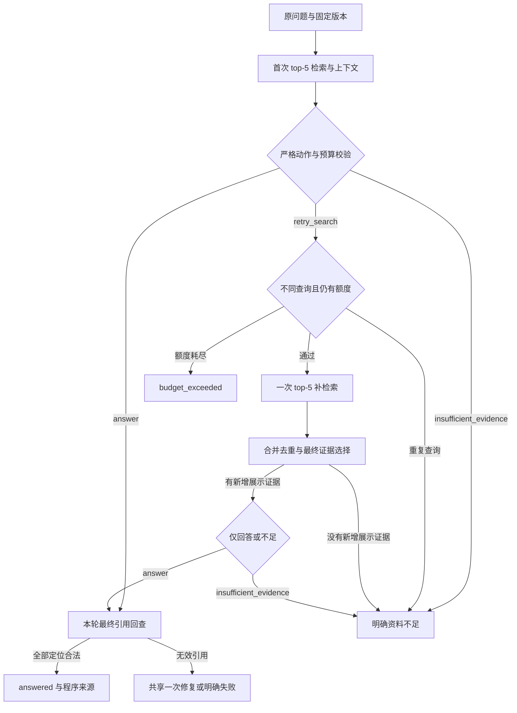

# D8 执行计划：最多一次受控补检索与开发题成对对照

制定日期：2026-10-05（Asia/Shanghai）。当前状态：**A–G 已按各自记录中的工程范围完成，状态为 completed_with_known_issues；四题首次、AI初审及用户总体确认保留，G当前回归/审计和D9–D11交接已完成。全量评测、来源章节硬检查及最终验收仍待补。** 使用者决定 **D7 先跳过**，本阶段直接从 D6 工程交接进入 D8。D8 是实施阶段编号；总计划原日历的 D8 / 10 月 4 日保留为基准，实际执行日期据记录填写。

依据：[两周总计划](/D:/course/paper-research-assistant/docs/v1/plan-codex.md) §4–7、[D6 总计划开头的完成情况](/D:/course/paper-research-assistant/docs/v1/d6/d6-ABCDEFG-plan.md)、[D6 G 审核后的交接](/D:/course/paper-research-assistant/docs/v1/d6/d6-G-completion-guide.md)，以及当前 `rag.py`、`search.py`、`context.py`、`llm_client.py`、`citations.py`、运行导出与评测源码。

本文保留实施安排，并单独标注实际完成项。A 的 57 项预检通过，三篇 1188 个 chunk ready；34 项历史源码引用匹配，781 个受保护文件未变；embedding/聊天均 0。见 [A 逐步说明](/D:/course/paper-research-assistant/docs/v1/d8/d8-A-contract-guide.md)、[完成记录](/D:/course/paper-research-assistant/artifacts/d8/task_a.json) 和 [初始配置](/D:/course/paper-research-assistant/artifacts/d8/agent_config.json)。使用者学习、自检及理解程度未测量；未标完成的模块、路径及实验继续是计划。

B 执行更新（2026-10-05；保留 B 阶段当时记录）：新增两个独立业务模块，实现严格三动作、首轮/补轮/空证据权限、当前证据消息和修复消息。当前源码 42 项离线检查通过，embedding/聊天/网络 0；786 个受保护文件匹配，A 配置与交付记录不变。独立审查发现的嵌套 Claim 实例校验绕过已修复并保留失败及回归记录。见 [B 指南与自检](/D:/course/paper-research-assistant/docs/v1/d8/d8-B-action-guide.md)、[检查报告](/D:/course/paper-research-assistant/artifacts/d8/agent_action_boundary_validation.json) 和 [完成记录](/D:/course/paper-research-assistant/artifacts/d8/task_b.json)。动作/提示词版本为 `d8-agent-actions-v1` / `d8-evidence-agent-actions-v1`；C 接下来实现实际补查、共享预算与引用回查，D 的完整故障边界和 F 的成对实验仍未执行。

C 执行更新（2026-10-05；保留 C 阶段当时记录）：独立编排入口已实现最多一次补查、补轮优先合并/去重/完整证据选择、同查询及无新增展示停止、共享 ChatBudget 和最终引用回查。当前源码 41 项针对性离线检查全部通过，63 次 SDK MockTransport 模拟 HTTP、真实 API/网络 0；802 个受保护文件匹配，A/B 及正式数据保持原样。末次修复失败分类、异常检索的阶段后截止检查两项缺陷已修复，失败/当时通过/最终回归记录均保留；独立审查接受。见 [C 指南与流程自检](/D:/course/paper-research-assistant/docs/v1/d8/d8-C-agent-guide.md)、[检查报告](/D:/course/paper-research-assistant/artifacts/d8/agent_orchestration_validation.json) 和 [完成记录](/D:/course/paper-research-assistant/artifacts/d8/task_c.json)。这是可调用的 Agent API；D 完整故障验证、E CLI/导出/成对适配、F 真实实验及 G 汇总仍未执行。页面仍为固定 RAG，未测问答收益或用户学习，验收仍留 D11。

D 执行更新（2026-10-05；保留D阶段当时记录）：统一186个unittest方法全部通过，含B42/C41适用回归及新增D103（动作预算22、证据引用67、记录资源14）；182次SDK MockTransport模拟HTTP，真实API/网络0，21份源码绑定。修复NaN/Infinity让失败记录无法严格导出的缺陷，验证仍用原值，记录用显式诊断标记；Agent版本为bounded-retry-agent-v2。新保存基础的原子独占竞争冲突也已修复并永久回归。816个保护基线中815个保持相同，唯一既有业务修改agent.py已留原C源码；A/B/C记录与正式数据不改。见 [D指南与自检](/D:/course/paper-research-assistant/docs/v1/d8/d8-D-boundary-guide.md)、[统一报告](/D:/course/paper-research-assistant/artifacts/d8/agent_boundary_validation.json) 和 [完成记录](/D:/course/paper-research-assistant/artifacts/d8/task_d.json)。独立审查接受；记录/批次独占基础已提前提供，E CLI/成对runner与F真实问答仍未做，问答收益及使用者学习未测量；验收仍D11。

E 执行更新（2026-10-05；保留E阶段当时记录）：独立CLI、D8两模式保存、共享首轮成对入口和六层事后评分已完成。当前离线报告、实际零费用准备验证、保护核对、故障修复及学习自检见 [E指南](/D:/course/paper-research-assistant/docs/v1/d8/d8-E-cli-guide.md) 和 [E完成记录](/D:/course/paper-research-assistant/artifacts/d8/task_e.json)。真实API为0，F四题和G汇总未执行；D7继续暂缓，D11验收及全量语义人审保持待办。旧阶段报告/源码绑定保留当时事实。

F 执行更新（2026-10-05；保留首次交付时状态）：新批次 `d8_f_dev4_20261005` 四题/八模式首次真实运行完成，实际embedding5次/201tokens、聊天9次/22188tokens，重试/修复0，源码及正式输入不改。139项独立记录核对通过，八模式AI初审完成、人工全部pending：D2-002一次补查新增两条展示并完整回答，D2-003 Agent以正文声称摘要点名，不能算满足来源限制。机器可答程序完成固定1/3、Agent3/3；AI按支持/范围为1/3、2/3，QAaccuracy未测量。见 [F指南](/D:/course/paper-research-assistant/docs/v1/d8/d8-F-comparison-guide.md)、[成对报告](/D:/course/paper-research-assistant/artifacts/d8/comparison/d8_f_dev4_20261005/comparison_report.md) 与 [完成记录](/D:/course/paper-research-assistant/artifacts/d8/task_f.json)。原E prepared及旧首次结果保留；该manifest只规划四题，不能同ID追加16题，后续完整20题需新批次或明确分开的额外批次。G汇总待做，D7暂缓、验收仍D11。

F 人审补记（2026-10-05；保留确认时状态）：用户明确“我的审核和AI相同”，四题八模式总体结论已记录为 `user_confirmation_of_ai_review`，见 [用户确认](/D:/course/paper-research-assistant/artifacts/d8/comparison/d8_f_dev4_20261005/human_review_confirmation.md)。确认的可答题完成观察为固定1/3、Agent2/3，D2-003来源失败保留。独立逐结论/逐引用人审评分未提供，QAaccuracy仍未测量；首次AI/机器/人审模板保留生成时历史状态。本次没有重跑问答或新增项目API调用，G仍待执行。
G 执行更新（2026-10-05）：完成A–F证据汇总、当前Agent v2/导出v2的186方法离线回归（182模拟HTTP、新增G方法0）、独立实验/接口审计和文件保护，真实API/网络0。E119适用方法按当前SHA继承，其中14记录方法与186重叠，不合计冒充独立测试。F四题/费用/139核对/84审查/AI及用户确认全部保留；固定1/3与Agent2/3是四题中可答题的用户确认AI完成观察，非全量准确率。978文件保护基线，README/三份导航更新有备份，问答/提示词/正式输入不改。见 [G指南](/D:/course/paper-research-assistant/docs/v1/d8/d8-G-completion-guide.md)、[G完成记录](/D:/course/paper-research-assistant/artifacts/d8/task_g.json) 与 [当前回归](/D:/course/paper-research-assistant/artifacts/d8/task_g_boundary_regression.md)。D8工程A–G完成并保留D2-003来源失败；下一阶段D9先修来源与时限、按需页面/旧六题AI，D10开发验证与冻结，D11首次验收。当前runner仅dev、验收入口待实现，D7仍暂缓。

## 1. 跳过 D7 后，从什么基础继续

| 项目 | 当前事实 | 对 D8 的影响 |
|---|---|---|
| D6 A–G | 已按记录中的工程范围完成 | 可直接复用固定 RAG、页面、版本检索和引用回查 |
| 正式语料 | 3 篇、71 页、1188 个 chunk；三个版本 ready；索引 `ep_cbf0f6caa97b962a` | 沿用同一 PDF、解析版本、SQLite、Qdrant 和 embedding 配置 |
| 固定问答 | `rag.answer_question(...)`；top-5、8000 字符；五终态 | 保留固定核心和首次结果，Agent 另建编排入口 |
| 正式开发集 | 20 题，17 可答、3 无答案；题目及来源标注已人审 | 开发、冒烟及调参只使用此集；标注人审不自动继承为答案人审 |
| 历史首次问答 | 10/6/4 三批；15 answered、5 insufficient_evidence、38 条结论；定位引用 43/43 | 作为诊断背景，不能充当本次统一成对实验或答案准确率 |
| D6 C 检索对照 | 仅 16 题/13 可答；全部标注依据返回 top-5/10/20 为 9/13、11/13、13/13；展示为 9/13、11/13、12/13 | 支持研究漏召回和预算省略；不能推出 Agent 已有效或答案已改善 |
| 答案语义复核 | AI 已审 14 题/29 条结论；新六题 9 条结论及两条不足理由待独立 AI 复核；人审仅三题整题抽审 | 不阻塞工程实现；全量人审准确率、支持率仍不能报告 |
| 验收集 | 20 题及规则已人审冻结 | D11 前不运行、不用于优化或演示 |
| D7 交付材料 | 新环境预演、录屏、简历整合和投递尚无项目内完成记录 | 暂缓，不作为 D8 前置，也不改成已完成 |

三个固定版本继续使用：

| 论文 | paper_id | parse_revision | chunk 数 |
|---|---|---|---:|
| RAG | `arxiv_2005.11401v4` | `r_269ac0cb1263292d` | 385 |
| ReAct | `arxiv_2210.03629v3` | `r_22af23d03fcb87a8` | 480 |
| Reflexion | `arxiv_2303.11366v4` | `r_d7736b29a2d8b39e` | 323 |

D7 的新环境预演仍应在最终交付前补做，可衔接 D13；录屏、简历与投递按使用者后续安排继续。D3 恢复稿及全量答案人审原待办保留，不把它们扩成 D8 的强制前置。

## 2. D8 的交付目标和边界

完成一个职责有限的问答 Agent：**模型选择是否补查及补查什么，程序执行检索、来源范围、预算和停止条件。** 它只使用现有 `search_evidence` 工具，不引入新框架、联网研究、多 Agent、多轮对话或新论文导入。

D8 最小交付包括：

1. 严格的 `answer / retry_search / insufficient_evidence` 三动作契约。
2. 首轮检索后可直接回答，也可改写一次查询并补检索；补后只能回答或不足。
3. 两轮候选合并、去重、完整原文选择、最终引用回查及明确五终态。
4. CLI、不可覆盖 JSON/Markdown 记录；能回看缺失信息、补查查询、新增证据、停止原因与真实用量。
5. 离线关键边界，以及四道开发题的固定 RAG / Agent 成对真实冒烟。

**Agent 胜过固定 RAG 不是完成前提。** 不触发补查、补查仍失败或多花请求，都是应保留的观察。D8 做最小对照；统一 20 题开发实验放到 D9–D10，最终冻结验收放到 D11。

## 3. A–G：7 小时 15 分钟＋45 分钟缓冲

| 任务 | 预计用时 | 工作 | 完成时留下什么 |
|---|---:|---|---|
| A | 45 分钟（原估时） | 核对接口和数据，冻结起始策略；限时回读 Ch9/Ch7 | **准备范围已完成**：参数/动作/停止规则冻结，57项预检、21份接口源码绑定、课程映射与学习自检；用户学习未测量，详见 A 指南 |
| B | 1 小时（原估时） | 三动作结构、提示词和严格解析 | **已完成**：独立严格动作模型、阶段/空证据/引用修复权限、消息与解析；42 项离线检查通过，无真实 API |
| C | 2 小时（原估时） | 一次补检索编排、合并选择与最终引用回查 | **已完成**：直接/补查/不足及停止路径、全轮共享预算、引用回查与轨迹；41 项针对性离线检查通过，真实 API 0 |
| D | 1 小时 15 分钟（原估时） | 离线边界和故障注入 | **已完成**：D当时统一186方法通过（新增D103），记录缺陷修复及失败现场保留，真实API 0；当前CLI见E |
| E | 45 分钟（原估时） | 独立 CLI、导出和对照适配 | **已完成**：D8完整轨迹/五终态/退出码、资源关闭、共享首轮独立预算、账本/事后评分；离线检查见E记录，真实API 0 |
| F | 1 小时（原估时） | 四题成对真实冒烟及逐项评价 | **已完成**：四题八首次、embedding5/聊天9、139项核对和八模式AI初审；用户已确认AI总体判断，补查收益及摘要范围失败均保留 |
| G | 30 分钟（原估时） | 完成范围、限制及 D9 交接 | **已完成**：当前186离线回归、适用报告继承、独立审计、可复用命令、真实用量、已知问题与D9–D11门槛；真实API 0 |

执行顺序：**A → B → C → D → E → F → G**。D 的用例准备可与 B/C 并行；E 的导出设计可提前，但真实 F 必须等对应边界通过。

这个估时只包含 CLI 与四题冒烟，不包含全量 20 题语义人审、页面模式改造或新环境预演。缓冲优先处理真实阻塞；若 B–E 超时，先保核心边界，F/G 据实际状态交接至 D9，不能靠跳过检查宣布完成。只有 4 小时时先 A/B/C，D–G 顺延，尚未通过边界的 Agent 不用于真实批跑。

学习嵌入 A/C，不另外叠加整章阅读：限时查看[第九章 9.1–9.3](</D:/course/hello-agents-study/docs/chapter9/第九章 上下文工程.md>)的证据选择，以及[第七章](</D:/course/hello-agents-study/docs/chapter7/第七章 构建你的Agent框架.md>)的动作校验和停止条件；需要职责划分时再看[第十四章 14.1–14.3](</D:/course/hello-agents-study/docs/chapter14/第十四章 自动化深度研究智能体.md>)，当天专题阅读控制在 45 分钟内。

## 4. A：冻结策略与真实预算

| 参数 | D8 起始值 / 规则 |
|---|---|
| 选择范围 | 1–3 个 ready 的完整 `(paper_id, parse_revision)` 配对；全轮固定 |
| 首轮与补轮检索 | 各 top-5；最多 2 轮，其中补检索最多 1 次；不同时扩大 k |
| 最终证据 | 去重后最多展示 8 个完整 chunk，正文合计最多 8000 Python 字符 |
| 聊天 | 沿用当前实际模型与 ChatPolicy；固定 RAG 常规 1 次，Agent 常规 1–2 次 |
| 聊天请求上限 | 每个模式每题共用 1 个 ChatBudget，SDK 尝试硬上限 3，HTTP 尝试另记 |
| 修复与网络重试 | 格式/动作/引用修复全轮共用最多 1 次；聊天可重试网络故障全轮最多 1 次；均占三次预算 |
| embedding | 每个检索轮实际调用一次，无自动网络重试；正常独立问答最多 2 次，失败也计数 |
| 时限 | 沿用单次聊天 30 秒、整轮 120 秒截止预算；各阶段前后检查剩余时间 |
| 记录 | 实际模型 ID、temperature、max_tokens、prompt/选择策略版本、源码 SHA、语料/题集/索引绑定 |

同一 ChatBudget 贯穿决策、补后回答、格式修复和引用修复，不在补轮重新创建。两次正常决策＋一次修复或网络重试可以用满三次；修复和重试都发生时可能没有最终回答额度，返回 `budget_exceeded`。执行补查前先检查最终决策还有请求和时间额度，避免明知无法继续仍消费 embedding。

**时限能力按实测表述：**当前 `embed_texts()` 使用固定 `httpx` 30 秒超时，未接总 deadline；同步检索、PDF 校验也没有硬中断。D8 至少完成阶段前后停止及聊天剩余超时，超时后不发布成功答案。不能把这些写成“进程严格在 120 秒内中止”；统一 embedding 剩余超时和更完整故障组合放 D9 验证。

A 同时固定下列规则，实施后不得按某道题的标注临时更换：

- 重复查询比较只用于防止显然重复：折叠空白＋`casefold()`，与原问题及已执行查询比较；实际请求文字保留原样。相同查询在收费前拦截，返回 `insufficient_evidence`，附 `stop_reason=retry_query_unchanged`，明确未执行第二次检索。
- 首轮工具执行成功但无命中/无可展示证据时，允许模型仅根据原问题选择改写一次或不足，禁止 `answer`。固定 RAG 的空证据直接程序拒答行为保留；两模式这项差异另记。
- 首轮或补轮工具异常均返回 `tool_error`；补查失败不静默改成“资料不足”，不发布未经验证的旧草稿。
- 第二轮再次要求 `retry_search` 时不执行工具；按非法动作处理，可使用剩余的共享修复额度改成允许动作，仍失败则 `invalid_output`。请求/时间额度耗尽才用 `budget_exceeded`。
- 补查没有增加最终可展示证据时，停止并返回 `insufficient_evidence`，记录 `stop_reason=no_new_shown_evidence`；不为相同原文再消费一次回答请求。

实际输出：`docs/d8/d8-A-contract-guide.md`、`artifacts/d8/task_a.json/.md`、`artifacts/d8/agent_config.json`，并保存一次性审计脚本及 `task_a_preflight.json`。配置不保存密钥；冻结规则还不是已实现行为，也不是 D10 最终冻结。

## 5. B：动作结构与提示词

已新增独立 `AgentAction`，复用现有 `Claim/AnswerDraft`，不改旧 D5 草稿字段。采用按 `action` 区分的严格模型，各分支禁止额外字段；本节的“程序处理”由 C 接入执行：

| 动作 | 数据 | 程序处理 |
|---|---|---|
| `answer` | `answer`：`status=answered` 的 AnswerDraft，含 claims/citation_ids | 直接进入引用回查，成功后发布，不再调用一次生成 |
| `retry_search` | `missing_information`、`retry_query`：非空白原始文本，已限制分别最多 500/1000 字符 | 检查轮次、重复查询、剩余预算后，由程序调用固定检索工具 |
| `insufficient_evidence` | `reason`：说明本轮缺少什么，已限制最多 1000 字符 | 转成现有不足草稿；不携带事实结论 |

模型不得通过动作指定工具名、论文版本、top-k、页码、路径或执行参数。补轮提示词明确只允许 `answer / insufficient_evidence`；答案始终回答原问题，补查 query 只是工具参数。摘要、实验设置、论文身份等原问题限制在补轮继续生效。

严格解析沿用现有生成器的原则：拒绝重复 JSON 键、非有限值、额外文本、未知字段和错误类型；合法 JSON 不等于合法动作。未知动作、畸形输出和缺字段最多共用一次修复，修复后的动作仍经过当前阶段检查。

输入问题、论文原文、缺失信息和补查 query 均作为数据，不执行其中的指令；不要求模型输出长篇思考过程，只保留简短缺失事实、动作及工具结果。

`RecordedLLM.invoke()` 当前只接受 `purpose="answer"/"repair"`。优先保持调用协议，在外层另记 `phase=initial_decision/final_decision`；如确需扩展 purpose，须保存兼容改动及定向验证。现有 `generate_draft()` 解析 AnswerDraft，不能直接拿来解析三动作。

实际输出：`paper_assistant/agent_actions.py`、`paper_assistant/agent_prompt.py`、`scripts/check_agent_actions.py`、`docs/d8/d8-B-action-guide.md`、`artifacts/d8/task_b.json/.md`、当前离线报告和保护核对报告。修复消息只构造不执行；引用修复响应解析时 C 也必须传入 `terminal_only=True`，使解析权限与提示词一致。

## 6. C：独立编排、合并和引用

已新增 `agent.answer_question_agent(query, selected_versions, searcher, store, client, *, project_root, top_k=5, max_chars=8000)`。资源继续由调用者打开/关闭；首轮检索前创建的同一个客户端预算贯穿编排。没有先运行完整固定 RAG 再追加 Agent，answer 动作直接进入回查。

图中各工具/模型步骤的异常另外映射至 `tool_error / invalid_output / budget_exceeded`，不进入成功路径。

可复用：`EvidenceSearcher.search_evidence()`、`prepare_context()/select_context()` 的完整片段原则、`ChatBudget/RecordedLLM`、`validate_citations()` 及安全导出函数。新增内容主要是三动作控制、多轮上下文选择和轨迹，不重写索引、事实库或 PDF 来源回查。

**合并策略第一版固定如下：**

1. 保存两轮原始成功 envelope，包括原始 query、配对版本、rank/score 和完整候选；先检查身份、范围、全文哈希。同 ID 的身份/原文冲突报工具错误，不能任选一份。
2. 候选顺序采用“补轮 rank 顺序 → 首轮 rank 顺序”，按 chunk ID 去重。合并后赋独立连续的选择序号；传入旧选择器的 `rank` 使用该序号，不能把两轮原始 rank 直接混入，否则旧排序会破坏补轮优先。原始轮次/rank/score 保存在外层，不把选择序号冒充检索排名，也不跨轮按 cosine score 排序。此顺序是待评测的选择策略，不预先宣称最优。
3. 对合并候选逐个完整加入，最多 8 条，最多 8000 字符；首次长度超限即停止，不切半个 chunk，也不继续挑小片段填空。留下去重、数量上限及字符预算省略记录。
4. 同时保存“新增返回 ID”“合并后新增 ID”“新增实际展示 ID”。新展示以首轮实际展示集合为基准；首轮返回但没展示的片段在补轮进入展示时另标来源，不能称为新召回。
5. 最终回答引用只允许最终上下文的 `allowed_citation_ids`。首轮展示过、最终却被省略的片段不能自动作为本轮最终引用依据。引用修复只使用当前最终证据，可转为不足，不能重新开放工具。

**兼容注意：**`validate_citations()` 会调用旧 `context.build_messages()`，该函数严格检查 shown_evidence 的字段、预算及省略理由。轮次、原始 rank/score、去重与 8 条上限轨迹放在外层独立记录；给引用校验提供符合旧契约的最终 context。建议新层先实施 8 条上限，再将入围候选交旧 `select_context()` 按字符预算选择；兼容 context 的 candidate_count 指该层入围数，全部合并候选及数量上限省略另在外层完整保存。数量上限等新增省略原因不可直接塞进旧格式。验证最终 context 与实际消息一致，不因适配丢失来源和省略记录。

原问题在每次模型调用中保留；补轮不依赖模型记住第一轮聊天里的证据，也不把旧 assistant 的引用自动加入白名单。

实际输出：`paper_assistant/agent.py`、`paper_assistant/agent_context.py`、`scripts/check_agent.py`、`docs/d8/d8-C-agent-guide.md`、`artifacts/d8/task_c.json/.md`、当前编排/保护核对报告及三次独立检查历史。C 的 41 项检查不代表 D 整体故障验收；真实四题问答仍未运行。

## 7. D：收费实验前必须通过的边界

已用假检索器、真实严格解析、SDK MockTransport、假时钟及临时真实 PDF/来源夹具验证。下列是七组场景清单，**方法数量以当前D报告为准**：186方法含新增D103、沿用B/C83；不混入问答质量分母。

| 场景组 | 至少覆盖 |
|---|---|
| 正常路径 | 首轮直接答案只发一次正常聊天；一次补查后回答；补查后仍不足；原问题与版本全轮不变 |
| 动作与查询 | 未知动作、错类型/额外字段/重复键、空查询、仅大小写或空白变化的同查询、补轮第二次 retry 被拦截；修复不能重新放开工具 |
| 无证据与故障 | 首轮空结果的允许动作；补轮空结果/重复候选/没有新增展示；检索服务异常与 no_hits 区分；失败消费统计保留 |
| 预算 | 生成、修复、网络重试共享三次；没有最终额度时不先发补查；总截止前后停止；SDK 隐式重试关闭 |
| 证据 | 两轮串论文/串版本、同 ID 内容冲突、8 条和 8000 字符上限、完整 chunk、来源轨迹及最终消息 SHA 一致 |
| 引用 | 不存在 ID、库中存在但未展示 ID、首轮展示而最终省略 ID、用户伪造 ID 被拒；SQLite/PDF 损坏仍为工具错误 |
| 记录 | 两轮成功/失败用量聚合、usage 缺失保留 null、终态无伪成功答案、重复批次拒绝覆盖、客户端关闭、导出失败留现场 |

补轮真实不一定触发或有效；离线构造可以证明控制路径，不得写成真实问答改进。若共享 context/LLM/导出代码发生改动，只重跑受影响的适用检查；旧 D5/D6 记录继续绑定当时 SHA，不能冒充新实现验收。

实际输出：新增 `scripts/check_agent_boundaries.py` 与三份D场景模块，保留C的 `scripts/check_agent.py`；新增 `agent_records.py`、`agent_export.py`，修复 `agent.py` 的非有限值记录并升到v2。说明/记录为 `docs/d8/d8-D-boundary-guide.md`、`artifacts/d8/agent_boundary_validation.json/.md`、`artifacts/d8/task_d.json/.md`、保护报告及不可覆盖日志。D为记录边界提前提供保存/批次独占基础；E的CLI、完整运行绑定与成对runner仍未实现。

## 8. E：CLI、过程导出与成对入口

先提供独立 `scripts.answer_question_agent`，沿用固定 CLI 的完整版本参数、五终态及退出码约定；错误也导出记录。最近文件和不可覆盖历史均使用 D8 专用位置，不覆盖 D5/D6 最近答案或任何首次结果。

每次独立问答记录至少包含：

- run_id、原问题、固定版本、配置/源码绑定、prompt/选择策略版本和五终态；
- 每轮查询、工具 envelope/失败阶段、实际展示上下文与发送消息、严格解析动作、修复及引用检查；
- 缺失事实、去重/省略、新增返回与新增展示、最终停止原因；
- 分轮 embedding、共享聊天 SDK/HTTP 尝试、重试/修复、供应商实际 usage、已知 tokens 和缺失标记、组件及整体耗时。

JSON 保存完整步骤，Markdown 展示问题、答案/不足、来源、补查摘要、停止原因和用量。引用页码由程序读取，均为 PDF 文件页序；“定位合法”不显示成“答案正确”。

为 F 新增独立成对 runner/评分适配，避免修改旧 D5 首跑入口：

1. 每题真实首轮检索一次，保留不可变快照；固定核心通过只读检索适配器取得该快照，Agent 获得其独立副本。适配器严格核对 query、版本和 top-k，不能返回不匹配的历史候选。
2. 两模式分别持有独立 ChatBudget；Agent 若需要才执行一次真实补检索。每个模式开始时，用“120 秒减去共享首轮检索实际耗时”设置剩余截止额度（现有 ChatBudget 支持显式 deadline）；剩余非正时直接预算终止。顺序运行另一模式的等待时间不计入本模式，初始化及本模式后续步骤仍占自身额度。独立线上问答则在首轮检索前启动全轮预算。不能因快照回放给满额新预算，或声称首轮耗时/成本为零。
3. 批次记录实际共用请求一次，以及两模式独立运行各需一次的逻辑成本。分开报告实际批次账本、组件耗时与按共同检索组件计算的模式代价，不能把后者冒充两次独立实测墙钟时间。
4. `evaluation.score_case()` 当前只理解单个 search/context；新增多轮适配，分别统计首轮、补轮、合并候选及最终展示，最终来源匹配完整 PDF 身份。旧评分器和原始输出保留。

页面模式选择与轨迹展示放 D9；已有页面继续可供固定 RAG 使用。若有余时提前改页面，必须处理 `web_runtime` 的 D6 task/下载/路径绑定和 Rerun 无请求边界，另列实际状态，不能只加按钮视为串通。

实际输出：新增 `agent_runtime.py`、`agent_comparison.py`、`agent_evaluation.py` 及两份独立CLI；D8导出基础兼容固定RAG独立路径并升到v2。命令、完整记录、共享首轮/独立预算、实际与逻辑账本、六层事后评分、冻结/预占/只续未尝试和故障恢复已通过当前E离线检查，具体方法数/源码绑定见 [E完成记录](/D:/course/paper-research-assistant/artifacts/d8/task_e.json)，操作与学习自检见 [E指南](/D:/course/paper-research-assistant/docs/v1/d8/d8-E-cli-guide.md)。真实API为0；默认成对命令只准备，`--live`或明确执行标志才调用。F四题真实首跑、G汇总尚未执行；旧B/C/D报告保留各自当时源码，不改称当前E验收。

## 9. F：四题先成对冒烟，不强迫补查

先冻结本次配置、样本、源码与题集 SHA，再顺序运行以下四题；从正式开发集读取原问题和完整选定版本，不把期望要点、标注引文、case_id 或可答标签传入问答模型。

| 题目 | 选择原因 | 看什么 |
|---|---|---|
| D2-001 | RAG 直接事实题，历史可回答 | Agent 能否直接回答；是否不必要地补查/增加成本 |
| D2-002 | RAG-Sequence / RAG-Token 复合问题，历史 top-5 缺依据 | 是否识别缺失事实、补查新增依据；是否完整回答两个方法 |
| D2-003 | ReAct 摘要限定，历史可答题拒答 | 是否保留摘要来源限制；正文同事实不能顶替摘要证据 |
| D5-006 | ReAct 不含本地项目排期，正式无答案题 | 是否合理不足；补查是否徒增费用或引入外部知识 |

模型没有选择补查也照实保留，不能改提示词强迫这四题走预定路径。真实路径未覆盖的控制分支由 D 的离线检查证明，并在 G 写明“真实尚未观察”。D3-004（HotpotQA 停止规则）和 D2-004（改写与展示预算）留给后续扩展开发实验，不临时挑成功题替换失败题。

**计划请求量，仅供预算：**四题首轮共享检索共 4 次；Agent 补查最多另 4 次，因此 embedding 常规总计 4–8 次。无空结果/故障/修复/重试时，固定聊天共 4 次，Agent 共 4–8 次，合计 8–12 次；八个模式运行各上限三次，聊天硬上限合计 24 次。实际次数及 tokens 以记录为准，不从 tokens 推算人民币费用。

每对保留首次结果与错误；运行前预占，恢复只继续未尝试项，已失败/中断项不自动付费重跑。确需复测建立新批次及原因。共享 Qdrant 目录只允许一个使用进程，真实 F 前关闭可能占用该目录的页面/CLI。

报告至少包括：

| 指标 | 本次报告方式 |
|---|---|
| 精确依据命中 | 首轮、补轮、合并后、最终展示分别统计；四题中可答分母 3，完整 20 题才使用 17/21 的可答题/标注引文分母 |
| 成对变化 | 逐题列命中改善/退化、程序完成变化、AI/人审语义变化，不能把命中等同答对 |
| 引用定位 | 发布引用合法次数/发布引用总次数；零引用为 N/A；另列修复前拦截 |
| 答案支持与完整性 | 每条结论对照它实际引用的最终原文，检查复合问题、摘要限制及措辞；AI、人审分开 |
| 拒答与故障 | 可答题拒答计未完成；无答案程序拒答、语义合理拒答、工具/格式/预算失败分别报告 |
| 额外代价 | 是否触发补查、是否新增展示、检索/聊天次数、重试/修复、实际/缺失 usage、耗时；无收益补查单列 |

F 对新输出做独立 AI 初审并准备人审包，用户未实际复核的状态保持 pending；不继承开发题的 `human_verified`。旧新六题 AI 缺口另列待办，不要求先重生成或重跑旧答案。

**结论限制：**这是四题开发冒烟。Agent 同时改变查询、候选选择并可能增加聊天次数，即使改善，也不能归因于“查询改写单独有效”，不能证明优于固定 top-10/20，更不能外推全量人审准确率。

实际输出：`docs/d8/d8-F-comparison-guide.md`、`artifacts/d8/task_f.json/.md`、preflight/保护核对和新批次 `artifacts/d8/comparison/d8_f_dev4_20261005/`。批次含manifest、四份首轮快照、四题两模式完整首次case、机器summary、139项独立审计、逐claim/引用AI评价及首次生成的人审包；八份独占历史另存D8运行目录。后续用户总体确认另存 `human_review.json` 和 `human_review_confirmation.md`，原pending模板不覆盖。新增纯事后包脚本，不改问答/提示词/评分业务或真实首次输出。独立逐条人审评分未提供，全量答案人审及准确率仍待补。

## 10. G：完成标准与 D9–D11 衔接

D8 工程完成应有三类实际证据：三动作与一次补查可运行；关键动作/证据/引用/预算边界通过；四题首次成对输出及完整轨迹/用量可回查。逐条说明真实是否观察到直接回答和补查，不承诺一定触发或成功。人审未完成、没有收益或待补页面，不妨碍如实汇总，但不能写成全量评测完成。

已汇总到 [G指南](/D:/course/paper-research-assistant/docs/v1/d8/d8-G-completion-guide.md)、`artifacts/d8/task_g.json/.md`；README/目录/总计划更新前已保存旧快照，当前回归与审计另存，不改旧D6验收及A–F事实。当前状态为completed_with_known_issues，后续功能见下表。

| 后续阶段 | 接着做什么 |
|---|---|
| D9 | 优先补D2-003同类摘要来源硬检查、embedding剩余时限及故障组合；按需要接页面模式与轨迹；补旧六题AI评价。当前F manifest仅四题且全部完成，不能同ID追加16题；完整20题建立新批次，或把额外16题单列为独立批次，不拼称当前四题manifest的同一冻结实验。源码/配置/策略变化同样建立新版本与新20题批次，旧四题保留为冒烟 |
| D10 | 修开发集发现的高优先级问题、适用回归，冻结正式配置。修改策略/源码后建立新版本和新批次，不能把旧四题与新十六题冒充同一冻结实验 |
| D11 | 先实现/验证验收入口（当前runner仅dev），再于冻结20题运行两模式，共40份首次输出；独立来源/语义/完整性评分、实际与逻辑用量分列 |
| D12 | 分析至少三类失败与收益/成本；修复后结果标回归，保留首次冻结结果 |
| D13–D14 | 补 D7 暂缓的环境预演、录屏及交付材料；简历/投递按使用者后续安排执行 |

固定 top-10/20 的生成对照属于另一个变量，确需研究时在 D9–D10 开独立开发实验，不挤进 D8。当前 D6 top-k 纯检索结果只能作背景。

## 11. 本阶段暂缓项与可用表述

暂缓：D7 交付事项、全量旧答案人审、reranker/混合检索、扩大上下文预算、第三轮检索、新 PDF 上传与搜索导入页面、公网部署、并发、Docker/FastAPI、长期记忆及额外 Agent 框架。D9 的更多故障验证不替代 D8 必须已有的工具和预算上限。

实施和验证完成后可以说：“在固定 RAG 上增加最多一次由模型选择的补检索，程序限制动作、版本、证据和调用预算，并保存两轮证据及运行代价；已在实际列明的开发样本上完成成对观察。”具体收益只引用实际结果和评分范围。

当前可以说“D8 A–G 已按记录中的工程范围完成，受控Agent、当前离线边界/入口、四题首次成对观察及AI/用户总体确认已保存，已交接来源/时限/页面和全量评测待办”。不能写“全量评测/冻结验收已完成”或“Agent整体优于RAG”，不能把本次21/21（旧D6为43/43）定位合法写成准确率，或把D7暂缓写成已交付。D8 的学习重点是能解释：模型选择什么、程序强制什么、为什么补查可能没有收益，以及怎样用同一首轮证据比较效果和代价。
