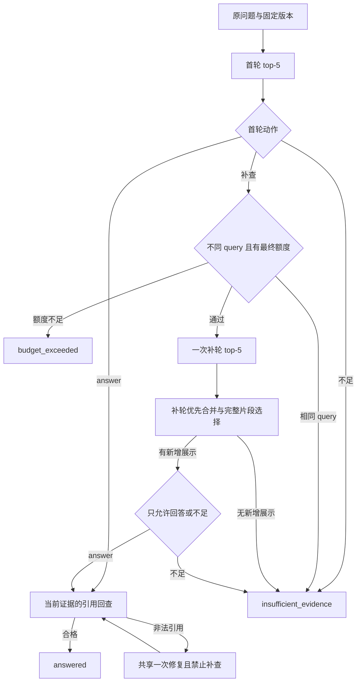

# D8 C：一次补检索、共享预算与引用回查

完成日期：2026-10-05（Asia/Shanghai）。C 实现独立的受控 Agent 编排入口，复用 A 的冻结规则、B 的动作解析及旧检索/引用业务。A/B 原记录保留当时状态；最新进度见本指南及 D8 总计划。D–G 仍待执行。

新增 [agent.py](/D:/course/paper-research-assistant/paper_assistant/agent.py)、[agent_context.py](/D:/course/paper-research-assistant/paper_assistant/agent_context.py) 和 [离线检查脚本](/D:/course/paper-research-assistant/scripts/check_agent.py)。入口版本 `bounded-retry-agent-v1`，合并策略版本 `d8-retry-first-full-chunks-v1`；B 动作/提示词版本保持不变。旧固定 RAG、页面、CLI 与正式语料保持原样；实际成对实验留到 F。

## 1. 一道题实际怎样运行

1. 校验原问题、1–3 个完整版本配对与固定 top-5，检查截止时间，进行首轮检索。
2. 从完整候选形成实际展示上下文，以 B 提示词请求一次动作。首轮无展示时只允许补查或不足。
3. 若直接 answer，直接进入本轮引用回查；若不足，形成终态；不会再生成一次同样答案。
4. 若 retry_search，记录缺失信息和原始 query；先阻止相同查询，再检查最终决策仍有请求/时间额度，然后只执行一次补检索。
5. 合并两轮、去重、选择完整片段。若没有新增最终展示 ID，程序停止为不足，不再消费最终聊天。
6. 有新增展示时，以原问题及最终证据请求第二次动作，只允许 answer 或不足。回答经实际 SQLite 来源与 PDF 身份回查后才发布。



图中检索、模型或来源工具异常分别进入错误终态；不是无命中或资料不足。修复最多一次，图中的回查不会形成无限循环。定位合法仍不证明语义支持，`semantic_support_status` 保持 `not_reviewed`。

## 2. 合并选择怎样保证可回查

`validate_search_round(search, query, selected_versions, top_k=5, max_chars=8000)` 检查成功/空结果 envelope 的真实 query、版本配对、top-k、数量、连续排名和索引身份，复用旧上下文代码校验每条候选的版本、页码、原文和 SHA。候选自身带索引 ID 时也必须一致。

`merge_agent_context(initial_search, retry_search, original_question, selected_versions, *, max_chars=8000, max_chunks=8)` 返回 `context` 和 `trace`。所有候选在截断前校验；同 ID 的论文/版本/页码/正文或哈希不同均报工具错误，不能借数量上限隐藏冲突。

合并顺序固定为补轮 rank → 首轮 rank，按 chunk_id 去重；跨 query 的 cosine score 不比较排序。先保留最多 8 个完整候选，再用旧选择器遵守最多 8000 Python 字符、第一次超限即停止，不能截半个片段或跳过大段再塞小段。

兼容 context 的 `rank` 是连续选择序号，`candidate_count` 是最多 8 条入围候选数；原始检索排名和分数保存在外层。最终 context 的 `question` 始终是原问题。上下文继续通过旧 `build_messages()`，可以直接交旧引用校验。

| trace 字段 | 意义 |
|---|---|
| `rounds` | 两轮原始成功 envelope 和各自上下文 |
| `merged_candidates`、`selection_origins` | 去重候选、原轮次/rank/score 与新选择序号 |
| `duplicates`、`count_omitted`、`character_omitted` | 去重、数量及字符限制省略 |
| `new_returned_ids`、`new_merged_ids` | 相对首轮返回集合的新候选 |
| `new_shown_ids` | 相对首轮实际展示的新最终展示 ID；用于继续/停止 |
| `new_recalled_shown_ids` | 首轮未返回、补后实际展示的 ID |
| `initial_returned_unshown_now_shown_ids` | 首轮已返回但没展示，合并后进入展示的 ID |

最后一行属于展示变化，不能称作新召回。首轮展示过但最终被省略的片段不能引用，即使 SQLite 中存在。

## 3. 请求、修复与停止条件

调用者在首轮检索前创建一个 `ChatBudget`；C 全程复用，不在补轮重置。正常 1–2 次聊天，SDK 尝试至多 3 次；网络重试至多 1 次；格式、动作及引用修复合计至多 1 次。修复和重试都占三次请求额度，实际 HTTP 次数与 SDK 尝试分别保存。

聊天调用仍使用 `purpose="answer"/"repair"`，外层另记 `initial_decision/final_decision`。引用修复消息及解析器同时传入 `terminal_only=True`；修复不能打开第三轮检索。某次修复已完成却仍非法，记 `invalid_output`；下一次允许的请求发起前额度不足，记 `budget_exceeded`。不会把末次非法输出因刚好用满请求数改成另一种失败。

| 触发条件 | 结果 / stop_reason | 后续调用 |
|---|---|---|
| 空白折叠、casefold 后 query 相同 | insufficient_evidence / retry_query_unchanged | 不发第二次 embedding |
| 补后无新增最终展示 | insufficient_evidence / no_new_shown_evidence | 不发最终聊天 |
| 补查前没有最终请求额度 | budget_exceeded / request_limit | 不发第二次 embedding |
| 超过截止时间 | budget_exceeded / deadline_exceeded | 不发布答案，不继续后续阶段 |
| 检索失败、上下文冲突、库/PDF 故障 | tool_error / 安全错误码 | 不静默退回旧答案或不足 |
| 动作/引用修复后仍非法 | invalid_output / 安全错误码 | 不再修复或检索 |

每个阶段前后检查 deadline，包括异常检索结束后。异常先保存轮级原错误/失败用量；若同时超时，终态优先 deadline，`interrupted_failure` 记录被中止的原失败。未知供应商 usage 保持 null，另记已知总和，不把未知费用算为零。

默认单次聊天至多 30 秒，整轮截止预算 120 秒。embedding 仍使用旧固定 30 秒超时，同步检索/PDF 没有硬中断；过期后不发布成功。C 的检查不能证明进程一定在 120 秒内终止，D9 的剩余时限接入仍待做。

## 4. 程序接口与运行轨迹

```python
from paper_assistant.agent import answer_question_agent

# searcher、store、client 由调用者创建；client.budget 在首轮检索前开始。
result = answer_question_agent(
    query, selected_versions, searcher, store, client,
    project_root=project_root, top_k=5, max_chars=8000,
)
```

资源仍由调用者关闭。C 不加载 `.env`、打开数据库或创建新客户端；真实外部请求只通过调用者已有检索器与聊天客户端进行。

返回五终态及 `answer/error/failure_stage/stop_reason`。`search` 是首轮快照，`initial_context` 是首轮展示，`context` 是最终实际展示；补轮不会覆盖首轮。

`search_rounds` 保存每轮请求、成功 envelope 或安全失败、实际统计；`action_steps` 保存阶段、purpose、repair_kind、完整实际消息/响应、解析结果/错误、消息及上下文 SHA、引用白名单和 SDK 尝试编号；`citation_checks` 保存每次回查。`statistics.embedding` 累计两轮成功/失败用量，`statistics.chat` 来自同一真实预算。

这是可调用的编排 API。D8 独立 CLI、不可覆盖运行导出与成对评测适配由 E 完成；页面仍执行旧固定 RAG。E 还需实现共享首轮快照、各模式独立剩余预算，以及实际批次费用和单独运行逻辑费用的区分。

## 5. 离线验证与保留的缺陷

当前源码 **41 项离线检查全部通过**，0 失败/错误/跳过，实际经过 SDK 的 MockTransport 模拟 HTTP 63 次，11 份源码绑定；802 个受保护文件匹配。见 [编排检查报告](/D:/course/paper-research-assistant/artifacts/d8/agent_orchestration_validation.json)、[保护核对](/D:/course/paper-research-assistant/artifacts/d8/task_c_integrity.json) 及 [完成记录](/D:/course/paper-research-assistant/artifacts/d8/task_c.json)。所有检查使用合成检索/存储、临时真实 PDF、真实 SDK 的 `httpx.MockTransport` 与假时钟；真实 API 和网络均为 0，没有加载密钥环境或打开正式库。独立审查已复现并确认截止检查修复，无剩余阻塞。

已覆盖直接答案、无证据动作、补后答案/不足、同查询/无新增展示停止、两轮候选与最终省略引用、共享修复/请求预算、失败用量、消息哈希、资源归属，以及成功/异常阶段的截止停止。这属于 C 的针对性检查；D 的完整故障注入、E 导出和 F 真实四题实验仍未完成。

首轮 32 方法检查有 1 个失败，发现“第三次请求修复仍非法却被改成预算耗尽”，已修正终态分类；随后扩充到 38 方法通过。独立审查再发现检索异常的阶段后截止检查缺失，已增加异常路径和 3 项回归，最终 41 方法全部通过。对应运行 ID 为 `20261005_044937_261884`、`20261005_045123_245204`、`20261005_045705_592690`。所有失败、当时通过及最终回归记录保存在 [D8 日志目录](/D:/course/paper-research-assistant/archive/run_logs/d8)，旧记录没有覆盖。检查数是 unittest 方法数，不与真实题数或准确率混用。

在项目根目录重跑离线命令，每次写新的历史报告并刷新当前报告：

```powershell
.\.venv\Scripts\python.exe -B -X utf8 -m scripts.check_agent
```

## 6. 你可以怎样验收和学习

建议用约 20–30 分钟沿 `answer_question_agent()` 阅读一条直接回答和一条补查路径，再运行上述离线检查。当前未测量你的学习程度或新增人工验收；通过程序检查不等于你已理解，也不等于模型在真实题上改善。

1. 找到补查前请求额度检查：为什么不能先花 embedding 再发现不能回答？
2. 找到 `new_shown_ids`：为什么“新返回证据”不一定允许继续聊天？首轮已返回但没展示的片段又怎样计数？
3. 找到共享 budget 和 terminal_only：格式修复后，引用错误还能修吗？首轮引用修复能要求补查吗？
4. 找到最终 context 白名单：首轮见过却最终省略的 ID 为什么不能发布？
5. 假时钟超时但工具同时抛异常时，终态和原失败分别保存在哪里？为什么不能说进程严格 120 秒退出？

下一项 D 系统补齐离线故障组合，再由 E 接 CLI/导出和成对实验接口；F 才执行真实开发题。验收集保持冻结，到 D11 使用。
