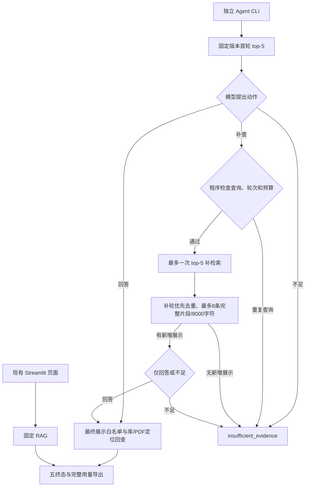

# D8 G：完成范围、已知问题与 D9–D11 交接

执行日期：2026-10-05（Asia/Shanghai）。D8 A–G 已按记录中的工程范围完成，状态为 `completed_with_known_issues`：已有最多一次受控补检索的 Agent、CLI、成对开发入口、离线边界及四题真实观察。全量开发评测、冻结验收、Agent 页面和来源章节硬检查仍待后续。

G 没有调用聊天或 embedding 服务，没有重跑 F 问答，也没有运行验收题。G 新增当前源码离线回归、独立记录审计、汇总和交接；A–F 结果、失败现场与用户确认保持原样。[G 完成记录](/D:/course/paper-research-assistant/artifacts/d8/task_g.json)和[保护核对](/D:/course/paper-research-assistant/artifacts/d8/task_g_integrity.json)给出本轮范围及绑定。

## 1. A–F 留下了什么

| 阶段 | 已完成的范围 | 证据 |
|---|---|---|
| A | 接口/数据预检、起始策略冻结、课程映射和自检材料；57项准备检查 | [A记录](/D:/course/paper-research-assistant/artifacts/d8/task_a.json)、[策略](/D:/course/paper-research-assistant/artifacts/d8/agent_config.json) |
| B | 严格三动作结构、阶段权限、当前证据消息和共享修复消息；42方法 | [B记录](/D:/course/paper-research-assistant/artifacts/d8/task_b.json) |
| C | 独立编排、最多一次补查、合并去重与引用回查；当时v1的41方法 | [C记录](/D:/course/paper-research-assistant/artifacts/d8/task_c.json) |
| D | 当时Agent v2/导出v1的186方法，含新增103；修复非有限诊断值与独占发布竞争 | [D记录](/D:/course/paper-research-assistant/artifacts/d8/task_d.json) |
| E | Agent CLI、两模式独立导出、共享首轮/独立预算的成对入口、实际/逻辑账本、六层事后评分；导出升v2 | [E记录](/D:/course/paper-research-assistant/artifacts/d8/task_e.json)、[E指南](/D:/course/paper-research-assistant/docs/v1/d8/d8-E-cli-guide.md) |
| F | 四题八模式首次真实运行、139项机器核对、84项交付审查、AI初审及用户总体确认 | [F记录](/D:/course/paper-research-assistant/artifacts/d8/task_f.json)、[用户确认](/D:/course/paper-research-assistant/artifacts/d8/comparison/d8_f_dev4_20261005/human_review_confirmation.md) |

旧指南和阶段记录中的“下一阶段未执行”描述各自交付时的状态；当前进度以本指南及 [D8 总计划](/D:/course/paper-research-assistant/docs/v1/d8/d8-ABCDEFG-plan.md)开头为准。用户阅读了学习材料或请求解释，不自动算作已经掌握或新增人工验收。

## 2. 当前流程与强制边界



图中工具、输出或预算失败分别进入 `tool_error / invalid_output / budget_exceeded`，不进入成功发布。现有页面通过 `web_runtime` 使用固定 RAG；Agent 页面模式尚未接入。成对入口在两种模式之间共享同一份实际首轮检索快照，每种模式持有自己的预算；Agent需要时才执行第二次检索。

当前版本为 Agent `bounded-retry-agent-v2`、动作 `d8-agent-actions-v1`、提示 `d8-evidence-agent-actions-v1`、合并 `d8-retry-first-full-chunks-v1`、导出 `d8-immutable-mode-records-v2`。这些是当前版本，不是D10的最终冻结。

| 程序强制规则 | 当前行为 |
|---|---|
| 动作/版本 | 只有三动作；同一轮论文与处理版本固定；补轮及引用修复不能重新开放检索 |
| 检索/证据 | 首轮、补轮各top-5；最多一次补查；不同查询；无新增最终展示就停止；最多8条完整片段/8000 Python字符 |
| 聊天预算 | 同一模式同一题共用最多3次SDK尝试、最多1次网络重试、最多1次格式/动作/引用共享修复；均占三次额度 |
| 引用定位 | 只能引用当前最终展示ID；回查SQLite身份/全文哈希及PDF身份/页界；工具损坏不交模型修复 |
| 记录 | 请求前预占批次/题尝试；不可覆盖历史；导出失败保留原步骤/已知用量并清除发布答案；竞争冲突保留已有latest |
| 时间 | 阶段前后检查截止预算、聊天按剩余时间配置timeout；embedding剩余deadline和严格120秒硬中止仍未验证 |

引用定位通过只证明引用真实且属于本次展示。**题目要求摘要时，正文引用是否符合章节范围，目前没有程序硬检查。**提示词已有这条要求，但F的D2-003表明模型可能违反；完整性和语义支持也仍需独立评价。

## 3. 当前验证与历史记录怎样区分

G 新跑了当前Agent v2/导出v2下的完整既有边界套件：**186方法通过，0失败/错误/跳过，182次实际SDK MockTransport模拟发送，真实API/网络0**，见 [当前回归](/D:/course/paper-research-assistant/artifacts/d8/task_g_boundary_regression.md)。这不是新增186个方法；G新增测试方法为0。

重新运行的原因是D旧报告绑定导出v1，而E已升导出v2。新回归单独保存，旧B/C/D报告不覆盖。E当前CLI41、成对43、事后评分19、导出16，共119方法/101次模拟发送，源码SHA仍匹配，按绑定继承，没有在G无理由重复运行。E的16条导出检查包含D记录14条，与186方法重叠，不能相加冒充独立检查总数。A57是准备检查，F139是记录核对，84是交付审查，也不混入unittest方法或问答题数。

G 对记录和接口另做独立只读审计，分别见 [实验与人审审计](/D:/course/paper-research-assistant/artifacts/d8/task_g_evaluation_audit.md)、[当前接口审计](/D:/course/paper-research-assistant/artifacts/d8/task_g_interface_audit.md)。本轮保护基线为978个文件；只有已备份的README/三份当前导航可更新，业务源码、正式数据、A–F记录和历史不改。最终数量与新交付哈希见保护报告。

## 4. F 四题真实看到了什么

唯一批次为 `d8_f_dev4_20261005`，四题八模式首次结果保留。

| 题目 | 固定 RAG | Agent | AI总体判断，用户已确认一致 |
|---|---|---|---|
| D2-001 | 直接回答 | 直接回答 | 两模式完整有据；Agent额外机制说明未增加原题覆盖 |
| D2-002 | 本轮资料不足 | 一次补查后回答 | 新增两条展示，两个机制完整有据；补查在这一例有收益 |
| D2-003 | 缺摘要依据而不足 | 未补查，回答却引用正文 | 固定模式合理不足但未完成可答题；Agent违反摘要来源限制 |
| D5-006 | 资料不足 | 资料不足 | 两模式合理拒答；明显超出所选论文范围，不外推困难拒答能力 |

程序可答完成为固定 **1/3**、Agent **3/3**；AI按引用支持、问题范围与完整性为固定 **1/3**、Agent **2/3**。用户原话“我的审核和AI相同”已单独记录为 `user_confirmation_of_ai_review`，确认四题八模式的总体判断。未提供独立逐结论/逐引用评分，`qa_accuracy=null`，不报告全量人工准确率。

16条发布结论中，AI判14条引用并集支持、D2-003两条部分支持且违反范围。21次引用定位全部合法；逐引用AI评价为15次完整支持、6次部分支持，不能把定位21/21写成语义21/21。原AI/机器/模板中的pending是生成时历史状态，当前总体确认另存，模板没有代填独立人审标签。

可答分母3题/4段标注引文：首轮全部目标命中1/3、逐引文1/4；Agent最终全部仍1/3、逐引文2/4。补轮/合并只D2-002适用，分母1题/2引文，全部0/1、逐引文1/2。Token精确标注原句仍漏，实际另一引用却支持机制；精确命中与语义完成分开。

| 账本 | embedding次数 / tokens | 聊天SDK/HTTP次数 / tokens |
|---|---:|---:|
| 实际本批次 | 5 / 201 | 9 / 22188 |
| 固定模式独立运行的逻辑归属 | 4 / 165 | 4 / 8544 |
| Agent独立运行的逻辑归属 | 5 / 201 | 5 / 13644 |

实际5次embedding由4次共享首轮与1次补查构成，总供应商HTTP为14。逻辑embedding合计9/366重复归属共享首轮，不能替代实际5/201。usage完整，重试、修复、失败均0；不据tokens估算货币价格。共享首轮和各模式自身耗时分别保存，组件相加不能冒充两次独立实测墙钟时间；[成对报告](/D:/course/paper-research-assistant/artifacts/d8/comparison/d8_f_dev4_20261005/comparison_report.md)保留原分量。

真实观察包括直接回答、有新增展示的一次补查和直接资料不足。没有真实观察到相同查询停止、无新增展示停止、无收益补查、修复/网络重试、故障或预算终止；这些路径由离线场景证明。四题同时涉及查询、选择与聊天次数变化，不能推出改写单独有效、Agent整体优于RAG，或优于固定top-10/20。

## 5. 可复用命令与记录位置

在项目根目录操作。下面两个帮助命令只显示参数，不调用模型：

```powershell
.\.venv\Scripts\python.exe -B -X utf8 -m scripts.answer_question_agent --help
.\.venv\Scripts\python.exe -B -X utf8 -m scripts.run_agent_comparison --help
```

以下是会消耗embedding/聊天额度的新独立问答示例，G没有执行：

```powershell
.\.venv\Scripts\python.exe -B -X utf8 -m scripts.answer_question_agent --paper-id arxiv_2005.11401v4 --parse-revision r_269ac0cb1263292d --query 'What forms of parametric and non-parametric memory are combined in the RAG model?' --json
```

当前成对runner默认只准备，默认样本只有四题。需要完整20题开发批次时，必须显式传入20个ID并使用新批次名；下面准备示例不发模型请求，G也没有创建这个未来批次：

```powershell
$d9CaseIds = @(Get-Content -LiteralPath 'eval/dev.jsonl' -Encoding utf8 | Where-Object { $_.Trim() } | ForEach-Object { ($_ | ConvertFrom-Json).case_id })
$d9BatchId = 'd9_dev20_' + (Get-Date -Format 'yyyyMMdd_HHmmss')
.\.venv\Scripts\python.exe -B -X utf8 -m scripts.run_agent_comparison --batch-id $d9BatchId --case-ids $d9CaseIds
```

准备会写manifest/state，并绑定准备时的源码/公开配置/正式输入。源码改变后，旧prepared批次不能直接执行；先完成修复，再建立对应版本的新批次。明确 `--execute-prepared` 才执行已准备且未尝试的批次；`--live` 新建并执行；`--resume` 只续同一manifest中尚未尝试的题。三种标志互斥，不使用`--resume`复跑已收费或已预占题。

**F当前manifest只有四题，`remaining_case_ids=[]`，不能同ID追加16题。**可另建完整20题，或把额外16题明确列为独立批次；不能拼称F的同一冻结实验。

Agent CLI正常answered/不足且导出成功退出0，运行/导出失败退出1，参数错误退出2。成对runner的prepared/completed退出0，attention-required退出1，预检或输入错误退出2。零退出码不表示答案语义正确。

记录入口：Agent最近结果在 `artifacts/d8/agent_result.json/.md`，成对固定模式在 `artifacts/d8/fixed_rag_result.json/.md`；历史分别为 `archive/run_logs/d8/agent_<run_id>`、`fixed_rag_<run_id>`，批次记录在 `artifacts/d8/comparison/<batch_id>/`。F原八份历史及旧D5/D6最近结果保留。

## 6. D9–D11 的实施顺序与完成门槛

| 阶段 | 工作 | 完成时应有的证据 |
|---|---|---|
| D9 优先 | 修D2-003同类来源问题 | 按真实摘要区域建立版本/PDF/text绑定；从原问题提取来源限定；无合格展示证据时按现有一次补查/不足处理；发布前检查实际引用范围。正文同事实、第1页正文、未知/跨章节片段被挡，真实摘要可用，不扩大检索/修复预算 |
| D9 优先 | 接embedding剩余deadline，补超时/故障组合 | 超时传入与阶段过期记录、失败不发布、未知用量保留、无额外请求；严格硬中止若未实现仍明示限制 |
| D9 按需 | Agent页面模式与轨迹 | 复用独立runtime；五终态、原文、补查与用量可见；Qdrant独占资源、页面重绘不重复收费、失败/下载检查 |
| D9 待补 | 旧六题AI评价 | 对旧首次9条结论及2条不足理由事后独立复核并另存；不生成新答案冒充旧首次评价，不继承题目标注的人审 |
| D9–D10 | 新完整20题开发成对实验 | 修复版本固定后新建manifest；两模式各20份输出、同首轮/独立预算、实际/逻辑账本、来源/语义/完整性分开评分；失败仍进入分母 |
| D10 | 适用回归及正式冻结 | 冻结源码、提示、选择/来源策略、模型/公开配置、数据/题集/rubric及必要来源区域表；密钥不入记录；冻结后变更建新版本 |
| D11 | 冻结验收20题、两模式首次运行与评分 | 验收入口先实现并验证；共40模式首次输出，完整冻结绑定、独立语义评价及实际用量；评分标签不进入问答消息，首次结果不覆盖 |

当前 `scripts.run_agent_comparison` 只接开发集，没有验收split入口；不能把上面的开发命令直接宣称为D11验收。D11执行入口与冻结验证是后续工作，本轮仅核对验收文件哈希，没有把题目拿来试跑、调参或演示。

第一个来源修复是已讨论的方案，G没有实现。不能靠PDF第1页、关键词或模型自报章节当作可靠摘要标签，也不能在引用修复时重新开放工具。来源合规只是语义审核的一部分，不保证所有结论已经正确。

D12分析至少三类失败及收益/代价，修复后输出标为新版本回归；D13–D14按需要补D7暂缓的环境预演、录屏和交付材料，简历/投递依用户后续安排。全量旧答案人审、D3恢复稿人审仍按各自历史范围待办。

## 7. 使用者怎样检验本次交接

建议用20–30分钟查看G指南、F四题与D两个故障案例，不需要再次请求模型。确认自己能回答：

1. 模型选择补查什么，程序怎样限制轮次、证据与请求？
2. 为什么实际embedding是5次，而两模式逻辑合计是9次？
3. 为什么D2-003程序answered，却不算满足摘要要求？
4. 哪些是真实观察，哪些只是离线构造？186方法、139核对与四题分别是什么单位？
5. 源码改变后为什么要新版本/新批次？D11的验收题为什么现在不用于修复？

用户已经确认F四题八模式与AI总体结论一致；这份学习清单不新增独立逐条人审、用户掌握程度或新环境预演完成事实。

## 8. 可用的项目表述

“在固定RAG基础上实现最多一次由模型选择的补检索，程序限制动作、论文版本、最终展示引用和调用预算，保存两轮轨迹及实际用量；四道开发题完成首次成对观察，其中一例补查补足机制证据，一例发现正文归因摘要的来源失败，已交接后续修复。”

D8工程完成保留已知问题。没有依据报告全量人工准确率、冻结验收成绩、Agent整体优于RAG、严格120秒进程中止，或D7已交付。
