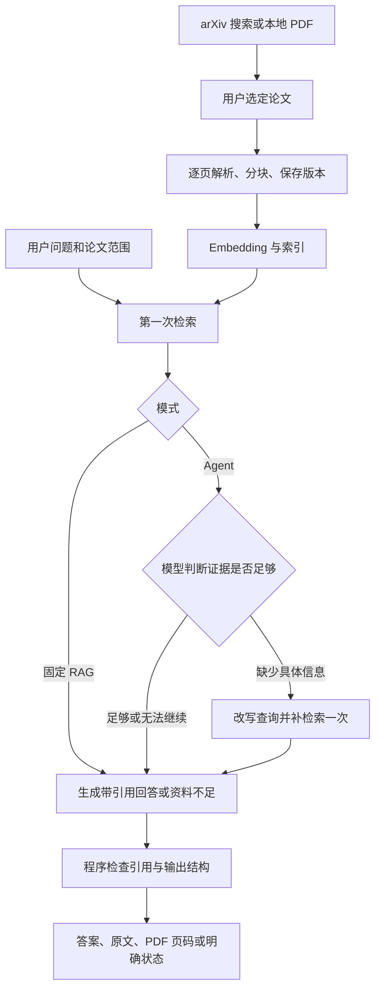

# 论文调研助手：学习与开发计划（按阶段执行）

制定日期：2026-09-27。目标岗位：Python / AI 应用开发 / Agent 开发实习。

统一聊天入口与问题规划更新（2026-10-12）：[A–C 执行计划](/D:/course/paper-research-assistant/docs/v1/d13-query-plan/d13-query-plan-ABC-plan.md) 中 A–C 已全部完成。A 去掉页面方式选择与标签；B 在一次准备调用中完成首问／追问理解、澄清及子查询规划，复用所选版本的标题和已有摘要；C 执行实际计划查询，简单问题保留按需一次补查，复杂问题逐条 top-5 检索并轮流合并最多 8 条完整片段／8000 字符，再一次综合回答原问题。原问题、子查询论文范围和摘要来源要求保留，旧引用优先恢复，命中片段先于邻近正文纳入；局部失败保留真实用量并说明缺口，页面与 JSON／Markdown 区分计划检索和补查。A 的两个页面方法、B 的三个后端方法通过；C 最终三个既有方法通过：Agent 合并 0.419 秒、runtime 追问与原问题 1.127 秒、页面轨迹 2.112 秒，模拟浏览器布局、两篇论文引用和失败折叠原文交互通过。真实模型／embedding／重排请求均为 0，未新测准确率、未运行 D14。日志分别见 [A](/D:/course/paper-research-assistant/docs/v1/d13-query-plan/A-unified-chat-guide.md)、[B](/D:/course/paper-research-assistant/docs/v1/d13-query-plan/B-question-planning-guide.md)、[C](/D:/course/paper-research-assistant/docs/v1/d13-query-plan/C-planned-retrieval-guide.md)；下一步 D14。

回答组织与引用展示更新（2026-10-09）：用户批准的前两项已完成。两模式在原回答调用中按问题逻辑组织连贯段落，保留原 claims 与引用结构；页面正文使用 Markdown，段末紧凑编号回查原文，同一来源复用编号，失败资料默认收起。三个相关既有方法与模拟服务下的浏览器展示通过，真实模型／embedding／重排请求为 0。第三项检索覆盖优化留后续，见 [两项修改日志](/D:/course/paper-research-assistant/docs/v1/answer-paragraphs-guide.md)。

当前进度（2026-10-12）：**D13 后独立重排、连续对话、新论文入库及统一入口与问题规划 A–C 均已完成实现；下一步 D14。** 侧栏支持文本型 PDF 上传、后台局部阶段／批次进度、失败重试和 ready 列表刷新；入库完成保留原论文选择与会话，选定新论文后直接提问、补全追问、澄清歧义及逐轮回查原文。入库实现与当时验证见 [C 上传日志](/D:/course/paper-research-assistant/docs/v1/d13-import/C-upload-guide.md)，范围和 A/B 记录见 [入库 A–C 计划](/D:/course/paper-research-assistant/docs/v1/d13-import/d13-import-ABC-plan.md)。原 20 条冻结验收题留 D14 双模式单轮首次运行，本轮未运行验收或新测准确率。D14–D17 不重新编号，D7 暂缓事项由 D16 承接；下方历史日志保留当时事实。

D10 交接时记录（2026-10-07，历史）：**D10 A–G 已完成记录范围，状态 `completed_with_known_issues`，下一阶段 D11。** 同一完整批次 `d10_d_dev20_20261007_195707` 保留 20 题、40 模式、89 条 claim，严格 AI 完整有据可答题为固定 RAG 13/17、Agent 15/17，负题合理拒答各 3/3。D3-004 章节/实验归属未独立证实和 D6-003 生成者措辞歧义保留，新答案人审 pending；结果不代表验收或人工准确率。G 仅汇总交接，结果、提示、配置不变，无新增源码行为、测试、哈希或模型请求，见 [G 独立日志与学习答案](/D:/course/paper-research-assistant/docs/v1/d10/d10-G-completion-guide.md)和 [开发总结第 7 节 G 交接](/D:/course/paper-research-assistant/artifacts/d10/dev_comparison.md:414)。D11 专用验收入口尚待实现，验收尚未运行，验收题面未用于调优；D7 暂缓，下方各阶段更新保留执行时的历史状态。

项目定位：**带证据回查和受控补检索能力的论文调研助手。**

原时间预算（历史基准）：总计 14 天，每天约 7–8 小时，原日历为 2026-09-27 至 2026-10-10。2026-10-08 新增三组功能后，以 D1–D17 表示实施顺序，不把原日历当作新的完成承诺；D11 起实际日期以任务日志为准。

本计划参考现有 [plan.md](/D:/course/hello-agents-study/log/plan.md) 和 [d1.md](/D:/course/hello-agents-study/log/d1.md)。D1 已完成环境与教程运行，loop 精读待补，目前没有项目代码。下文的功能、数字和验收均为计划，不能当作已经完成的成果写进简历。

执行进度更新（2026-10-01）：使用者确认 D2 已完成。D3 已完成三篇 71 页逐页解析、六页 AI 对照、ReAct Figure 1 局部恢复、自动质量过滤、arXiv 关键词搜索/固定版本下载，以及题集从六条增至十条。使用者已明确确认新四题 D3-001–D3-004 人工复核完毕：`review_status=human_verified`、`human_reviewed_by=user`、`human_reviewed_at=2026-10-01`；任务 D 完成，十题均人工通过。六页人工覆盖尚未单独确认，Figure 1 恢复稿的人工状态仍为 `pending`。随后按使用者要求完成六项局部数学恢复（RAG 五组作者源码表达式、Reflexion 一个行内变量），原图 AI 对照通过，人工待复核；内置 LaTeX 编译环境异常，排版编译未验证。未将全部 71 页数学准确或 D3 整体标为完成。下一步推进 D4 的分块、解析版本和入库，分块只读取质量过滤后的保留片段。详细状态和命令见 [D3 的 7–8 小时安排](/D:/course/hello-agents-study/log/d3-2026-10-01.md)、[实际继续执行说明](/D:/course/paper-research-assistant/artifacts/d3/continuation_guide.md) 和 [新题复核说明](/D:/course/paper-research-assistant/eval/d3-review.md)。第 6 节日期保留为原始基准，实际工作按依赖顺序推进，不跳到原日历的 D5；10 月 10 日总目标暂时保留，后续优先压缩选做项。

D4 执行更新（2026-10-01）：任务 B 已完成三篇分块与不可变快照，71 页、1179 个父片段 → 1188 个 chunk：RAG 385、ReAct 480、Reflexion 323。全部原文切片/哈希/来源/覆盖与快照检查通过，三篇重复执行均复用同一版本，分块器十二项边界检查通过。每篇十条人工抽样待复核；SQLite 和向量进度见下两段，问题检索与 PDF 对照留给 E/F。见 [D4 执行计划](/D:/course/paper-research-assistant/docs/v1/d4/d4-ABCDEFG-plan.md) 与 [三篇分块预览](/D:/course/paper-research-assistant/artifacts/d4/chunk_preview.md)。

D4 任务 C 更新（2026-10-01）：SQLite 已保存三篇、三个处理版本、1188 个 chunk；参数化 SQL、外键、不可变保护、逐篇事务和来源冲突拒绝已实现。重复入库新增 0，新进程按 ID 读回全部原文/来源与快照一致，14 项存储边界检查通过。C 阶段向量导入表为空，后续 D 状态见下段。见 [SQLite 逐步实现说明](/D:/course/paper-research-assistant/docs/v1/d4/d4-C-storage-guide.md)。

D4 任务 D 更新（2026-10-01）：已安装并固定 qdrant-client 1.19.1，沿用 qwen3.7-text-embedding、1024 维、cosine。三篇正式版本共 1188 个点全部 ready，索引配置 ep_cbf0f6caa97b962a。含十条独立试运行共 120 次真实请求、实际 84046 tokens；成功响应先原子缓存，再用确定性 UUID5 入库。重复运行 0 请求、数量不增长，新进程逐条来源/哈希/缓存向量方向核对及内部查询通过。25 项离线边界检查通过；39 个输入/快照和 SQLite 三张原文事实表未改。后续 E 进度见下段，F 的事实题/PDF 对照及 G 汇总仍待完成；D4 尚未整体完成。见 [任务 D 逐步说明](/D:/course/paper-research-assistant/docs/v1/d4/d4-D-index-guide.md) 和 [索引验证](/D:/course/paper-research-assistant/artifacts/d4/index_validation.json)。

D4 任务 E 更新（2026-10-01）：已实现 `EvidenceSearcher.search_evidence()` 与 `scripts.search_evidence` CLI。单篇明确论文/处理版本，多篇按完整配对选择；先检查 ready 和实际范围数量，再请求一次问题向量，通过 Qdrant top-k 后回 SQLite 核验并返回原文、ID、页码和分数。20 项离线边界通过，三篇各一道事实题实际返回 top-5，3 次问题 API、103 tokens、LLM 0。RAG/Reflexion 标注引文位于 rank 1，ReAct D2-003 未召回预期摘要第 1 页；这不是三题问答正确率。原文/状态四表、向量文件、39 个输入与快照不变。F 对照与诊断进度见下一段，G 汇总待做；D4 仍未整体完成。见 [任务 E 说明](/D:/course/paper-research-assistant/docs/v1/d4/d4-E-retrieval-guide.md) 与 [实际检索记录](/D:/course/paper-research-assistant/artifacts/d4/retrieval_validation.json)。

D4 任务 F 更新（2026-10-01）：已复用E三道正常事实题，完成15个真实候选的原文/身份/哈希核对和13个完整原PDF页的AI视觉对照。RAG rank1/2、Reflexion rank1完整支持所问；ReAct rank1/5虽含同事实却来自正文，其他三条为参考文献尾片段，正式top5没有摘要来源证据。摘要p1_c6完整在库、未误过滤/拆分，当前480条向量与缓存方向一致；F独立新实验只新增1次问题向量API、35 tokens，测得摘要第9名。新实验前5ID顺序复现但分数略有差异，不冒充E原请求第9名；E旧结果不变。39输入/快照、SQLite四表、Qdrant文件不变，未改分块或检索参数。AI复核完成，本次候选人工PDF状态pending；下一步G汇总既有边界和D5接口，D4整体仍进行中。见 [F详细步骤](/D:/course/paper-research-assistant/docs/v1/d4/d4-F-retrieval-review-guide.md) 与 [当前复核报告](/D:/course/paper-research-assistant/artifacts/d4/retrieval_review.md)。

当前验收补记（2026-10-02）：用户已明确确认 D4 B 的三篇各十条分块抽样，共三十条；F 的三题十五候选/十三个完整 PDF 页对照也已确认。人工记录见 [human_review.json](/D:/course/paper-research-assistant/artifacts/d4/human_review.json)。G 本轮当前源码 SQLite 14 项、索引 25 项、检索 20 项共 59 项重跑通过，新增人审继承 22 项通过；正式新进程九项验收通过，1188 条正文/向量/缓存方向一致，39 个输入/快照、SQLite 四表及 Qdrant 两个数据文件保持一致，本次没有调用 embedding 或聊天模型。D4 状态为 `completed_with_known_issues`，已完成并保留 ReAct 正式 top-5 摘要漏召回与严格来源依据 2/3 观察；独立新实验 rank 9 不能写成原 E 全排序。最终 G 状态见 [正式验收](/D:/course/paper-research-assistant/artifacts/d4/validation.md) 与 [D5 交接指南](/D:/course/paper-research-assistant/docs/v1/d4/d4-G-completion-guide.md)。下一步 D5 答案生成/引用校验尚未实现；D3 六页覆盖和恢复稿仍各自保留人工待确认。上方各阶段日期描述当时执行状态，第 6 节日历继续保留原始基准。

D5 规划更新（2026-10-02）：已依据 D4 正式交接与当前源码整理 [D5 的 7–8 小时执行计划](/D:/course/paper-research-assistant/docs/v1/d5/d5-ABCDEFG-plan.md)，D5 功能尚未实现。复用现有检索、聊天配置与 `Claim/AnswerDraft`，依次补全聊天响应与请求记录、实际证据上下文、引用业务校验、固定 RAG CLI 和运行快照；先运行四类代表题，再完成十题初跑，新增六题经人工复核后补齐十六题。ReAct 摘要题仍是可回答题，本轮证据不足时可拒答，但质量指标仍计未完成/错误拒答，不改标注或偷偷补摘要。界面留到 D6，一次补检索留到 D8；沿用当前正式分块和索引，保留初跑失败。下方日历继续保留原始日期，实际按依赖执行。

D5 任务 A 执行更新（2026-10-02；保留 A 阶段当时记录）：已完成课程内容到项目的映射、接口清单、回答/引用边界、外围状态约定及首轮非敏感配置。离线 ready 命令退出码 0，三篇共 1188 个 chunk；本机向量配置与正式 profile 一致。D4 30 项源码引用核对（20 个不同文件）全部 SHA 匹配，没有重跑旧测试或覆盖 G 验收；本次检查的 86 个文件前后哈希一致。现有 AnswerDraft 五个结构演示符合预期，包含“伪造 ID 可过结构但在库不存在”的反例，D5 业务引用校验仍未实现。当前聊天配置实际为 deepseek-flash、30 秒；目标输出上限/温度/重试等独立保存为待实现值。网络、embedding、聊天均 0 次；使用者理解未测量，不新增人审确认。见 [任务 A 指南](/D:/course/paper-research-assistant/docs/v1/d5/d5-A-contract-guide.md)、[检查记录](/D:/course/paper-research-assistant/artifacts/d5/task_a.json)、[首轮配置](/D:/course/paper-research-assistant/artifacts/d5/baseline_config.json)。下一步 B 补完整聊天响应与请求记录，C–G 仍待执行。

D5 任务 B 执行更新（2026-10-02；保留 B 阶段当时记录）：已保留 D2 的 `invoke_llm()`，新增 `RecordedLLM`、`ChatPolicy` 与共享 `ChatBudget`，记录完整文本、finish_reason、usage、耗时、SDK/HTTP 尝试。关闭 SDK 隐式重试，生成/最多一次修复/最多一次网络重试共享三次预算；空响应、截断、非法 JSON 与服务错误分别处理。34 项离线检查通过；DeepSeek 真实连通验证 1 次请求、56 tokens，embedding 0 次。此验证仅说明聊天接口可用，尚未运行论文问答或测量答案正确率。见 [B 逐步说明](/D:/course/paper-research-assistant/docs/v1/d5/d5-B-llm-guide.md)、[完成记录](/D:/course/paper-research-assistant/artifacts/d5/task_b.json) 和 [实际聊天配置](/D:/course/paper-research-assistant/artifacts/d5/chat_runtime_config.json)。项目 `docs` 九份现有文档已按 D4/D5 与任务 A–G 重命名，当前链接同步更新，旧验收与原始快照保留。下一步 C：选择实际展示证据、构建提示词并解析 `AnswerDraft`；D–G 仍待执行。

D5 任务 C 执行更新（2026-10-02；保留 C 阶段当时记录）：已新增上下文纯函数、完整原文快照、版本化提示词与严格 AnswerDraft 解析；按 rank 稳定排序/ID 去重/完整片段/首次超字符预算即停止，正文硬上限 8000 Python 字符。38 项核心离线检查通过，三组 D4 旧候选回放为 0 API。RAG 首题执行新检索和真实草稿生成：5 条展示证据、4837 字符、3 条结论，问题 embedding 1 次/34 tokens，聊天 1 次/2758 tokens，无重试/修复。结果 draft_valid，引用检查 pending，未计算问答准确率；伪造引用仍可能过结构，必须交 D。格式与引用修复全轮共享一次，沿用 B 的三次请求预算；正式数据和旧 D4/A/B 记录不变。见 [C 逐步说明](/D:/course/paper-research-assistant/docs/v1/d5/d5-C-generation-guide.md)、[完成记录](/D:/course/paper-research-assistant/artifacts/d5/task_c.json) 与 [真实草稿](/D:/course/paper-research-assistant/artifacts/d5/generation_smoke.json)。下一步 D 引用回查与固定流程，E–G 待执行。

D5 任务 D 执行更新（2026-10-02；保留 D 阶段当时记录）：已实现 citations.py 引用集合/SQLite身份全文/实际PDF SHA及页序回查，以及 rag.answer_question 固定一轮检索、生成与共享修复。42项核心+15项脚本记录检查通过，共57项，离线网络0；C旧草稿回查5次引用/2来源全部valid，本次0 API。D新真实首题 answered，5条展示证据/4837字符、3条结论/5次引用检查/2来源（RAG PDF文件页序1/2）；新增问题embedding1次/34 tokens、聊天1次/2758 tokens，无重试或修复。来源损坏归tool_error，未知引用可在剩余共享额度内修一次，失败不发布answer；semantic_support_status=not_reviewed，未计算问答准确率。正式数据与D4/A/B/C旧记录不变。见 [D逐步说明](/D:/course/paper-research-assistant/docs/v1/d5/d5-D-rag-guide.md)、[完成记录](/D:/course/paper-research-assistant/artifacts/d5/task_d.json)、[新真实答案](/D:/course/paper-research-assistant/artifacts/d5/rag_smoke.md)。下一步E通用CLI/运行导出/组合边界，F–G待执行。

D5 任务 E 执行更新（2026-10-03）：通用 `scripts.answer_question` CLI、完整 JSON/Markdown 与不可覆盖历史已实现，复用 D 固定核心。37 项离线检查通过，58 个 CLI 场景、59 次 SDK MockTransport 模拟 HTTP，真实网络 0 次。新真实 CLI 首题退出码 0/answered，3 条结论、5 次引用定位检查、2 来源（PDF 文件页序 1/2）；新增 embedding 1 次/34 tokens、聊天 1 次/2758 tokens，无重试/修复。纯 JSON 输出与最近/历史记录一致，正式输入和旧源码未改。两项来源/部分支持案例另作 AI 复核，0 API、人审 pending，不计问答准确率。见 [任务 E 指南](/D:/course/paper-research-assistant/docs/v1/d5/d5-E-answering-guide.md)、[完成记录](/D:/course/paper-research-assistant/artifacts/d5/task_e.json) 和 [当前答案](/D:/course/paper-research-assistant/artifacts/d5/answer_result.md)。下一步 F 开发题集初跑、扩充与语义评价；G 总验收待完成。

D5 任务 F 执行更新（2026-10-04）：已新增顺序批跑与事后机器统计，46 项离线检查通过（真实 API 0）。先四道代表题，再同一冻结批次完成其余六题；正式十题均保留首次输出，7 题 answered、3 题不足，其中 2 道可回答题未检到所需依据。最终引用定位合法 21/21；精确全部标注引文命中 5/9、单条 7/12，不等于语义召回率或问答准确率。AI 逐条查看实际引用原文，答案人审 pending。实际新增 embedding 10 次/379 tokens、聊天 10 次/22612 tokens，无重试/修复；174 项原始记录核对通过，332 项旧源码/正式输入/验收文件不变。已准备四事实、两无答案候选题的原文/PDF 材料，用户明确“暂未复核，先保留候选”，正式开发集仍为十题；十六题合并/初跑与 G 总验收尚待补。见 [F 指南](/D:/course/paper-research-assistant/docs/v1/d5/d5-F-evaluation-guide.md)、[当前进度](/D:/course/paper-research-assistant/artifacts/d5/task_f.md)、[AI 逐题评价](/D:/course/paper-research-assistant/artifacts/d5/qa_baseline/d5_f_dev10_20261004/ai_semantic_review.md) 和 [六题复核包](/D:/course/paper-research-assistant/artifacts/d5/eval_candidate_review.md)。固定 RAG 已可供 D6 界面复用，自动补检索仍为 D8 计划；下方原始日历不据此假改完成日期。

D6 执行与口径修正（2026-10-04）：A 已将正式开发集扩至 16 题，旧十题内容保留（前六行换行规范化），新六题首次真实运行 4 answered、2 无答案题程序拒答。三题整题抽审涉及两道回答的 7 条结论及一道不足理由，不能换算成逐条人工支持率或全批准确率；其他 12 条旧批次结论未涉及。B 的 20 条验收候选已来源/泄漏复核，用户实际确认全部通过，正式题集与评分规则已冻结。检索对照只用开发集；独立入口复用一次 top-20 返回结果派生 5/10/20，聊天 0 次，旧十题/新六题首次基线可离线汇总。验收题 D11 前不运行、不用于优化。见 [D6 总计划](/D:/course/paper-research-assistant/docs/v1/d6/d6-ABCDEFG-plan.md)。下方日历与上方各阶段当时记录保留。

D6 C 执行与检查后修正（2026-10-04）：16 道开发题各检索一次 top-20，同一结果派生 5/10/20 前缀。13 道可答题的精确标注依据全部命中，返回候选为 9/13、11/13、13/13，实际展示为 9/13、11/13、12/13；单条展示引文为 12/17、15/17、16/17。top-10 完整找回 D2-003、D3-004，top-20 再补齐 D2-002、D2-004 的返回依据。top-20 有 8/13 道可答题触发预算停止，其中只有 D2-004 因此遗漏标注依据。本次 top-5 候选身份/排序/正文复现历史结果，但分数有微差，不推论一般确定性。原实验用量为 embedding 16 次/671 tokens、聊天 0 次；本次报告修正新增模型调用 0 次。验收题未参与运行或调优，结果不是答案准确率，也未比较重排与扩大预算。C 已完成，D/E/F/G 待完成；见 [C 完成记录](/D:/course/paper-research-assistant/artifacts/d6/task_c.json) 和 [D6 总计划](/D:/course/paper-research-assistant/docs/v1/d6/d6-ABCDEFG-plan.md)。

D6 D 执行更新（2026-10-04）：最小 Streamlit 页面已完成，固定为 1.65.0，pip check 通过。选择 ready 的 1–3 个完整版本、提交问题、五终态、引用原文/文件页序、用量与 JSON/Markdown 下载已串通，直接复用现有固定 RAG。27/27 新离线检查通过，外部 API 0；真实浏览器只提交开发题 D2-001 一次，answered、3 条结论/5 次引用/2 来源，embedding 1 次/34 tokens、聊天 1 次/2758 tokens，无重试/修复，实际下载与 Rerun 均未重跑问答。新记录保存 D6，D5 旧核心/首次结果、C 原实验和冻结验收题保留。生成答案未新增人工评分，验收题留到 D11。下一步 E 补四题、F 边界汇总、G 交接，Agent 自动补检索仍为 D8。见 [D 指南](/D:/course/paper-research-assistant/docs/v1/d6/d6-D-web-guide.md) 与 [D 完成记录](/D:/course/paper-research-assistant/artifacts/d6/task_d.json)。

D6 E/F/G 审核后进度（2026-10-04）：A–G 已按记录中的工程范围完成，正式开发集 20 题经标注人审，两次合并及三个 10/6/4 首次批次保留。机器观察为 15 answered、5 insufficient_evidence、38 条结论，引用定位 43/43；AI 已审 14 题/29 条结论，六题新输出和全量答案人审待补，人工仍仅三题整题抽审。C 对照只覆盖扩充前 16 题、13 道可答：全部标注依据返回 9/13、11/13、13/13，展示 9/13、11/13、12/13。F 强化核对 680 项及 25 项新增回归通过（21 种篡改拦截）；只在列明的 35 份本地记录中未发现验收执行证据。G 已修正交接口径、录屏论文选择及 README 操作草案。下一实施阶段为 D7 录屏/新环境预演/简历整合与少量投递；这些完成状态以实际记录为准，D8 补检索 Agent 尚未实现，验收留 D11。原日历及各阶段当时日志保留，不据此改写完成日期。见 [G 交接指南](/D:/course/paper-research-assistant/docs/v1/d6/d6-G-completion-guide.md)。

D8 规划与顺序调整（2026-10-05）：使用者决定 D7 先跳过，直接从 D6 已完成的工程交接进入 D8；D7 的环境预演、录屏、简历及投递事项继续暂缓，不记作已完成。已整理 [D8 一次受控补检索执行计划](/D:/course/paper-research-assistant/docs/v1/d8/d8-ABCDEFG-plan.md)：独立三动作 Agent，首轮与补轮各 top-5、最多一次补查、最终最多 8 条完整证据/8000 字符，共享三次聊天尝试及一次修复/网络重试上限；先离线边界，再四道开发题共享首轮快照做固定 RAG/Agent 成对冒烟。D8 A–G 尚未执行，完整 20 题开发对照衔接 D9–D10，验收仍留 D11。旧答案语义复核缺口保留；当前阶段检查与聊天超时不能写成严格 120 秒进程中止。上方 D6 日志中的“下一阶段 D7”是当时安排，本段为最新执行顺序；下方原始日历保留。

D8 任务 A 执行更新（2026-10-05；保留 A 阶段当时记录）：接口/数据离线核对、Ch7/Ch9 到项目的映射、初始策略冻结与学习自检材料已完成。57 项预检通过，三篇 1188 个 chunk 的 ready/SQLite 版本计数一致；本机 embedding 与正式 profile 一致，当前聊天 deepseek-flash。34 项历史源码引用（26 个不同文件）匹配，781 个受保护文件前后路径/内容一致；保存 21 份接口相关源码和 168 份 data/eval 文件绑定。冻结首轮/补轮动作、同查询及无新增展示停止规则、完整证据/8000 字符、共享三次聊天预算；新增 Agent 控制仍未实现，B–G 待执行。embedding/聊天 0，未重跑旧边界、全向量核对或问答；验收仅核对冻结 SHA，使用者学习与理解未测量。见 [A 指南](/D:/course/paper-research-assistant/docs/v1/d8/d8-A-contract-guide.md)、[完成记录](/D:/course/paper-research-assistant/artifacts/d8/task_a.json) 和 [初始配置](/D:/course/paper-research-assistant/artifacts/d8/agent_config.json)。D7 继续暂缓，验收仍 D11；本次配置不是 D10 最终评测冻结。

D8 任务 B 执行更新（2026-10-05；保留 B 阶段当时记录）：已新增严格三动作模型、按实际证据构建的 Agent 消息、首轮/补轮/空证据权限和修复消息；动作/提示词版本为 d8-agent-actions-v1 / d8-evidence-agent-actions-v1。42 项当前源码离线检查通过，embedding、聊天、网络和 mock HTTP 发送均 0；786 个受保护文件匹配，8 项初始契约对齐，A 配置及记录保持原样。独立审查发现的嵌套 Claim 实例跳过重验已修复并通过回归，检查夹具失败和真实缺陷现场均保留。见 [B 指南与自检](/D:/course/paper-research-assistant/docs/v1/d8/d8-B-action-guide.md)、[完成记录](/D:/course/paper-research-assistant/artifacts/d8/task_b.json) 和 [当前检查报告](/D:/course/paper-research-assistant/artifacts/d8/agent_action_boundary_validation.json)。A/B 已完成，C–G 待执行；B 仅实现消息/解析，实际补查、共享预算与引用回查由 C 接入，四题成对实验和问答收益尚未测量。D7 继续暂缓、验收仍 D11；使用者学习与人工确认未测量，上方 A 及规划段落保留当时状态。

D8 任务 C 执行更新（2026-10-05；保留 C 阶段当时记录）：已新增可调用的受控 Agent 编排 API 和两轮上下文合并模块：首轮/补轮各 top-5、最多一次补查、补轮优先去重、最多8条完整片段/8000字符、同查询及无新增展示停止，全轮共享 ChatBudget，最终引用白名单及 SQLite/PDF 回查复用旧核心。41项当前源码针对性离线检查通过，63次实际 SDK MockTransport 模拟 HTTP；真实 API/网络0，802个受保护文件匹配，A/B及正式数据保持原样。修复末次非法动作分类与异常检索的阶段后截止检查，三次历史检查和独立审查记录保留。见 [C 指南与流程自检](/D:/course/paper-research-assistant/docs/v1/d8/d8-C-agent-guide.md)、[完成记录](/D:/course/paper-research-assistant/artifacts/d8/task_c.json) 和 [当前检查报告](/D:/course/paper-research-assistant/artifacts/d8/agent_orchestration_validation.json)。A/B/C 已完成记录范围，D–G 待执行；C 不代表 D 完整故障验收、E CLI/导出或 F 真实成对实验。页面仍固定 RAG，问答收益/使用者学习未测量，D7继续暂缓、验收仍D11；embedding剩余deadline与严格120秒进程中止仍未验证。上方阶段段落保存各自当时状态。

D8 任务 D 执行更新（2026-10-05）：系统边界/故障统一186个unittest方法全部通过，新增D103（动作预算22、证据引用67、记录资源14），沿用B/C83分开计数；182次实际SDK MockTransport模拟HTTP，真实API/网络0，21份源码绑定。修复非有限检索值让失败记录无法严格JSON导出的缺陷，原值继续校验、诊断值明确标记，agent.py升为bounded-retry-agent-v2；新agent_export记录基础的原子独占冲突不再改写latest。815/816保护基线保持相同，唯一既有业务修改agent.py有原C源码备份；A/B/C报告和正式数据不改，失败/当时通过/当前回归现场保留，独立审查接受。见 [D指南与验收自检](/D:/course/paper-research-assistant/docs/v1/d8/d8-D-boundary-guide.md)、[统一报告](/D:/course/paper-research-assistant/artifacts/d8/agent_boundary_validation.json) 和 [完成记录](/D:/course/paper-research-assistant/artifacts/d8/task_d.json)。A/B/C/D完成记录范围；D为记录边界提前提供保存/批次独占基础，E CLI/运行绑定/成对适配、F真实四题实验与G汇总仍待执行。页面仍固定RAG，问答收益/使用者学习未测量；D7继续暂缓、验收仍D11，未证明严格120秒进程中止。上方C及其他阶段段落保存当时事实与源码绑定。

D8 任务 E 执行更新（2026-10-05）：独立Agent CLI、D8完整历史/latest/恢复导出、共享一次真实首轮且两模式独立预算的成对runner、实际/逻辑费用账本和多轮事后评分已实现并离线验证。批次默认只准备；冻结源码/正式输入/公开配置，在请求前独占预占，续跑只处理未尝试题。失败与导出失败保留用量，未知值为null及已知小计，期望标签仅用于事后评分。具体当前检查方法数、模拟HTTP、源码SHA、保护核对及零费用命令见 [E指南](/D:/course/paper-research-assistant/docs/v1/d8/d8-E-cli-guide.md) 和 [E完成记录](/D:/course/paper-research-assistant/artifacts/d8/task_e.json)。真实API 0，未运行F四题；A–E完成记录范围、F/G待执行，页面仍固定RAG。QAaccuracy/使用者学习未测量，D7继续暂缓、验收仍D11，严格120秒进程中止未证明。上方D及其他阶段日志保留当时事实。

D8 任务 F 执行更新（2026-10-05；保留首次交付时状态）：全新批次 `d8_f_dev4_20261005` 四题/八模式真实首次完成，实际embedding5次/201tokens、聊天9次/22188tokens，重试/修复0；139项独立记录核对通过，八份独立AI初审与pending人审包保存。D2-002 Agent一次补查后完整回答两机制；D2-003 Agent用正文归因摘要，不能算符合范围。程序可答完成固定1/3、Agent3/3，AI支持/完整性口径为1/3、2/3，不是人审准确率；人工八份pending，QAaccuracy未测量。897保护文件和原E prepared/旧首次原样，未修改业务/提示词/正式输入，仅新增纯事后包脚本。见 [F指南](/D:/course/paper-research-assistant/docs/v1/d8/d8-F-comparison-guide.md)、[成对报告](/D:/course/paper-research-assistant/artifacts/d8/comparison/d8_f_dev4_20261005/comparison_report.md) 和 [F完成记录](/D:/course/paper-research-assistant/artifacts/d8/task_f.json)。A–F完成记录范围、G待做；当前manifest只四题，不可同ID追加16题，完整20题需新批次或明确分开额外批次。D7暂缓、Agent页面D9、验收D11，旧六题AI/全量人审缺口保留；上方阶段日志保留当时事实。

D8 F 人审补记（2026-10-05；保留确认时状态）：用户明确“我的审核和AI相同”，四题八模式总体结论已记录为用户确认AI审核结论，见 [确认说明](/D:/course/paper-research-assistant/artifacts/d8/comparison/d8_f_dev4_20261005/human_review_confirmation.md)。可答题完成观察为固定1/3、Agent2/3，两模式负题合理拒答均1/1；D2-003摘要来源问题保留。独立逐结论/逐引用评分未提供，QAaccuracy未测量。原AI/机器/首次输出与pending模板保留生成时历史状态，本次API 0、未重跑问答；A–F完成记录范围、G仍待执行。

D8 任务 G 执行更新（2026-10-05）：A–G已完成记录中的工程汇总与交接，状态completed_with_known_issues。本次真实API/网络0、未重跑F/验收题；当前Agent v2/导出v2重跑既有186方法通过，182模拟HTTP，旧报告不覆盖；E119适用方法按SHA继承，14方法重叠不相加。F四题八首次、实际embedding5/201tokens与聊天9/22188tokens、139核对/84审查及用户总体确认保留，可答支持完成观察固定1/3、Agent2/3，QAaccuracy未测量。README及三份导航有修改前备份，978保护基线业务/正式输入/历史保持原样。见 [G指南](/D:/course/paper-research-assistant/docs/v1/d8/d8-G-completion-guide.md)、[G记录](/D:/course/paper-research-assistant/artifacts/d8/task_g.json)、[当前回归](/D:/course/paper-research-assistant/artifacts/d8/task_g_boundary_regression.md)。下一阶段D9优先补摘要来源硬检查、embedding剩余时限与故障组合，按需Agent页面和旧六题AI；新完整20题开发批次后D10正式冻结，D11验收入口待实现再首次运行冻结20题。原四题manifest不可续加16；D7继续暂缓、全量答案人审待补。上方各阶段日志仍描述当时事实。

D9 规划更新（2026-10-05）：依据D8 G完成状态、来源失败和当前接口制定 [D9 A–G执行计划](/D:/course/paper-research-assistant/docs/v1/d9/d9-ABCDEFG-plan.md)，规划完成但A–G均待执行。本阶段先建立三篇可信摘要范围表并在固定RAG/Agent共用来源门槛，接embedding剩余deadline、做离线故障组合；新阶段配置/导出及Agent页面随后，补旧六题AI复核并另建修复版本四题成对冒烟，再零请求准备完整20题开发批次。计划7小时15分钟加45分钟缓冲，核心超时则页面/实验顺延并明确未完成；20题真实执行和40模式语义评分安排D10，之后正式冻结，D11验收入口先验证再首次运行冻结题。原D8四题/策略/费用/人审和源码快照不覆盖，D7继续暂缓。本次仅文档规划，业务源码与正式数据未修改、API 0；原日历及阶段日志继续保留。

D9 任务 A 执行更新（2026-10-06）：完成独立起始契约、来源/预算/终态提交点和最小兼容接口约定，schema d9-initial-agent-contract-v1；明确实际来源表/硬门槛、embedding剩余时限及D9入口分别待B/C/E实施，不把目标rules当作已实现能力。保存13份拟修改源码和4份导航副本、核对当前绑定；业务源码/正式数据/D8首次结果与人审历史不改，项目API 0，未运行旧测试或创建新实验。见 [A指南](/D:/course/paper-research-assistant/docs/v1/d9/d9-A-contract-guide.md)、[新配置](/D:/course/paper-research-assistant/artifacts/d9/agent_config.json) 和 [A记录](/D:/course/paper-research-assistant/artifacts/d9/task_a.json)。用户明确后续四问：“用户让你做了吗？结果需要它吗？有证据吗？没它会失败吗？”；按当前已授权任务和必要证据控制扩展。A准备范围完成，B–G待执行，下一步B，D7继续暂缓、验收仍D11；上方规划及阶段日志保留当时事实。

D9 任务 B 执行更新（2026-10-06）：三篇固定PDF摘要按原文结构与解析/过滤/分块区间核定，独立范围表绑定文件和图片SHA，AI结构复核verified、人审pending。两模式显式source_registry共享来源资格、原问题约束和逐引用硬校验；Agent保留共同首轮top-5，仅一次摘要point白名单补查，越界只用共享终态修复。必要离线新检查、真实旧D2-003回放及受影响legacy通过，首次失败和修复历史分开保存，真实API 0；正式数据/向量与D8首次、评分、费用、人审均不改。见 [B指南](/D:/course/paper-research-assistant/docs/v1/d9/d9-B-source-scope-guide.md)、[范围表](/D:/course/paper-research-assistant/artifacts/d9/source_regions.md) 和 [B记录](/D:/course/paper-research-assistant/artifacts/d9/task_b.json)。A–B完成各自范围、C–G待执行，下一步C；受控D9入口/导出/页面仍待E，不将离线结果或旧成绩写成新模型准确率。上方A与规划日志保留当时事实；用户四问继续控制扩展，D7暂缓、验收D11。

D9 B 人审补记（2026-10-06）：用户明确“人审全部通过”，当前三篇摘要范围与B自检事项按用户总体确认记为通过；人审状态更新为confirmed，范围区间和原文不变，确认前表/完成记录/导航有独立副本。新表绑定新的SHA，必要来源与实际成对检查另存确认后证据；不改旧测试、D8首次/评分/费用及AI历史，也不将总体确认换算为新模型准确率。见 [人审确认](/D:/course/paper-research-assistant/artifacts/d9/human_review_confirmation.md)。本次API 0；下一步C仍待执行。

D9 任务 C 执行更新（2026-10-06）：剩余时间已接入原生 embedding HTTP 发送前检查，超时取 min(30,remaining)，未发送计0、迟到保留已知用量；全终态提交前检查、资源关闭/末核对及成对公平预算已实现。32项针对性与317项受影响兼容方法通过，真实API/网络0。原生两参embedding保持30秒、三参检索兼容，旧自定义函数明确适配，不以TypeError回退重发；全终态过期保留原故障，提交后导出故障独立保存，不扣入另一模式等待。正式数据、来源表/人审及A/B/D8历史保护，首次失败/修复记录另存；未证明严格120秒进程中止。见 [C指南与自检](/D:/course/paper-research-assistant/docs/v1/d9/d9-C-budget-guide.md)、[C完成记录](/D:/course/paper-research-assistant/artifacts/d9/task_c.json)。A–C完成各自范围，D–G待执行，下一步D；完整D9 stage/配置/CLI/导出/页面仍待E，不将模拟或旧成绩换算为新答案准确率。用户四问继续控制扩展，D7暂缓、验收D11；上方各阶段日志保留当时事实。

D9 任务 D/E 执行更新（2026-10-06）：D 485项离线边界方法（新增12项故障组合）、E入口21项/成对导出29项/页面13项通过；两模式五终态10份实际AppTest树，当前源码绑定、故障停止、实际/未知用量、不可覆盖首次和D8兼容验证齐。D9使用独立runtime配置、CLI/页面、显式stage d9 runner与独立记录目录；原问题来源要求、剩余预算、预占/防重跑、会话下载及顶层失败发布规则已接入。真实API/网络0，正式输入与A/B/C/D8历史保持；首次失败、修复和独立AI审查另存。见 [D指南](/D:/course/paper-research-assistant/docs/v1/d9/d9-D-boundary-guide.md)、[E指南](/D:/course/paper-research-assistant/docs/v1/d9/d9-E-runtime-guide.md)、[D记录](/D:/course/paper-research-assistant/artifacts/d9/task_d.json)、[E记录](/D:/course/paper-research-assistant/artifacts/d9/task_e.json)。A–E完成各自范围，F–G待执行；下一步F旧六题补评、新四题成对首次与全20题零请求准备，本次未建立正式新批次。全20题真实执行/评分留D10，验收D11，D7继续暂缓。未证明答案准确率、广义来源语言理解或严格120秒强制中止；用户四问继续控制扩展，上方历史更新保持当时事实。

D9 任务 F 执行更新（2026-10-06）：旧六题9结论/10实际引用/2不足理由独立AI补评完成，旧结果/历史和30展示绑定保持；新D9四题八模式真实首次及AI/人审材料保存，D2-003 Agent一次核定摘要白名单补查后完整回答、固定正文排除0聊天拒答。D2-002 Agent事实受引用支持但未解释题目机制，无补查，整题未完成；AI完整完成观察固定1/3、Agent2/3，负题两模式合理拒答。实际embedding5/191tokens、聊天8/已知16781tokens，重试/修复0；聊天总null由0请求空统计传播，八付费响应usage均已知。独立全20题prepared已显式绑定17可答/3负题、33源码/175输入及策略/范围/机器rubric，准备0环境/API、0尝试，执行/40模式评分留D10。见 [F指南](/D:/course/paper-research-assistant/docs/v1/d9/d9-F-comparison-guide.md)、[F记录](/D:/course/paper-research-assistant/artifacts/d9/task_f.json)、[新八模式人审包](/D:/course/paper-research-assistant/artifacts/d9/comparison/d9_f_dev4_20261006/human_review.md)。A–F记录范围完成，G待执行；旧/新答案人审pending，D2-002问题保留，QAaccuracy未测量。业务源码/正式输入/A–E与D8旧历史不改；D7继续暂缓，验收仍D11，用户四问持续适用，上方阶段日志保留历史状态。

D9 任务 G 执行更新（2026-10-07）：完成当前实验/人审证据与接口的独立只读审计，D/E 适用源码绑定保持并沿用已通过报告；汇总策略/范围核定、真实用量、失败、命令及学习自检。业务源码、策略、范围表、正式输入、A–F 与 D8 历史不改，旧导航已备份，新增 API/网络 0，完整 20 题仍仅 prepared。见 [G 交接指南](/D:/course/paper-research-assistant/docs/v1/d9/d9-G-completion-guide.md)、[G 完成记录](/D:/course/paper-research-assistant/artifacts/d9/task_g.json)。A–G 完成记录范围，整体 completed_with_known_issues；D2-002 回答不完整、新旧答案人审和学习掌握待办保留，未报告全量准确率。下一步 D10 开发验证/必要修复/正式冻结，D11 专用验收入口与首次运行尚未实现，D7 暂缓；上方各任务日志保留当时事实。

D10 规划更新（2026-10-07）：已制定 [D10 A–G 执行计划](/D:/course/paper-research-assistant/docs/v1/d10/d10-ABCDEFG-plan.md)，A–G 均待执行。承接 D9 的机制回答缺口，先最小调整现有 Agent 决策提示，再通过当前精简后的 `--stage d9` 入口新建完整 20 题双模式开发对照，逐题评价 40 份输出并固定最终版本。精简前 prepared 保留历史但不执行；不继承全仓哈希、独立审计或全量回归门槛，不重复导入验收。未来行为修改只选 1–3 个相关现有方法，无行为修改不跑测试。本次仅规划与导航修改，没有模型请求；D11 冻结验收、D7 交付继续暂缓至各自阶段。

D10 任务 A/B 执行更新（2026-10-07）：**A/B 已完成，C–G 待执行。** A 从 D9 保存结果定位 D2-002：首轮缺 passage 使用机制证据，Agent 却直接回答两条相关事实；B 只调整现有 Agent 系统提示，要求比较、机制及多部分问题覆盖原问题，缺证据且选定论文内可补查、允许 `retry_search` 时补查，证据足够时直接回答，补查或修复终态仍不足时拒答。提示版本为 `d10-question-complete-agent-v1` / `d10-source-scoped-agent-v1`；固定 RAG、检索与调用预算不改。语义效果留 D/E，本轮仅检查修改文件语法，未运行测试、模型或真实问答，未做哈希审计。下一步 C 按实际改动判断必要验证，D 使用精简后的 `--stage d9` 入口新建并执行完整 20 题双模式开发批次，E 逐题评价，再按开发证据固定最终版本；精简前 prepared 不直接执行。见 [当前 D10 A–G 安排](/D:/course/paper-research-assistant/docs/v1/d10/d10-ABCDEFG-plan.md)，上方规划及各阶段日志保留当时事实；D11 验收、D7 交付仍留各自阶段。

D10 任务 C 执行更新（2026-10-07）：C 已完成必要验证判断。A/B 仅改系统提示文本和两个版本常量，消息构造、动作解析与补查执行逻辑未改，修改文件 AST 语法解析已通过且源码未继续修改，因此直接复用，不重复运行结构边界方法，也不新增提示句子断言测试、哈希或模型请求。独立 [C 工作日志与学习说明](/D:/course/paper-research-assistant/docs/v1/d10/d10-C-verification-guide.md) 包含约 16 分钟学习路线及四道题参考答案；语法结果不证明新提示的语义效果，真实输出及评价分别属于 D/E。

D10 任务 D 执行更新（2026-10-07）：**A–D 已完成，E–G 待执行，下一步 E 逐题语义评价。** D 使用现有 `--stage d9` 入口完成新批次 `d10_d_dev20_20261007_195707`，20 题、40 模式输出保存并导出成功，CLI 退出 0。机器状态为固定 RAG 15 answered / 5 不足，Agent 17 answered / 3 不足；Agent 在 D2-002、D2-003、D5-005 共补查 3 次。实际 embedding 23 次 / 922 tokens，聊天 SDK/HTTP 42/42 次 / 已知 106692 tokens，原聊天总量保留 null，网络重试和修复均 0。D2-002 本次实际补查并输出了两机制，其支持与完整性留 E 判断；机器结果不代表准确率，语义评价与新答案人审未完成。真实问答属于用户本次完成 D 的授权，结果沿用 `artifacts/d9/comparison/d10_d_dev20_20261007_195707/`；没有另加测试或哈希审计。独立 [D 工作日志与学习说明](/D:/course/paper-research-assistant/docs/v1/d10/d10-D-development-run-guide.md) 包含学习路线和问题答案，与 C 分开；上方 A/B 及各阶段记录保留当时事实，D11 验收与 D7 交付仍留各自阶段。

D10 任务 E 执行更新（2026-10-07）：已完成 `d10_d_dev20_20261007_195707` 同批次 20 题、40 模式的 AI 事后语义评价，逐条支持、必要点覆盖、来源及拒答分开记录。固定 RAG 的 claim 为 38 supported / 1 partial，Agent 为 48 supported / 2 partial；严格完整有据的可答题分别为 13/17、15/17，负题合理拒答各 3/3，不能把机器 `answered` 直接当准确率。D2-002 Agent 补查后机制完整有据；D3-004 两模式章节/实验归属未独立证实，D6-003 两模式生成者措辞歧义，作为已知问题保留。评价只用实际展示与真正引用，标注仅用于事后完整性判断，首次输出和机器字段保留原样，新答案人审 pending。见 [完整评价](/D:/course/paper-research-assistant/artifacts/d10/dev_comparison.md)及独立 [E 工作日志、学习路线与答案](/D:/course/paper-research-assistant/docs/v1/d10/d10-E-semantic-review-guide.md)。

D10 任务 F 执行更新（2026-10-07）：开发证据未要求追加业务改动，直接冻结 D 的同一批次 `d10_d_dev20_20261007_195707` 与实际使用的提示版本 `d10-question-complete-agent-v1` / `d10-source-scoped-agent-v1`，具体配置、范围和已知问题写入同一 [开发总结](/D:/course/paper-research-assistant/artifacts/d10/dev_comparison.md)。提示未再改，没有新增测试、哈希或模型请求；独立 [F 工作日志、学习路线与答案](/D:/course/paper-research-assistant/docs/v1/d10/d10-F-freeze-guide.md)已保存。**A–F 已完成，G 汇总交接待执行，D10 尚未整体完成。** D11 专用验收入口及首次运行仍待实施，验收题面未用于本轮调优；D7 继续暂缓，上方 C/D 记录保留当时事实。

D10 任务 G 执行更新（2026-10-07）：已汇总同一完整开发批次的 AI 评价、真实用量、F 冻结范围、已知问题、新答案人审 pending 与 D11 交接，记录见独立 [G 工作日志、学习路线与答案](/D:/course/paper-research-assistant/docs/v1/d10/d10-G-completion-guide.md)及 [开发总结第 7 节](/D:/course/paper-research-assistant/artifacts/d10/dev_comparison.md:414)。**D10 A–G 已完成记录范围，状态 `completed_with_known_issues`。** G 只做汇总交接，保存结果、提示和配置不变，无新增源码行为、测试、哈希或模型请求。下一阶段 D11，专用验收入口尚待实现、验收尚未运行；验收题面未用于调优，D7 继续暂缓。上方 A/B/C/D/E/F 更新是各阶段执行时的历史状态。

D11 完成更新（2026-10-08）：A 已提供所选论文标题和核定摘要原文作为补查背景；B 已将论文信息传入首轮、最终和修复消息，要求按真实主题、缺口和正文语言生成查询；C 已加入同页有限邻接正文读取，保留实际引用定位与现有预算。3 个相关现有测试方法通过，本地旧候选回放取得正文；真实模型/embedding 请求为 0，未新测模型效果，未新增哈希/审计。独立日志分别见 [A](/D:/course/paper-research-assistant/docs/v1/d11/d11-A-paper-context-guide.md)、[B](/D:/course/paper-research-assistant/docs/v1/d11/d11-B-retry-query-guide.md)、[C](/D:/course/paper-research-assistant/docs/v1/d11/d11-C-evidence-body-guide.md)。下一步 D12；D13 混合检索未实现，D14 验收尚未运行，D10 旧成绩仍归属原阶段。

D12 完成更新（2026-10-08）：A 已加入逐条论文原文、模型知识和分析依据；B 已接通固定 RAG/Agent 正常证据不足时的回答或解析，并修复两模式外层来源不足短路；C 已适配页面引用弹窗与已有导出。4 个相关现有离线方法通过，真实模型/embedding 请求为 0，未新测真实回答效果。见 [D12 A–C 计划](/D:/course/paper-research-assistant/docs/v1/d12/d12-ABC-plan.md)及独立 [A](/D:/course/paper-research-assistant/docs/v1/d12/d12-A-answer-basis-guide.md)、[B](/D:/course/paper-research-assistant/docs/v1/d12/d12-B-useful-answer-guide.md)、[C](/D:/course/paper-research-assistant/docs/v1/d12/d12-C-display-export-guide.md)日志。当时下一步 D13，验收留 D14；已有 D10 成绩不代表新规则的效果。

D13 完成更新（2026-10-08）：已有 chunks 正文的标准库 BM25、每路最多 20 条的 dense/BM25 召回、chunk ID 去重与 `sum(1/(60+rank))` 的 RRF 已实现。页面、两模式 CLI、共享对照与独立检索入口默认接入；来源限定约束两路，上下文保留 RRF 分数含义。3 个相关现有离线方法通过（0.655 秒），真实模型/embedding API 为 0，没有新增哈希、审计、报告或正文向量重建。A/B/C 各有独立日志、学习入口和 3 个问题答案，见 [D13 A–C 计划](/D:/course/paper-research-assistant/docs/v1/d13/d13-ABC-plan.md)。下一步 D14 完成验收入口并运行原 20 题首次双模式验收，本轮未运行验收，未测新的回答准确率。

D13 后重排完成更新（2026-10-08）：百炼 `qwen3-rerank` 客户端、完整融合候选重排后截取、失败有余时 RRF 回退、截止停止、共享首轮真实请求计数及耗时/服务用量已接入。本机使用用户北京业务空间地址，重排密钥留空复用 embedding 密钥；无需重建正文向量。3 个相关现有离线方法最终通过：初跑 0.577 秒，运行服务与共享首轮/补轮方法通过；检索方法旧模拟 embedding 缺少剩余时限适配，改用已有 `LegacyEmbedderAdapter` 后单独重跑 0.097 秒通过，另外两项直接复用。没有新增测试方法、全量回归、哈希或独立报告，真实模型/embedding/重排 API 请求为 0，未测准确率、未运行 D14。规划和独立学习日志见 [重排 A–C 计划](D:/course/paper-research-assistant/docs/v1/d13-rerank/d13-rerank-ABC-plan.md)。

D13 后新论文入库规划更新（2026-10-09）：已核实底层解析、过滤、分块、SQLite 和向量入库可复用，但页面尚无上传入口，本地非 arXiv 元数据、D9 固定版本范围及来源读取仍需接通。制定 [新论文入库 A–C 计划](D:/course/paper-research-assistant/docs/v1/d13-import/d13-import-ABC-plan.md)：A 薄入库编排与本地来源，B 新论文接入现有问答／引用，C 上传、后台局部进度与列表更新。A–C 均待实施；新上传不继承旧源码快照／全文件哈希流程，不增加审计或通用校验层。每任务完成后记录简短日志。本轮仅规划，源码／正式数据未改，测试和真实模型请求为 0；下一步 A，完成后回到 D14，D14–D17 不重新编号。

D13 后新论文入库 A、B 完成更新（2026-10-09）：本地 `import_pdf()` 服务已直接复用解析、过滤、分块、SQLite 和向量入库，相同 PDF 复用原版本与缓存，支持索引失败重试；真实本地来源及空 arXiv 字段已接通。页面问答使用当前 profile 的实际 ready 版本，新论文摘要范围从实际文本边界定位并随版本保存，普通正文、两模式追问和引用回查接入原核心；默认 CLI／批量冻结范围保留。4 个相关既有方法通过，全程模拟服务，真实请求为 0，正式三篇／索引未改；没有新增源码快照、全文件哈希流程、审计或通用校验层。独立日志见 [A](D:/course/paper-research-assistant/docs/v1/d13-import/A-import-guide.md)、[B](D:/course/paper-research-assistant/docs/v1/d13-import/B-runtime-guide.md)，状态见 [A–C 计划](D:/course/paper-research-assistant/docs/v1/d13-import/d13-import-ABC-plan.md)。下一步 C 实现上传入口和局部入库进度，D14–D17 不重新编号。

D13 后新论文入库 C 完成更新（2026-10-09）：侧栏 PDF 上传、可选元数据、“开始入库”、后台局部阶段／计数、失败原材料重试和成功刷新列表已实现；入库与问答共用忙状态，旧对话和引用仍可查看，成功保留当前选择／会话，同名论文标签更新已同步。扩展既有页面方法并单独运行，7.043 秒通过；模拟服务下真实浏览器完成失败重试、同名论文入库、新论文提问和新旧原文回查，真实模型／embedding／重排请求为 0，临时资源已清理。没有新增哈希、审计、通用校验或额外引用规则。独立 [C 日志](D:/course/paper-research-assistant/docs/v1/d13-import/C-upload-guide.md)已保存，A–C 均已实现，下一步回到 D14。

页面问答兜底调整（2026-10-09）：实际 Raft 两轮失败均涉及 1200 token 截断，其中一轮被三次请求上限阻断修复。页面现用 4096 输出 token，取消整轮次数／120 秒硬限制，保留单次网络超时、一次重试／修复和一次补检索；截断后重新生成短答，仍失败则在主区展开实际原文，具体错误留在详情。三个相关既有方法最终通过，模拟浏览器载入实际失败日志确认展示，真实请求为 0，未改旧日志或正式索引。升级须重启后台，记录见 [问答兜底日志](D:/course/paper-research-assistant/docs/v1/answer-fallback-guide.md)。下一阶段仍为 D14。

## 1. 项目交付时，要交付什么

面向刚开始阅读一个研究方向的学生，解决三个具体问题：找到候选论文；针对选定论文提问；快速回到原文核对答案。首版按一次选择 1–3 篇、文本型英文 PDF 设计。

完整演示路径：

> 搜索 arXiv → 用户选择论文并导入，或上传本地 PDF → 提问 → 检索证据 → 必要时改写一次查询并补检索 → 回答或说明资料不足 → 展开原文片段和 PDF 页码 → 导出带来源的问答记录。

上面保留原有主链路。新增阶段完成后，查询结合论文标题/真实摘要、检索采用 BM25＋向量＋RRF，并在配置启用时对完整融合候选做独立语义重排；证据不足时也继续给出回答或解析，并区分原文、模型知识和分析。引用仍指向实际展示的原文，模型知识不附虚假的论文引用。

两个重点贯穿开发：

1. **证据可回查。** 引用指向固定版本的解析结果；页码、原文由程序读取；模型生成的引用需要校验。
2. **补检索有边界。** 模型判断缺少什么信息，最多改写并补检索一次；保留过程与成本，并与固定 RAG 比较。

| 范围 | 本期安排 |
|---|---|
| 必做 | arXiv 元数据搜索、本地 PDF 导入、逐页解析、分块与向量检索、带证据回答、资料不足状态、一次可选补检索、简单界面、运行记录、评测 |
| 2026-10-08 新增必做 | D11 论文信息、缺口化查询与正文获取；D12 不足时仍回答/解析及来源展示；D13 BM25＋向量＋RRF；随后补充独立重排，在原验收前完成 |
| 轻量交付 | Markdown 导出当前问答及引用；README、架构图、3–5 分钟录屏、可重复启动方式 |
| 完成必做后再选一项 | 由元数据生成 BibTeX；或基于正文片段生成“研究问题 / 方法 / 局限”阅读卡片 |
| 两周后再考虑 | 完整综述、跨论文深度比较、复杂 PDF 表格/公式、OCR、多数据源、长期记忆、多 Agent、MCP、通用 LLMOps 平台 |
| 本期不单独搭建 | FastAPI 服务、前后端分离、Redis/Celery、Docker、复杂上下文压缩 |

阅读卡片属于定向信息提取；只取几个相关片段时，不能宣称已经完整总结全文。跨论文对照表不一定需要解析 PDF 表格，但仍按本期优先级暂缓。

**成功标准：能运行、能回查、能解释、能复现评测。Agent 必须胜过固定 RAG，不作为项目验收前提。**

## 2. 学习路线：围绕当前需要学，不通读整门课

建议顺序：第七章核心循环 → 第八章 RAG → 尽早引入第十二章评测思路 → 第九章上下文选择 → 按需参考第十四章的研究流程。

| 阶段 | 学什么 / 本地材料 | 学到什么程度就开始写项目 | 对应产出 |
|---|---|---|---|
| D2：Agent 基础 | [第七章](</D:/course/hello-agents-study/docs/chapter7/第七章 构建你的Agent框架.md>) 的 7.3、7.4.2、7.5；对照 [my_react_agent.py](/D:/course/hello-agents-study/code/chapter7/my_react_agent.py) | 能追踪输入、消息、模型输出、动作解析、工具结果、停止条件；知道哪个判断由代码执行 | 一页循环说明、两个可复现故障记录、项目骨架 |
| D3–D5：RAG | [第八章](</D:/course/hello-agents-study/docs/chapter8/第八章 记忆与检索.md>) 的 8.3，重点 8.3.1、8.3.2、8.3.4 | 能解释分块、embedding、相似度、top-k、元数据过滤；能定位“没检到”和“检到了但答错” | 固定 RAG、带页码的证据记录、首轮开发集结果 |
| 从 D2 建样例，D5 起用指标 | [第十二章](</D:/course/hello-agents-study/docs/chapter12/第十二章 智能体性能评估.md>) 的 12.1；参考 12.4 的人工判定与报告思路 | 能定义输入、期望证据、评分规则、开发集与验收集 | 自己的 JSONL 样例、批量运行和评分脚本 |
| D8–D9：受控循环与上下文 | [第九章](</D:/course/hello-agents-study/docs/chapter9/第九章 上下文工程.md>) 的 9.1、9.2、9.3 | 会选择、去重和限制证据长度；能说明补检索触发与停止条件 | 一次补检索、证据预算、结构化运行记录 |
| D8 按需参考，不超过 1 小时 | [第十四章](</D:/course/hello-agents-study/docs/chapter14/第十四章 自动化深度研究智能体.md>) 的 14.1、14.2、14.3 | 理解发现问题、收集资料、形成回答的职责划分 | 一张自己的流程图，不搬整套项目 |
| D11–D13：当前改进 | D11 A/B/C 实施日志与现有消息、检索、上下文代码；D12 回答依据；D13 BM25/RRF | 能区分论文背景和本轮可引用证据、查询与排序、模型知识和原文支持 | 主题化补查、有效正文、不足时仍解析、混合召回；只学本阶段实际使用的机制 |
| D13 后重排补充 | [客户端日志](D:/course/paper-research-assistant/docs/v1/d13-rerank/A-client-guide.md)与[集成日志](D:/course/paper-research-assistant/docs/v1/d13-rerank/B-integration-guide.md) | 能解释 RRF 名次、模型相关性和原文支持的区别，追踪候选位置映射及真实请求数 | 完整候选重排后截取；实际效果留原 D14 |

本期跳过：第八章完整记忆体系与 Neo4j、第九章终端工具及长程维护案例、第十二章完整 BFCL/GAIA 接入、第十四章完整前后端与多角色协作。

学习停止条件：**能用自己的话解释当前模块，并独立修改一个行为、验证修改有效，就进入下一步。** 每天专题阅读控制在 1–1.5 小时，避免重新进入“课程学完才开发”的状态。

## 3. 技术栈与职责

默认沿用已经跑通的 DeepSeek 对话模型，记录实际模型 ID。不要为了选模型占用一天。

| 层 | 选用技术 | 在项目中负责什么 |
|---|---|---|
| 语言 / 配置 | Python、venv、锁定依赖、环境变量 | 可重复运行；对话模型与 embedding 分开配置 |
| LLM 接入 | 已跑通的 HelloAgentsLLM | 调用模型；外面包一层薄适配，统一配置、超时、计数 |
| 受控 Agent | 参考第七章循环，自行实现本项目的小循环；Pydantic 校验动作 JSON | 允许回答、补检索、资料不足三类决策；执行预算、校验和错误处理 |
| 元数据 / 下载 | httpx + 标准库 XML 解析 | 获取 arXiv 标题、作者、摘要、版本和链接；下载选中的 PDF |
| PDF 解析 | PyMuPDF | 逐页提取文本并保存页序号；检查乱码、空白和阅读顺序 |
| Embedding | 百炼 API；D2 实际验证 qwen3.7-text-embedding、1024 维 | D4 优先沿用已验证配置；文档与查询使用同一模型、同一维度，并保存实际索引配置 |
| 向量检索 | qdrant-client 本地持久化模式 | 存向量与检索用元数据；按选定论文和解析版本过滤 |
| 独立重排 | 百炼 `qwen3-rerank`，复用 httpx | 配置启用时对完整 RRF 候选评分排序，再选问答前 5 条；不生成新证据或重建向量 |
| 事实记录 | SQLite，先用标准库 sqlite3 | 存论文、不可变 chunks、导入状态、运行与引用快照 |
| 界面 | Streamlit | 搜索 / 导入 / 提问 / 查看证据 / 导出；业务逻辑放在独立模块 |
| 验证 | pytest、JSONL、CSV、Markdown | 测关键边界，批量运行样例，人工评分和结果报告 |

版本安排：当前环境的 hello-agents 为 0.1.1，而本地第十四章示例固定 0.2.9。项目建立独立环境；先复用已验证的调用方式，只安装项目需要的依赖，不把“跑通所有章节”作为前置条件。

这里的 harness 工作量限定为循环、动作校验、工具边界、预算和运行记录。无需同时引入 Deep Agents、LangGraph 和另一套 Agent 框架。简历应区分 HelloAgents 提供的能力与自己实现的能力。

Embedding 是独立服务，需要对应的账号、密钥和可用额度，不能直接假定现有 DeepSeek 配置可用。初始计划默认 text-embedding-v4，D2 的实际成功记录是 qwen3.7-text-embedding、1024 维；D4 执行前确认当前配置并记录实际值，不为了匹配旧计划切换模型。D2 原定鉴权与连通验证最多 90 分钟，失败时备用 sentence-transformers + BAAI/bge-small-en-v1.5；当前已跑通百炼，后续先维护这一套后端。更换模型时重建索引，不能混用向量。[百炼向量化文档](https://help.aliyun.com/zh/model-studio/embedding)、[备用模型说明](https://huggingface.co/BAAI/bge-small-en-v1.5)。

Qdrant Python 客户端支持不启动服务的本地持久化模式，因此本期无需额外部署数据库服务；由单个应用进程管理长期复用的客户端，CLI 评测与页面不要同时打开同一个本地存储目录。[官方说明](https://github.com/qdrant/qdrant-client#local-mode)。

## 4. 先做固定 RAG，再加入 Agent 决策

本节保留 D1–D10 的原始实现路径；D11–D13 的新增行为按第 6 节和各任务日志推进，不把下面的历史设计当作新增功能已经完成。

固定流程负责导入、解析、索引和首次检索。Agent 的决策空间只放在问答中的补检索环节：是否需要补查、补查什么。第一版一个 `search_evidence` 工具就够，不按工具数量评价完成度。

实现分两阶段：D5 做“检索 → 回答 / 资料不足 → 引用校验”；D8 再加入模型可选择的 `answer / retry_search / insufficient_evidence` 动作。`answer` 动作直接携带答案与引用，不额外调用一次模型生成相同答案。补检索后只允许回答或资料不足。

模型动作采用固定 JSON 结构并用 Pydantic 校验；合法 JSON 也可能包含错误决定。程序执行工具和强制限制，不能仅依靠提示词要求模型遵守。不要直接沿用 `Action: ...` 正则解析多行答案。

建议起始参数（属于工程起点，D10 前用开发集调整并冻结）：

- 一次选择最多 3 篇，开发语料先固定 3–5 篇文本型英文论文。
- 每页内分块，避免跨页丢失来源；默认按段落切分到约 300–400 个 embedding tokenizer token，保留少量重叠。具体上限随所选模型验证，避免静默截断。
- 首次检索 top-k = 5；最多补检索 1 次，最多 2 轮语义检索；合并去重后最多呈现 8 条证据。
- 固定 RAG 与 Agent 最终证据文本使用相同长度上限，例如 8,000 字符；字符限制用于工程截断，不冒充精确 token 统计。
- Agent 正常路径最多 2 次模型请求；总请求硬上限 3 次，包含格式修复和网络重试。固定 RAG 正常路径 1 次请求。两者均记录实际次数。
- 格式错误最多修复 1 次；可重试网络错误最多重试 1 次，仍受总预算限制。每次请求超时起始设为 30 秒，问答总时限 120 秒；达到时限停止，真实耗时以运行记录为准。
- 使用“尚缺的事实 / 补检索查询”记录简短决策依据；保留动作与结果即可，不要求模型输出冗长思考过程。

不靠一个相似度阈值证明“证据足够”。高相似度片段可能没有答案，模型也可能误判是否需要补查，这些都交给后续评测检验。

## 5. 从第一天设计清楚的证据与状态规则

### 5.1 来源标识和不可变快照

至少保留这些字段，表结构先保持简单：

- 论文：`paper_id`、arXiv 版本、标题、来源链接、PDF 文件哈希。
- 解析：`parse_revision`、解析器与分块配置；重新解析生成新 revision，不覆盖旧文本。
- 证据：`chunk_id`、`paper_id`、`parse_revision`、`pdf_page`、原文文本、内容哈希。
- 运行：`run_id`、问题、所选论文与解析版本、实际送给模型的证据片段、输出、调用统计。

`chunk_id` 可表示为 `arxiv_论文IDv版本_r解析版本_p页序_c块序`。本地文件用内容哈希生成稳定来源 ID。Qdrant 的 point ID 使用确定性 UUID，文字形式的 chunk ID 放入 payload，不直接把任意字符串当 point ID。

页码统一表示 **PDF 文件中的第几页，从 1 开始**，可能与论文印刷页码不同。原始 PDF、逐页文本和旧解析结果保留到能回查旧回答。

### 5.2 引用校验的边界

模型返回若干 `claim + citation_ids`，页码和原文由代码补齐。校验至少包括：引用是否存在、属于所选论文及版本、是否在这一次实际提供给模型的证据集合中。用户输入的 ID、全库其他 ID 不得进入允许集合。

上下文截断后，要保存真正呈现的证据片段。不能用完整 chunk 中没有展示的句子替本轮回答证明来源。

**这些程序检查保证引用定位合法，不能保证原文支持结论。** 对“结论是否正确、证据是否支持结论”另做人评。界面可显示“引用已校验，可回查原文”，不要显示“答案真实性已验证”。

建议输出状态：`answered`、`insufficient_evidence`、`tool_error`、`invalid_output`、`budget_exceeded`。无检索结果和检索工具出错必须区分；论文问答模式不自动用模型通用知识补答案。

### 5.3 导入与失败处理

稳定 paper ID 只是去重依据之一。实际幂等需要唯一约束、确定性 chunk / point ID 和导入状态共同保证。

- 同一 PDF、同一解析配置重复导入时复用已有 ready 版本，不重复生成记录和向量。
- 导入有 `pending / ready / failed` 状态；SQLite 中的证据写入与向量写入都完成后再标记 ready。
- 检索只允许 ready 的指定解析版本；失败导入不能暴露半份语料。
- 重试使用同一导入键继续或覆盖未完成写入；新解析版本完成后切换，旧引用仍然可查。

PyMuPDF 能提取文本，但 PDF 的阅读顺序、双栏和断行仍需要抽样检查。D3 每篇至少对照 2 页原文，若明显错乱先标记解析质量不足；不要默默用错误文本生成答案。[文本提取说明](https://pymupdf.readthedocs.io/en/latest/recipes-text.html)。

## 6. 每天的学习、开发和验收

D1–D10 的日期保留原始计划基准，不表示实际完成日期。2026-10-08 调整后，D11–D17 按下表执行，原 D11–D14 的验收、分析、交付和求职工作顺延；不另复制开发题集或新增整批评测。

默认每天：1–1.5 小时专题学习，4.5–5 小时实现与验证，1 小时基础知识 / 求职，最后 15–30 分钟写日志。卡住时先缩小任务，不用新增框架解决所有问题。

| 天 / 日期 | 当天学习重点 | 必须交付 | 当天验收 |
|---|---|---|---|
| D1 / 9月27日（已有进度） | 环境、教程运行、观察失败 | 保留现有日志；loop 精读列为待补 | 承认当前只有学习产出，未实现项目功能 |
| D2 / 9月28日 | 限时补读 Ch7 循环与工具边界；Pydantic、配置 | 建独立项目骨架；验证 LLM 和 embedding；确定 3 篇样本，写首批 6 个问题 | 能解释一次循环；至少一次真实模型调用和一次向量生成成功；问题有人工核对的页码 / 期望证据 |
| D3 / 9月29日 | HTTP 超时、arXiv 元数据、逐页提取 | 本地 PDF → 逐页文本；arXiv 搜索与选中文件下载；样例增至 10 条 | 至少 3 篇可解析样本；每篇抽查 2 页；下载失败可说明状态并走本地导入 |
| D4 / 9月30日 | Ch8 分块、embedding、向量检索；SQLite 唯一约束 | chunk 与解析版本；SQLite + Qdrant 入库；按论文过滤；[7–8 小时执行安排](/D:/course/paper-research-assistant/docs/v1/d4/d4-ABCDEFG-plan.md) | 重复导入数量不增长；进程重启后可查；打印查询命中片段、ID、页码，人工核对 |
| D5 / 10月1日 | 证据拼接、结构化回答、引用校验 | CLI 固定 RAG；拒答与工具错误分开；开发集增至 16 条并初跑；[按当前进度的执行安排](/D:/course/paper-research-assistant/docs/v1/d5/d5-ABCDEFG-plan.md) | 正常问题能带证据回答；伪造引用被拦截；资料外问题能表明不足；保存首次结果 |
| D6 / 10月2日 | Streamlit 状态与业务层分离；人工标注 | 页面串通导入、选论文、提问、看证据；准备剩余评测题 | 页面能查看实际原文；开发集达到 20 条；另准备 20 条验收题并固定题目、证据和评分规则 |
| D7 / 10月3日 | 重复启动与交付方式 | 修第一周问题；完整演示；环境重建 / 部署预演；简历初稿 | 按 README 从新环境启动；本地闭环可录屏；开始少量投递符合方向的岗位，描述已实现能力 |
| D8 / 10月4日 | Ch9 证据选择；参考 Ch14 的研究流程 | 加入一次可选补检索；记录缺失信息、查询和新增证据 | 能观察直接回答与补检索两条路径；相同查询不无效循环；达到上限后明确停止 |
| D9 / 10月5日 | 超时、重试、执行预算、上下文长度 | 完善动作校验与运行记录；预算覆盖修复与重试 | 用可控故障验证超时、格式错误、无结果、超预算；每次真实调用都计数 |
| D10 / 10月6日 | 按开发证据定位机制回答、检索与生成问题 | 最小改进 D2-002 同类决策；新版本 20 题双模式对照与语义评价；[当前 A–G 安排](/D:/course/paper-research-assistant/docs/v1/d10/d10-ABCDEFG-plan.md) | 40 份输出含首次与失败；记录实际用量、支持与完整性，必要修复后固定最终版本；只验证实际行为改动 |
| D11 / 实际日期见日志 | 论文信息、缺口化查询、正文取证 | A：提供所选论文标题与真实摘要；B：围绕缺口生成带主题词、与正文语言一致的补查查询；C：获取有效正文与必要邻接片段；[A–C 计划](/D:/course/paper-research-assistant/docs/v1/d11/d11-ABC-plan.md) | 保留原文定位、选定论文/版本和现有预算；按实际改动选择相关现有测试，A/B/C 日志分开，附学习入口与答案 |
| D12 / 实际日期见日志 | 回答依据、无证据分支与展示 | A：逐条回答依据与提示；B：固定 RAG/Agent 在不足时继续回答或解析；C：同步页面、引用弹窗及已有导出；[A–C 计划](/D:/course/paper-research-assistant/docs/v1/d12/d12-ABC-plan.md) | 有原文支撑的句子可回查；模型知识/分析标明依据，未知具体事实不编造；复用现有决策调用与预算，技术失败保留真实状态 |
| D13 / 实际日期见日志 | BM25、向量检索与 RRF | A：已有 chunks 上 BM25；B：两路各最多 20 条召回、chunk ID 去重与 RRF 融合，接入问答和检索入口；C：使用说明、独立日志与必要离线验证；[A–C 计划](/D:/course/paper-research-assistant/docs/v1/d13/d13-ABC-plan.md) | 选定论文/版本和来源白名单约束两路；外部 top-5、Agent 一次补查及最终 8 条/8000 字符保留；不重新生成正文向量；原 D13 范围没有独立重排，后续新增见下一行 |
| D13 后重排补充 / 2026-10-08 | 候选相关性评分与检索排序 | A：百炼 `qwen3-rerank` 客户端；B：完整 RRF 候选重排后截取、失败回退与调用统计；C：配置、分开日志及必要现有方法；[A–C 计划](D:/course/paper-research-assistant/docs/v1/d13-rerank/d13-rerank-ABC-plan.md) | 正文和引用不变，相关性分数单独记录，真实调用计入时限与次数；最多一次请求/检索轮，不新增重试或整批评测，效果检查并入 D14 |
| D13 后连续对话补充 / 2026-10-09 | 会话历史、追问理解与逐轮引用 | A–C 已实现并分别写日志；问题详情、逐轮引用与既有导出已接通；[A–C 计划](/D:/course/paper-research-assistant/docs/v1/d13-conversation/d13-conversation-ABC-plan.md) | A、B 三个既有离线方法最终通过；C 页面／运行时方法通过，预算结果复用，真实请求 0；旧答案来源独立，历史不自动成为论文证据；未新增哈希、审计或通用校验 |
| D13 后新论文入库补充 / 2026-10-09 | 本地 PDF 上传到问答 | A–C 已实现：薄入库、本地来源／摘要、实际 ready 问答入口、上传和后台局部进度；[A–C 计划](D:/course/paper-research-assistant/docs/v1/d13-import/d13-import-ABC-plan.md) | A/B 四个相关既有方法通过；C 既有页面方法及模拟服务下真实浏览器流程通过，真实请求 0；失败可重试，完成后保留原选择／会话 |
| D13 后统一入口与问题规划补充 / 2026-10-12 | 前置理解、子查询取证与综合回答 | A–C 已完成：统一页面入口、一次问题理解与规划、按计划检索与原文合并、完整问题的一次综合回答；[A–C 计划](/D:/course/paper-research-assistant/docs/v1/d13-query-plan/d13-query-plan-ABC-plan.md)及 [C 日志](/D:/course/paper-research-assistant/docs/v1/d13-query-plan/C-planned-retrieval-guide.md) | A 两个、B 三个、C 三个既有方法最终通过，模拟浏览器引用和失败资料交互通过；真实请求 0，未新测准确率、未运行 D14 |
| D14 / 顺延 | 首次最终验收 | 完成原计划的验收入口；使用原 20 题执行一次固定 RAG/Agent 双模式验收，分别评价回答有用性与论文证据支持 | 每题保留两模式输出、证据、用量和评分；无原文的有用解析与有据论文回答分开，不跳过失败 |
| D15 / 顺延 | 失败归因与必要修复 | 解释实际失败与补查增益；只修具体问题，修后仅复测受影响案例；整理最终结果 | 保留首次验收；局部修复结果明确标注，不再重跑已通过的无关检查 |
| D16 / 顺延 | 使用与交付 | 更新启动说明、架构图、使用指南；完成新环境启动、完整演示录屏与可行部署，承接暂缓 D7 | 他人能按文档启动或观看完整录屏；入口、配置、数据准备明确 |
| D17 / 顺延 | 项目表达与求职 | 更新简历、投递与模拟项目追问 | 能说明完整链路、设计取舍、失败案例及实际效果，不把规划写成完成成果 |

D7 是原计划的缓冲与交付检查点，暂缓事项并入 D16；D15 留给实际结果分析和必要局部修复。当前环境已有启动入口，D16 完成新环境预演与交付。

部署默认面向单用户演示。D16 验证新环境启动；如已有合适主机再部署单进程实例。没有主机时交付明确启动命令与录屏，在线地址属于加分项，不让云环境问题阻塞投递。演示站若开放公网，限制请求和使用额度，避免公开无限制模型调用入口。

arXiv 联网卡住时先用本地样本推进主链路，搜索与下载后补。元数据请求串行、缓存重复请求，并遵循官方当前每三秒最多一次请求的限制。[arXiv API 使用说明](https://info.arxiv.org/help/api/tou.html)。

## 7. 评测怎么做，才有可解释的数字

### 7.1 两套验证分开统计

**问答质量集：沿用已有 40 条，20 条开发 + 20 条冻结验收。** 验收集在 D6 固定，按新顺序 D14 前不运行或用于提示词和参数优化。同一事实的近似改写分在同一侧，避免跨集合泄漏。D11–D13 不重复整批 D10 开发对照，已有失败用于定位，验证仅覆盖实际改动。

建议总分布：20 条事实定位，8 条方法或局限解释，6 条资料中没有答案，6 条术语改写 / 检索困难题。开发与验收各覆盖这些类型；不强行纳入需要复杂表格识别或跨论文深度推理的问题。

每条至少记录：`case_id`、`split`、`question`、`paper_ids`、问题类型、是否应当可回答、期望要点、人工核对的原文与 PDF 页码。期望证据不要只存 chunk ID，分块改变后仍应能判断检索是否命中。

验收集是开发过程中的保留题集，不是独立第三方测试集。样本少、语料少，结果只说明当前语料和题目上的表现。

**程序边界测试：另列约 10 项，不混进 40 条问答成功率。** 覆盖以下行为即可，不追求覆盖率数字：

1. 重复导入不生成重复记录。
2. 导入中断后重试成功，失败版本不可被检索。
3. 重解析后旧回答仍指向旧证据。
4. 不存在的引用 ID 被拒绝。
5. 库中存在但本轮未展示的 ID，以及用户在问题里伪造的 ID，被拒绝。
6. 论文过滤生效，未选论文的证据不进入回答。
7. 无结果返回资料不足；网络异常返回工具错误。
8. 未知动作、错误参数、畸形 JSON 不被直接执行，格式修复有上限。
9. 补检索、模型请求、重试达到预算后停止。
10. 上下文截断后，运行快照与真正发送的证据一致。

故障测试尽量用假的工具返回或 mock 完成，避免每次测试都消耗真实 API。问答质量评测使用真实检索和真实模型，不能用 mock 的成功数代替。

### 7.2 对照条件

- 固定模型、语料、解析与索引版本、问题、首轮检索参数、回答规则和最终证据长度上限。
- 固定 RAG：一次检索后生成。Agent：同一次首轮检索后，自选是否补查一次。
- 两者使用同一套引用校验与输出规则；不故意削弱基线。
- Agent 使用更多请求是其代价，必须如实展示；不能声称等调用成本比较。
- 记录模型采样参数、运行时间、错误与原始结果。即使低温度也可能波动；只测一次时说明未充分评估稳定性。
- 运行记录保存实际 usage；封装拿不到时标记缺失，另报调用次数与字符数，不让模型估算精确 token 或费用。

### 7.3 最终报告至少列出这些指标

| 指标 | 如何计算 / 判定 |
|---|---|
| 检索命中 | 可回答问题中，返回证据包含人工标注关键依据的题数 / 可回答题数；可分首轮与补查后 |
| 引用定位合法率 | 返回给用户的引用中，通过存在性、范围、版本、本轮证据校验的引用数 / 总引用数；无引用时写 N/A；另报校验拦截次数，避免只看过滤后的合法率 |
| 证据支持率 | 人工判断确被所引原文支持的事实性结论数 / 全部输出的事实性结论数；缺引用的事实结论计不支持 |
| 可回答题完成率 | 正确覆盖关键要点、主要事实有支持、无重大错误的题数 / 可回答题数；同时报告错误拒答 |
| 应拒答题表现 | 无依据题中正确表明资料不足的题数 / 无依据题数 |
| 运行可靠性 | 返回有效终态的次数、工具错误数、格式错误数、预算终止数；正常拒答与系统故障分别列出 |
| 代价 | 每题模型请求、检索轮数、可获取的 token；耗时中位数与最大值，区分导入耗时和问答耗时 |

程序校验通过不能代替人工支持度判断。人工评分先写规则，再尽量打乱 / 隐藏 A、B 模式标签评阅；模型评分最多作为辅助。报告题数和分母，例如 `15/20`，不要只写一个百分比。

D12 调整回答规则后，D14 评分须将“回答有用性”和“论文原文支持”分开：模型知识或分析可以有用，但无原文的事实不能计为论文证据支持；原资料外题改看是否准确说明依据并给出有用回答或解析。已有题目与标准证据保留，具体评分说明到 D14 随验收入口适配，不在 D11 运行验收。

D14 看过首次验收结果后，D15 修复只复测受影响案例；保留初次结果，后续分数注明为局部回归。当前不新增题集或额外付费裁判，也不以阶段名义增加哈希、快照、审计或独立验证报告。

## 8. 遇到延期怎么砍

| 触发条件 | 立即采取的动作 |
|---|---|
| D3 下载 / arXiv 接口不稳定 | 用固定本地 PDF 完成主链路；保存网络失败状态，后续补搜索入口 |
| D4 embedding / 入库仍未跑通 | 停止扩充论文；用 1 篇和少量 chunks 排查；不叠加混合检索、重排器 |
| D5 固定 RAG 尚不能正确回查 | D6 先完成核心问答；界面缩减到上传、问题框、答案和证据 |
| D7 仍无法演示完整链路 | 取消全部选做项；只保留本地 PDF + 引用问答，优先修通 |
| D8 补检索效果不稳定 | 保留最多一次改写，明确记录失败；不增加规划层和更多 Agent |
| D10 评测标注明显不足 | 缩为 24 条问答，12 开发 + 12 验收，保持类型覆盖；公开实际规模，不混入程序测试凑数 |
| D15 仍有交付风险 | 冻结功能，只修阻止运行或造成引用错误的问题；保留录屏与可运行版本 |

删除顺序：选做阅读卡片 / BibTeX → 界面美化 → 公网部署 → 额外论文数量。**不删除证据回查、基本错误状态、执行上限、最小对照评测。**

## 9. 为实习面试留出的学习与材料

每天约 1 小时基础学习，尽量从当天代码引出问题：

| 阶段 | 基础内容 | 用项目说明 |
|---|---|---|
| D2–D4 | Python 模块、类型、异常、文件操作；HTTP、状态码、超时 | 为什么下载失败不能进入“解析完成”？为什么配置要集中？ |
| D4–D6 | SQL、唯一约束、事务、索引；向量检索基本原理 | 稳定 ID 为什么不等于幂等？SQL 与向量库各保存什么？ |
| D7–D9 | 同步 / 异步、阻塞 I/O、重试与预算 | 哪些环节可能阻塞？为何首版允许串行？如何避免重试无限增加成本？ |
| D10–D17 | 常见数据结构与简单算法练习；RAG / Agent 追问 | 分块为什么影响召回？怎么区分检索失败与生成失败？补检索为什么值得或不值得？ |

准备三种讲述长度：30 秒说用户问题与结果，3–5 分钟说完整链路，10 分钟深入证据、失败处理或评测其中一点。

必须能回答的追问：

- 为什么不用固定 RAG 就结束？哪些题实际受益于补检索？
- 模型为什么可能引用真的段落却说错结论？程序和人工分别验证什么？
- PDF 重解析、重复导入、向量写入失败分别如何处理？
- 怎么确保工具失败不被包装成成功，循环不会无限继续？
- 哪些是 HelloAgents / Qdrant 提供的，哪些是自己的实现？
- 评测题如何构建，是否用于调参，失败样本是否保留？
- 下一步优化会选什么，为什么现在没有做？

简历表述框架（完成后填真实内容）：

> 基于 Python、HelloAgents 和 Qdrant 实现论文问答助手，支持指定论文检索及页码 / 原文回查；设计解析版本与引用校验机制，处理重复导入和工具失败。加入最多一次的查询改写补检索，在 N 条保留问题上与固定 RAG 对照，报告回答支持度、拒答表现及调用开销。

没有测量就不填提升比例；没有在线流量就不写高并发、生产级或服务大量用户。即使补检索没有明显收益，也可以用结果解释适用边界。

## 10. 最终交付检查

- [ ] 本地导入、arXiv 搜索、选论文、提问、证据回查能演示。
- [ ] 固定 RAG 与 Agent 两种模式都能运行，Agent 补检索与总请求有硬上限。
- [ ] 正常回答、资料不足、工具错误和超预算有可区分状态。
- [ ] 重复导入、失败重试、旧引用与引用范围等关键测试通过。
- [ ] 有人工核对证据的题集、冻结配置、逐题原始结果和评测报告。
- [ ] 有 README、架构图、依赖与配置示例、启动步骤、录屏及 Markdown 导出。
- [ ] README 说明语料、PDF 解析、语义支持度和样本量的限制。
- [ ] 已将真实完成的内容写入简历，并开始投递。

建议独立项目中逐步形成 `app.py`、`ingest.py`、`retrieval.py`、`agent.py`、`evidence.py`、`storage.py`、`schemas.py`、`tests/`、`eval/`。先用少量模块保持清楚，不预先搭多层通用架构。此处只是目录建议，本次规划没有创建项目代码。

每日日志只记五件事：今天交付了什么、如何验收、遇到什么失败、做了什么取舍、明天第一件事是什么。观察与因果结论分开；例如工具未调用，应先排除注册和参数问题，再做只改变提示词的对照。

**明天先做：限时读懂现有 loop，确定 3 篇样本，跑通一次 embedding，并把首批 6 个带原文依据的问题写出来。完成后立即开始 PDF 主链路。**
