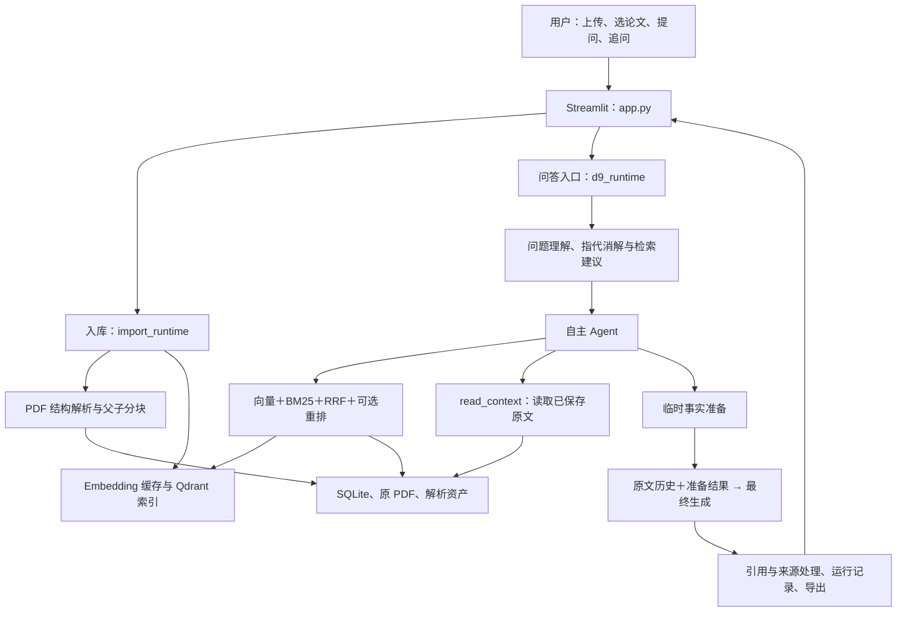

# v3：当前项目架构、实施状态与遗留问题

更新日期：2026-10-27（Asia/Shanghai）。本文由原 `docs/v2/plan2.md` 移入，作为 v3 架构与待办入口；[v2 总览](../v2/plan.md)及各专项保留阶段索引和历史记录。D1 十题完整 Agent 观察已于 2026-10-26 执行 10/10，结果见 [D1 第 8 节](d1-plan.md#8-实施结果2026-10-26)。

**当前状态：基础入库、混合检索、自主取证、临时事实准备、引用回查已接通；2.17 的准备原文历史衔接已实现，两个指定离线方法通过，一次真实固定证据两阶段观察已完成。D1 十题完整 Agent 观察已完成 10/10（2026-10-26）：10 题 answered、0 运行失败，9 题内容通过、1 题部分通过；合计 44 次聊天请求、466,703 tokens。** v2 总览中的旧状态不再代表最新进展，以本文、[2.17 第 9 节](../v2/2.17-ragflow-agent-original-history-plan.md#9-实施结果2026-10-26)及 [D1 第 8 节](d1-plan.md#8-实施结果2026-10-26)为准。

本文只整理现状与后续顺序，不新增业务实现、模型调用、测试、哈希或校验机制。

最新补充（2026-10-26）：v2.18 两题定向复测后，D1 第二批新十题已完成 10/10，0 运行失败；主答／追问要求 6 通过、4 部分通过，42 次聊天、438,100 tokens。安排、实际结果与交接提示词均直接追加在 [D1 第 11～13 节](d1-plan.md#11-第二批新增十题安排2026-10-26)，未新建 D2；后续待改进项见 [issues.md](issues.md)。原十题的历史汇总不覆盖，也不与新题混算。

最新补充（2026-10-27）：D2 第一阶段已实施，移除自主 Agent 的固定 8192 证据窗口、8000 字符上限和累计八块切片，改为保留会话原文、当前请求只发送新增块、引用 ID 累计并按实际模型容量裁剪完整请求。三个指定离线方法通过；两次 N07 观察中，第二次（用户要求重跑、当前代码）确认 `max_chars=None`、无 `max_tokens`、10 块／14,870 字符全部保留，`p7_c6` 进入最终并被引用，但模型仍未 `read_context` 读取 Section 3.2，详细关系适配和实际论元修改仍缺失，主要适配为部分覆盖。详见 [D2 第 7.1 节](d2-plan.md#71-第一阶段实际实施与结果2026-10-27)。

最新补充（2026-10-27，D2-QA）：D2 新十题 QA 完整 Agent 观察已完成 10/10、0 运行失败；9 通过、1 部分通过（Q01 顶层 Unanswerable 与官方两条原因口径不一致）。40 次聊天、478,818 tokens、308.97 秒，15 次 embedding、15 次 rerank、0 重试、0 修复。十题均 `answerable=true`、2 个自主步骤；Q04／Q06／Q08／Q09 的 `read_context` 均无新增正文。未发现跨题“核心缺口 + 可补证方向 + 额度未耗尽却提前收尾”案例；Q10 仅缺自然度数值表，但比较结论已给出。详见 [D2 第 10 节](d2-plan.md#10-新十题实际结果)。

最新补充（2026-10-27，D2 dev 第二批）：默认 `import_runtime.import_pdf` 已改为自动调用 MinerU 官方 API；两个指定离线方法通过；五篇 dev 论文均以 `mineru-api` 3.4.4／VLM／OCR／公式／表格／全文 `ready`，索引 embedding 19 次。D2-Q11～Q20 已完成 10/10、0 运行失败：7 通过、2 部分通过（Q12 语言方向、Q13 MEV 缺失，均提前收尾）、1 澄清（Q15，内容未交付）。问答 38 次聊天、554,570 tokens、251.503 秒，查询 embedding／重排各 16 次，0 重试、0 修复。详见 [D2 第 13 节](d2-plan.md#13-第二批十题实际结果)。

最新补充（2026-10-27，D2 澄清／充分性复测）：取消前置澄清关卡并统一探索／准备充分性规则；两个指定离线方法通过。只复测 Q12／Q13／Q15：3/3 完成、3/3 answered、0 运行失败；2 通过（Q12 补齐语言方向、Q13 覆盖三项分析）、1 部分通过（Q15 已给出相对性能和 0.979 recall，但完整绝对 F1 仍缺，仍提前收尾）。16 次聊天、340,810 tokens、117.172 秒，查询 embedding／重排各 4 次，0 重试／修复。详见 [D2 第 15.7.1 节](d2-plan.md#1571-实际实施与结果2026-10-27)。

## 1. 项目定位与当前边界

项目是本地论文调研助手：用户上传论文、选择已入库的论文版本，再进行单篇问答、跨论文比较和追问，通过回答中的引用回查 chunk 原文及 PDF 来源。页面当前选择范围为 1–3 篇论文。

主体是 Streamlit 页面和 Python 模块组成的本地应用，配合本地 SQLite、Qdrant 和文件资产；聊天、embedding、可选 rerank 通过配置调用外部模型服务，PDF 可使用本地 MinerU 或导入 MinerU API 解析结果。当前没有拆成独立前后端服务，也没有引入 RAGFlow 的 Go／Eino 运行框架。

Agent 路径采用“问答时临时提取事实”：取证后执行 `prepare_answer`，再生成完整回答。尚未把整篇论文提前编译成可独立检索的事实／知识图谱，也没有采用 RAGFlow 的编译事实直接作答分支。

## 2. 当前架构

### 2.1 模块连接



该图描述页面自主 Agent 主路径。固定 RAG 和固定证据实验是不同入口，见第 2.6 节。

### 2.2 PDF 入库与来源保存

```text
PDF 文件／明确版本的论文材料
    ↓
解析正文、公式、表格、图片与图注等结构
    ↓
整理来源单元、父内容和可检索子块
    ↓
保存 PDF、解析资产、版本与正文
    ↓
生成或复用子块 embedding → 写入 Qdrant
    ↓
按论文版本和索引配置记录 ready 状态 → 页面可选择
```

- [import_runtime.py](../../paper_assistant/import_runtime.py)负责页面入库、进度和耗时统计；默认解析方案仍为 `mineru-standard`。MinerU API 的解析调用及结果导入已有独立支持，不代表页面默认全部切换到云端解析。
- [mineru_parser.py](../../paper_assistant/mineru_parser.py)、[structured_ingest.py](../../paper_assistant/structured_ingest.py)和[structured_chunking.py](../../paper_assistant/structured_chunking.py)负责结构适配和分层分块。当前子块目标为 512 token，正文父内容目标为 1536 token；保留真实父子关系、页码、来源范围、bbox 和相关资产。父内容不是提前编译的知识。
- 公式保留解析得到的文本／LaTeX 与来源；图注和脚注已有入库支持。保存图像资产不等于模型已对整张图进行视觉理解，默认不会额外为每张图调用语义分析模型。
- [indexing.py](../../paper_assistant/indexing.py)负责 embedding 缓存、分批请求与向量写入；目前每批最多 10 个块，顺序推进，页面入库跨批复用 HTTP client。已有缓存或 ready 版本可按既有规则复用。

原文与向量分开保存：写入 SQLite 不等于已可检索，页面依据对应索引配置的 ready 状态选择版本。旧解析版本及其结果保留，不把不同解析器、档位或来源版本混成同一次实验。

### 2.3 检索与原文阅读

查询在用户所选的完整 `(paper_id, parse_revision)` 范围内执行：

```text
查询表达
   ├─ 查询 embedding → Qdrant 向量召回
   └─ 当前所选版本的 chunk → 本地 BM25 召回
                     ↓
                RRF 按排名融合
                     ↓
                可选模型重排
                     ↓
                返回 top-5 候选
                     ↓
         合并、父内容展开与原文窗口选择
```

[hybrid_search.py](../../paper_assistant/hybrid_search.py)中两路召回各取最多 20 条，RRF 常数为 60；BM25 从同一批 SQLite 子块建立运行内可复用的内存索引。配置重排时对融合候选排序，重排失败保留记录并沿用 RRF 顺序。embedding、BM25 和 rerank 分工不同，均不负责生成论文答案。

[evidence_reading.py](../../paper_assistant/evidence_reading.py)和[agent_actions.py](../../paper_assistant/agent_actions.py)提供本地 `read_context`：

- `parent_id`：读取已保存父内容对应的真实子块。
- `chunk_id + missing_information`：精读本轮真实返回或已展示的已知 chunk，说明本次要补什么信息；单块读取不自动附带邻居。

检索未展示的候选可提供页码、原节名、父块和省略原因等定位信息，定位不等于已读正文，也不直接获得引用权限。原文按论文、原节名和阅读顺序组织，使用既有 8192 token 证据窗口；该值是原文视图预算，不是整次聊天请求的总 token 上限。

### 2.4 页面 Agent 的实际工作流程

[d9_runtime.py](../../paper_assistant/d9_runtime.py)是页面统一问答入口，主要流程如下：

```text
原问题＋所选论文版本＋有限用户对话历史
    ↓
一次前置理解：必要指代补全、澄清、检索建议
    ├─ 必要对象不明确 → 返回澄清
    └─ 对象明确 → 自主 Agent
                      ↓
          选择 search／read_context／准备事实
                      ↓
          prepare_answer：facts、answerable、missing_information
                      ├─ 核心不足且有取证额度 → 缺口取证决策
                      │       ├─ 继续搜索／读取 → 新原文到达后再准备
                      │       └─ 明确无可靠方向 → 用保存材料收尾
                      └─ 足够或达到原有限额
                                  ↓
                    延续成功准备的实际消息历史
                    ＋准备响应＋最终作答指令
                                  ↓
                    一次最终生成 → 引用／来源处理 → 展示
```

前置计划是建议，不是必须逐条执行的队列。Agent 可以调整取证方向或在材料足够时提前结束；search 和 read_context 使用原生工具调用，同轮可以有多个调用，程序顺序执行并按 `tool_call_id` 回填结果。

模型负责理解问题、选择工具与方向、提取事实和表达答案；程序负责执行工具、保留版本与来源范围、组织实际可见原文、管理额度及发布。引用合法只证明可定位，不自动证明结论受到原文完整支持。

### 2.5 临时事实提取、历史与最终生成

当前存在两种不同的历史：

| 历史 | 保存／传递方式 | 作用与边界 |
|---|---|---|
| 用户多轮对话 | [conversation.py](../../paper_assistant/conversation.py)选择同会话最近有效交互，当前最多 3 轮、4000 字符；保留问题、主张和引用，不带全部工具轨迹和原文 | 帮助指代和表达理解；旧模型结论不当作已核实论文事实，必要时恢复对应原文 |
| 本次问答内部消息 | Agent 记录工具动作与观察；2.17 最终阶段重放成功准备请求的非 system 消息，再追加真实准备响应和最终指令 | 让最终生成继续看到该次准备的原文窗口，不依赖模型跨独立调用自动记忆 |

临时事实协议沿用 `facts / answerable / missing_information`；每条事实可以带 `citation_ids` 和 `evidence_quotes`。这份结果保存在运行记录中，但没有建立独立知识索引，不会自动被其他问题作为预编译知识召回。

**2.17 已落实的变化：**[agent.py](../../paper_assistant/agent.py)绑定成功准备的请求、响应和完整 context；[agent_prompt.py](../../paper_assistant/agent_prompt.py)通过共用历史组装函数保留准备请求中的原文，以最终 system 替换准备 system。最终以原文为依据，允许补足准备遗漏的必要内容，引用范围也不再缩成准备事实的 ID 子集。准备修复、无方向收尾及最终修复继续使用对应原文。

最终请求保留的是一次成功准备实际拥有的消息，不是把每轮完整请求全部拼接；原文不在最终 payload 再复制一份。旧工具历史主要保存动作和位置，原文来自准备请求中的 `evidence_sections`。这实现了当前接缝的原文延续，不是把所有历史正文永久保留的会话系统。

代码与指定离线方法已覆盖该连接；2.17 的一次真实固定证据观察进一步显示，最终可以从原文补入本次准备未写出的关系示例，并引用准备未引用但已提供正文的块。代价是更多输入 token；这还不证明完整 Agent 取证或普遍回答质量提升，后续由 D1 扩大观察。

### 2.6 运行入口与预算

| 入口 | 实际用途 | 与页面自主 Agent 的区别 |
|---|---|---|
| `app.py → d9_runtime.run_question(mode="agent", library_mode=True)` | 当前页面论文问答／追问主路径 | 前置理解＋自主取证＋临时准备＋最终生成 |
| `d9_runtime.run_question(mode="fixed_rag", ...)`／[rag.py](../../paper_assistant/rag.py) | 固定 RAG 对照与已有调用入口 | 采用固定检索／计划生成路径，不等同于自主取证循环 |
| [fixed_evidence.py](../../paper_assistant/fixed_evidence.py) | 固定已有可见原文，只运行准备和最终生成的定向实验 | 不搜索、不重排；与自主入口共用 2.17 最终历史组装，但不是固定 RAG，也不是完整 Agent 真实回归 |
| CLI／旧非自主入口 | 既有命令行和历史实验 | 调用路径与预算需按参数确认，不能直接算作页面当前流程 |

页面 Agent 最多五次自主决策，search／read_context 共用五次模型发起的取证额度；一次决策可产生多个工具调用，准备也占决策步。触顶有受限收尾，前置理解、最终生成、网络重试和格式修复另有实际请求，因此“五步”不等于整题只有五次模型请求。

页面交互使用 `INTERACTIVE_CHAT_POLICY`：输出上限 4096 token，单次请求超时 30 秒，网络重试和共享修复各最多一次，没有整题聊天请求数／总时长硬上限；旧 `ChatPolicy` 默认输出 1200 token、最多 3 次请求尝试、120 秒总时限。两类预算不宜直接混成同配置性能或质量对比。

### 2.7 数据保存、引用与模型职责

| 部分 | 当前内容或职责 |
|---|---|
| [storage.py](../../paper_assistant/storage.py)／`data/index/papers.sqlite3` | 论文、解析版本、父内容、子块、来源元数据和向量导入状态；是原文读取与版本归属的主要入口 |
| [retrieval.py](../../paper_assistant/retrieval.py)／`data/index/qdrant/` | 本地向量索引，按论文版本及索引配置限定检索范围 |
| `data/index/current_profile.json` 与 embedding 缓存 | 记录当前向量配置，按既有规则复用已生成向量；聊天模型配置独立于 embedding 配置 |
| 原 PDF 与解析资产 | 保存源文件、版面及图像等材料；引用继续定位到真实来源区域 |
| [citations.py](../../paper_assistant/citations.py)／[source_scope.py](../../paper_assistant/source_scope.py) | 对应实际提供正文的 chunk、所选版本、页码／区域及摘要等来源范围；生成 `evidence_refs/evidence_sources` |
| [agent_export.py](../../paper_assistant/agent_export.py)、[answer_export.py](../../paper_assistant/answer_export.py) | 页面与 JSON／Markdown 导出，保留主张、引句、来源和实际用量 |
| `archive/run_logs/d9/`、`artifacts/v2/` | 前者保存正常逐次运行记录，后者组织专项输入、结果和对照；保存记录不等于建立可检索知识库 |

模型服务由 [config.py](../../paper_assistant/config.py)分别配置：聊天 LLM 处理理解、工具选择、临时提取和回答；embedding 处理论文／查询向量；rerank 可选地排序候选；MinerU 处理 PDF 内容与版面。最近已保存实验使用 DeepSeek 聊天模型，具体运行配置以对应记录为准，不把某个历史模型名写成不可变架构。

## 3. 已完成到哪一步

| 能力 | 当前状态 | 证据入口 |
|---|---|---|
| 页面问答、连续追问、PDF 入库、版本选择、引用回查与导出 | 已实现 | 当前入口源码及[原总览](../v2/plan.md)中的阶段记录 |
| 结构父子分块、多来源保存、跨页上下文及图注／脚注处理 | 已实现，存在下述结构和映射遗留 | [2.7](../v2/2.7-structured-pdf-chunking-plan.md)、[2.7 B2](../v2/2.7-B2-evidence-attribution-plan.md)、[2.8](../v2/2.8-standard-five-question-fix-plan.md) |
| 原生工具调用、主动父块／已知 chunk 阅读、缺口取证分流 | 已实现，新增分支的真实运行覆盖有限 | [2.9](../v2/2.9-agent-tool-calling-grounding-plan.md)、[2.10](../v2/2.10-answer-focus-stage-context-plan.md)、[2.15 第 8 节](../v2/2.15-ragflow-gap-driven-evidence-plan.md#8-本次实际实施与结果2026-10-25) |
| 原问范围、方法阶段、引句与事实组织 | 已实施多轮局部改进，不能视为所有旧失败已解决 | [2.11](../v2/2.11-question-evidence-answer-plan.md)、[2.12](../v2/2.12-question-scope-answer-boundary-plan.md)、[2.13](../v2/2.13-question-intent-retrieval-plan.md) |
| 临时事实准备＋独立最终生成 | 已实现，生产规则保留覆盖与限定要求 | [2.14](../v2/2.14-ragflow-grounded-answer-plan.md)、[2.16 第 9 节](../v2/2.16-fact-coverage-faithfulness-plan.md#9-实施结果2026-10-25) |
| 准备原文历史传到最终，允许引用原文中准备遗漏的块 | 已实现，两个指定离线方法通过；一次真实固定证据观察已完成 | [2.17 第 9 节](../v2/2.17-ragflow-agent-original-history-plan.md#9-实施结果2026-10-26)及 `_replay_prepared_history` 当前代码 |
| 自主 Agent 的已读原文跨步骤保留与完整请求容量 | 第一阶段已实现，3 个指定离线方法通过；第二次 N07 确认 10 块／14,870 字符全保留、无 8192／8000／8 块限制，但 Section 3.2 细节仍未读取，覆盖部分 | [D2 第 7.1 节](d2-plan.md#71-第一阶段实际实施与结果2026-10-27)及[第二次结果](../../artifacts/v3/d2-evidence-history-fix-20261027-rerun/results.json) |
| D2 新十题 QA 完整 Agent 观察 | 已完成 10/10、0 运行失败；9 通过、1 部分通过；未发现跨题核心缺口提前收尾 | [D2 第 10 节](d2-plan.md#10-新十题实际结果)及[结果](../../artifacts/v3/d2-qa-new-ten-20261027/results.json) |
| D2 dev 第二批十题与默认 MinerU API 入库 | 五篇 API ready；10/10 完成、0 运行失败；7 通过、2 部分通过（Q12／Q13 提前收尾）、1 澄清 | [D2 第 13 节](d2-plan.md#13-第二批十题实际结果)及[结果](../../artifacts/v3/d2-qa-dev-next-ten-20261027/results.json) |
| D2 取消前置澄清／统一充分性后三题复测 | Q12／Q13 通过；Q15 部分通过（完整绝对 F1 仍缺）；3/3 完成、0 运行失败 | [D2 第 15.7.1 节](d2-plan.md#1571-实际实施与结果2026-10-27)及[结果](../../artifacts/v3/d2-clarification-sufficiency-rerun-20261027/results.json) |
| QASPER 数据准备、PDF 导入、来源映射、Answer／Evidence F1 入口 | 工具已实现并做过分批实验，尚无完整的当前同配置对照结论 | [2.3](../v2/2.3-qasper-evaluation-plan.md)、[2.7 C](../v2/2.7-C-qa-comparison-plan.md)、后续专项结果 |
| 当前版本完整 Agent 的十题开发观察 | 已完成 10/10（2026-10-26）；10 题 answered、0 运行失败，9 通过／1 部分通过 | [D1 第 8 节](d1-plan.md#8-实施结果2026-10-26)及[结果](../../artifacts/v3/d1-agent-ten-20261026/results.json) |

最近已完成的真实生成是 [2.17 固定证据实验](../../artifacts/v2/fact-coverage/monalog-original-history-20261026/run.md)：同一道 MonaLog 问题、5 个已有可见块，正常两次聊天，共 22,270 token、17.078 秒，无 embedding、重排、重试或修复。最终保留全部原文并补足准备遗漏的关系示例，同时加入了有据但非必要的生成流程背景。对照 [2.16](../../artifacts/v2/fact-coverage/monalog-fixed-evidence-20261025/run.md)的 15,529 token／15.812 秒，总 token 增加约 43.4%，记录耗时增加约 8.0%；单题及不同缓存状态不能外推为稳定延迟或等比例费用变化。

2.17 的两个离线方法通过结果来自其实施记录；D1 批次没有重跑这些方法，也没有重复固定证据实验。完整 Agent 的检索、阅读、准备与最终表达已在 D1 十题中观察，见 [D1 第 8 节](d1-plan.md#8-实施结果2026-10-26)。

## 4. 遗留问题及其影响

### 4.1 原文历史衔接已有单题与完整十题观察

旧问题是准备 claim 含公式、短 quote 却不含对应公式，最终只能依赖压缩材料。2.17 已修改传递链路，且真实请求确认五块原文进入最终生成，各自只出现一次。最终补出了本次准备未包含的量词链及介词关系，现阶段应标为“传递修复完成、单题观察有效”，不再标成待实施或未做真实观察。

遗留的是新题和完整自主取证上的质量、聚焦与成本：2.17 的额外背景有原文支持，但不直接回答事实选择问题；核心答案在 2.16 已覆盖，不能把新增例子数量当作准确率提升。8192 token 只限制证据视图，历史、准备响应和系统规则也占上下文。[D1](d1-plan.md#8-实施结果2026-10-26) 已完成 10/10：D1-02／D1-08 实际触发不足后补证，D1-06 出现跨页引用支持部分，D1-01／D1-05／D1-06／D1-10 有额外背景，10/10 自愿输出 `direct_answer`。下一步按这些具体残留问题决定局部修改，不重跑已完成的十题。

### 4.2 回答忠实性仍是内容质量风险

已有真实案例暴露过：把某模块的训练表示泛化为整个系统机制、将分数相近加强为统计结论、临时提取遗漏替代来源或条件，以及把不清楚的数学关系写成确定符号。2.14–2.16 对其中一些案例取得局部改善，不能据此认定所有旧题或新题都已解决。

2.17 让原文可见，并不自动保证正确理解。应区分证据是否取得、是否展示、准备是否忠实，以及最终是否正确使用；不以引用检查通过或回答发布成功代替内容评价。只有具体新输出暴露问题时，再修负责该行为的位置，不继续堆叠同义警告或增加审核模型。

D1 十题未出现明显的数值或主体臆造；更具体的问题是 D1-06 的跨页引用支持部分、D1-01／D1-05／D1-06／D1-10 的额外背景，以及 10/10 自愿输出未被要求的 `direct_answer`。引用检查通过仍不等于语义支持与聚焦都成立，后续只按具体题定位。

### 4.3 新取证分支的真实覆盖不足

2.15 已接通预算外候选定位、`chunk_id` 定向读取以及显式无可靠方向的分流。D1-02 首次准备 `answerable=false` 后经 read_context 补证再准备，D1-08 缺口读取后触顶收尾，该分支已在真实运行中出现；但这仍是两道题的观察，不表示所有缺口场景都可靠。

这表示验证覆盖有限，不表示代码已知不能工作。固定证据两阶段实验也不能补充这部分取证覆盖，不能为了凑分支而向模型注入正确位置或强制工具动作。

### 4.4 PDF 结构与公式恢复仍有局部限制

标题层级、表头及表格关系的恢复仍按 [2.8](../v2/2.8-standard-five-question-fix-plan.md)保留为后续事项。Standard、历史 Advanced 和 MinerU API 结果应按实际版本分别评价；MonaLog API 版本的符号改善不能外推为所有 PDF 公式都恢复正确。

现有父子结构、来源范围与图注已能支持阅读，但如果解析文本本身缺失或识别错误，历史重放只能继续提供这份解析结果，不能补回没有解析出来的内容。图像与区域资产可用于回查，不代表运行时默认进行了视觉核对。只有已见案例确实因结构或符号阻断回答时，再针对对应解析／适配环节安排改动。

### 4.5 检索／分层分块收益与完整评测尚未收敛

项目已有向量＋BM25＋RRF＋重排、父子分块及补读实现，但旧的 20 题、QASPER 首篇对照与后续局部批次使用不同阶段的解析版本、提示和流程，不能合并成当前系统准确率，也不足以把收益单独归因于 Agent 或某个检索组件。

QASPER 来源映射仍有未知或不完整归属；Evidence F1 的 null 不能当作 0，也不能删除未知引用来获得好看结果。官方短答案 F1 不能代替完整解释的正确性；2.16 普通完整回答实验没有按 QA 词面对齐，不能与旧短答协议直接混报。

当前没有完成“选定稳定版本＋相同题目／输出要求＋明确预算”的完整固定 RAG／Agent 对照和留出验收。具体论文就绪与版本绑定看对应实验输入，不把旧专项中的 1/20 等历史计数当作当前全库状态。

### 4.6 成本观察有限，历史入库速度不能外推

入库已有跨批连接复用和 embedding 缓存，仍以每批最多 10 条串行推进。原 2.5 的 25.90 秒是当时指定 PDF／方案的一次完整入库观察，不代表当前所有 Standard 或 API PDF 的完整耗时，也没有同一 PDF 的旧方案完整对照支撑统一提速比例。

问答的多次搜索、重排、临时准备和最终生成均有成本。已有批次出现请求数或 token 减少但墙钟时间增加；不能以调用轮数推断稳定延迟。当前先记录对应阶段的真实用量，不为尚未证明的瓶颈自动加入并发、额外缓存或大规模性能实验。

### 4.7 历史暂缓项与产品边界

- D5-006 按用户原要求保留：旧案例曾在没有取得论文证据时断言论文“不涉及”某项目。近期协议虽有调整，但没有对该暂缓项单独完成当前版本的验收，继续不标为已解决，也不顺带并入 2.17。
- 多轮用户历史有意限制为最近有效交互，不是整篇论文或所有轮次的永久记忆；更早引用需要依靠实际记录与原文恢复，不能把历史结论作为论文证据。
- 项目是选定论文范围内的本地助手，论文发现、全网研究、整库知识编译及复杂多 Agent 协作不属于当前已实现架构。本规划不据此新增这些产品目标。

## 5. 后续顺序

| 顺序 | 事项 | 完成依据与停止点 |
|---|---|---|
| 1 | [D1 十题完整 Agent 开发观察](d1-plan.md) | 已完成 10/10（2026-10-26）；9 道独立问题＋1 道承接真实回答的追问，每题一次，未在批次中调提示 |
| 2 | 根据实际残留错误决定下一项局部修改 | 先定位解析、检索、展示、准备或最终表达的责任；没有具体失败证据不继续增设机制，不因一次低分反复抽样 |
| 3 | 方案稳定后，按既有 QASPER／项目对照安排补齐统一版本的效果证据 | 明确论文版本、题目、输出要求和预算，复用仍有效结果；保留未知映射与所有失败，不新增一套评测框架 |
| 4 | 在真实案例阻断时处理对应 PDF 标题／表头／符号问题；之后再进入已有留出验收与项目表述整理 | 不为追求映射或结构率 100% 无限修复；实验完成与质量结论分开，求职表述使用实际证据 |

提前编译知识可作为后续检索组织方式的候选，但目前没有任务要求或实验结果证明它是解决现阶段问题的必要条件，不进入本轮实施顺序。原 RAGFlow 参考优先采用适配现有职责的原文读取、消息延续和引用组织，不整体迁移其框架或过滤模型。

后续验证继续遵守 [AGENTS.md](../../AGENTS.md)：文档不跑测试，普通代码小改只选 1–3 个相关现有方法，已通过且对应代码未变的结果复用；离线不发真实模型请求。完成后只在专项和本文更新必要状态与已有结果链接，不另建哈希、审计或验证报告。

## 6. 进展阅读与更新位置

- **当前架构与遗留问题：**本文第 2、4 节。
- **后续问题回查与修改：**[issues.md](issues.md)，集中记录 D1 与 v2.18 复测暴露的待改进项，以及已完成定向复测的修正。
- **第二批新十题及交接：**[D1 第 11～13 节](d1-plan.md#11-第二批新增十题安排2026-10-26)与[本批结果](../../artifacts/v3/d1-new-ten-20261026/results.json)，已完成 10/10。
- **已完成的十题观察：**[D1 第 8 节](d1-plan.md#8-实施结果2026-10-26)与[结果](../../artifacts/v3/d1-agent-ten-20261026/results.json)。
- **最近实现与真实两阶段观察：**[2.17 第 9 节](../v2/2.17-ragflow-agent-original-history-plan.md#9-实施结果2026-10-26)和[实际运行结果](../../artifacts/v2/fact-coverage/monalog-original-history-20261026/run.md)。
- **新机制前的两阶段对照：**[2.16 第 9 节](../v2/2.16-fact-coverage-faithfulness-plan.md#9-实施结果2026-10-25)和[旧运行结果](../../artifacts/v2/fact-coverage/monalog-fixed-evidence-20261025/run.md)。
- **历史改进顺序与早期批次：**[plan.md](../v2/plan.md)及各编号专项。

后续状态变化时，更新本文文首、第 3 节和对应遗留项，并链接专项实际记录；“已规划”“已实现／离线通过”“真实实验完成”“内容效果通过”分别记录，不因文档编号更大或代码存在而自动升级状态。
