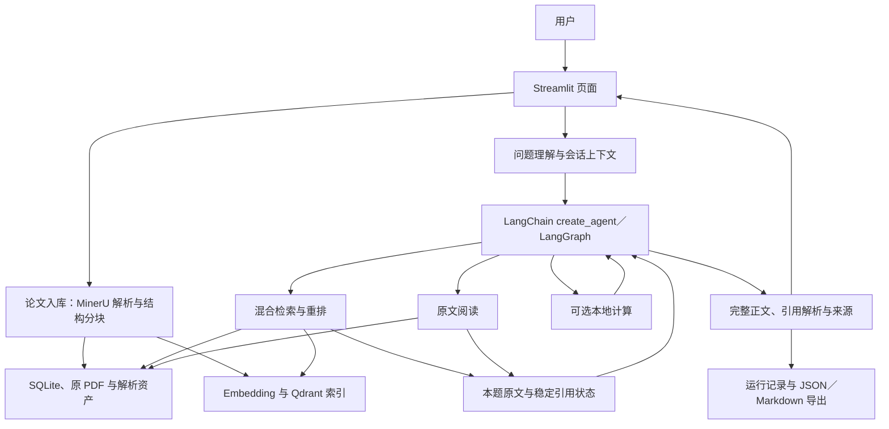

# v3：项目总览

更新日期：2026-11-08（Asia/Shanghai）。

本文说明项目定位、当前技术栈、整体架构、实施状态与最新评测结果。各阶段的实现、逐题复测和执行提示词保存在文末索引所列的专项规划中。

**当前项目是基于 Python／Streamlit 的本地论文调研助手，采用 LangChain／LangGraph 编排自主 Agent，以 SQLite、Qdrant 和文件资产保存论文及来源，结合混合检索、原文阅读和稳定引用完成论文问答。**

## 1. 项目定位与使用范围

用户上传论文或选择已入库版本，进行单篇问答、跨论文比较与连续追问，并通过答案引用回查原文和 PDF 来源。当前页面支持选择 1～3 篇论文。

项目重点是让回答建立在所选论文的实际材料上，保留论文版本、原文片段与答案引用之间的关系。应用运行于本地，PDF 解析、聊天、embedding 和可选重排通过配置使用相应模型服务。

## 2. 当前技术栈

| 层次 | 技术与组件 | 在项目中的作用 | 实现参考 |
|---|---|---|---|
| 应用与交互 | Python、Streamlit | 论文上传、版本选择、问答／追问、引用展开与结果下载 | [v2 总览](../v2/plan.md)、[D1](d1-plan.md) |
| Agent 框架 | LangChain、LangGraph、`create_agent` | 标准化工具与模型接口，调度模型／工具循环，承接消息历史、证据状态和异常收尾 | [D4：框架迁移](d4-plan.md) |
| 聊天模型接入 | DeepSeek、项目现有 RecordedLLM 适配 | 问题理解、工具选择、资料判断和正文生成，记录实际调用与用量 | [D4：模型接口与运行衔接](d4-plan.md) |
| PDF 解析 | MinerU 官方 API，保留显式本地解析和已有 bundle 导入入口 | 提取正文、公式、表格与版面来源，形成可保存的解析资产 | [D2：API 入库](d2-plan.md)、[D3：表格阅读衔接](d3-plan.md) |
| 结构化存储 | SQLite、原 PDF 与本地解析文件 | 保存论文／解析版本、父子块、页码、区域和来源资产 | [v2 结构分块规划](../v2/2.7-structured-pdf-chunking-plan.md) |
| 向量索引 | Qdrant、embedding 服务与本地缓存 | 保存论文向量，按所选论文版本执行语义召回 | [v2 总览](../v2/plan.md)、[D2](d2-plan.md) |
| 混合检索 | 向量召回、BM25、RRF、可选 rerank | 结合语义与关键词获取候选，再融合排序和重排 | [v2 总览](../v2/plan.md)、[D3](d3-plan.md) |
| 本地计算工具 | JavaScript、MiniRacer／V8 | 对已取得的数值进行可选计算，不产生新的论文证据 | [D3：计算工具与正文生成](d3-plan.md) |
| 引用与结果交付 | EvidenceRegistry、显式 `[ID:n]`、Streamlit 自定义组件、PDF.js、JSON／Markdown | 将引用映射到原文片段和 PDF 页序，提供悬停卡片、右侧预览和区域高亮 | [D3：稳定引用链路](d3-plan.md#29-迁移-ragflow-agentic-引用链路并真实复测-q50q692026-10-28)、[D8](d8-plan.md) |

**近期已接入 LangChain／LangGraph，框架负责 Agent 编排；现有入库、混合检索、父子块、来源和引用业务模块继续使用。** 工具、模型适配、图运行入口及相关代码整理已经落地，具体设计、实现和验证记录见 [d4-plan.md](d4-plan.md)。

当前配置使用 `deepseek-flash`、`qwen3.7-text-embedding` 和 `qwen3-rerank`，模型选择与索引配置分别管理，具体参数以实际配置和运行记录为准。RAGFlow 本地代码提供工具循环、原文阅读、引用与收尾机制的参考。

## 3. 整体架构与数据流

### 3.1 入库与检索

论文解析后整理为真实父子块，原文、版本及版面来源写入 SQLite 和文件资产；embedding 写入 Qdrant，并按现有缓存与就绪状态复用。问答限定在用户选定的论文／解析版本内，使用向量与关键词混合召回，融合、重排后提供候选原文。

目录和候选位置帮助模型定位材料，`read_context` 可以按已知块或目录父块读取实际正文。工具反馈区分检索命中、实际提供给模型的原文和本轮新增证据，供 Agent 决定是否继续阅读。表格、公式和跨页内容沿保存的来源关系回查。[D2：原文与容量](d2-plan.md)、[D3：表格阅读](d3-plan.md)、[D5：阅读反馈](d5-plan.md)

### 3.2 Agent 与回答生成

前置问题理解提供指代处理和检索建议，随后进入实际 `create_agent` 图。模型自主选择 `search`、`read_context`、`run_javascript` 或直接给出完整自然语言答案；现有调用层继续管理网络请求、重试和统计。

当前自主路径采用统一模型／工具循环，原文按实际模型请求容量保留和裁剪，生成的正文直接进入引用处理。[D3：统一工具循环](d3-plan.md#33-对齐-ragflow-的统一工具循环与宽松运行限制复测-q93q99q1002026-10-28)、[D4：框架迁移](d4-plan.md)

固定 RAG 通过同一问答入口提供对照，按固定流程做前置理解、一次混合检索、已有父块补读和作答。D6 已将 `library_mode=True` 的固定 RAG 从独立证据窗口改为 `full_request`。系统按完整消息计算输入容量，为输出预留空间，超出预算时整块裁剪较低优先级的证据，并同步实际展示内容和引用权限。[D6 第 15.9 节](d6-plan.md#159-实际执行记录2026-11-03)

### 3.3 引用、会话与结果保存

同一次问答共享证据注册表：原文首次展示时取得稳定 ref，搜索、阅读、重排和最终引用沿用同一身份。模型在论文事实后写 `[ID:n]`，程序将其映射回实际原文；普通论文书目编号保留为原文内容。

Agent 正文中的引用显示为行内徽标。悬停可查看论文标题、原文片段和 PDF 文件页序。点击卡片中的「在 PDF 中查看」，右侧 PDF.js 查看器打开已入库的原文件并跳到引用位置，按保存的 `source_spans` 高亮正文或表格。没有可用坐标时按页定位。读者可在保留左侧聊天的同时切换引用和论文。 [D8 预览与引用交互](d8-plan.md)

论文、解析资产和运行日志保存在本地；页面使用有限的近期用户历史理解追问，本题证据状态与注册表随该次问答使用。当前没有关闭页面后的持久化会话恢复。页面与导出消费同一份答案、引用和来源，详细机制见 [D3](d3-plan.md)、[D4](d4-plan.md)。

## 4. 当前能力与实施状态

| 能力 | 当前状态 | 详细规划与记录 |
|---|---|---|
| PDF 入库、版本管理、结构分块与索引复用 | 已实现，默认使用 MinerU 官方 API | [D2](d2-plan.md)、[D3](d3-plan.md) |
| 单篇问答、跨论文比较与连续追问 | 已实现，围绕所选论文版本提供回答 | [D1](d1-plan.md)、[D2](d2-plan.md) |
| 混合检索、原文补读与可选计算 | 已实现，由 Agent 根据问题选择工具 | [D3](d3-plan.md) |
| 稳定引用、原文／PDF 回查与结果导出 | D8 已接入行内引用徽标、悬停原文、右侧原 PDF 定位与区域高亮 | [D3](d3-plan.md)、[D8](d8-plan.md) |
| LangChain／LangGraph Agent 编排 | 已接入并完成迁移，当前页面主路径实际使用 | [D4](d4-plan.md) |
| 读取反馈与历史错题复测 | D5 已实现原文新增情况与阅读范围反馈。21 道历史错题复测为 16 通过、5 部分正确 | [D5](d5-plan.md) |
| 固定 RAG 容量调整与问答对照 | D6 完成固定 RAG 容量调整及两批对照；D7 完成新 50 题对照，当前 100 题汇总见第 4.2 节 | [D6](d6-plan.md)、[D7](d7-plan.md) |

### 4.1 D6 实际评测进展（2026-11-03）

两批均采用 QASPER dev 官方原题，每批 50 题、10 篇不同论文，所选论文均已入库并绑定实际解析版本。第一批用于开发对照和容量问题复测，含 43 道可答题和 7 道资料不足题。第二批用于新增验证，依据实际 PDF 核定为 45 道可答题和 5 道资料不足题。两批的题目范围都是单篇、单轮问答。[第一批样本](../../eval/qasper/d6-new50-v1/sample.json)、[第二批样本](../../eval/qasper/d6-new50-b2-v1/sample.json)

#### 4.1.1 四种检索配置对照

首批 41 道有正向证据的题中，40 道形成四组共同有效题集。E50-001 因评测脚本传给上下文准备函数的字段有误而缺少该轮结果。Returned 指检索返回的候选，Shown 指当时上下文预算下实际纳入的原文。表中数值是按题平均的证据覆盖率。

| 配置 | Returned@5 | Shown@5 | Returned@10 | Shown@10 |
|---|---:|---:|---:|---:|
| 纯 BM25 | 61.50% | 53.35% | 83.88% | 54.47% |
| 纯向量 | 77.54% | 62.79% | **90.54%** | 65.29% |
| BM25＋向量＋RRF | **78.67%** | **74.92%** | 83.88% | **75.54%** |
| 同一融合候选池＋rerank | 74.17% | 64.35% | 83.00% | 64.97% |

本批 RRF 的实际展示覆盖最高，重排后两档展示覆盖均下降。纯向量在 Returned@10 上最高。表中 Shown 采用对照当时的 8192-token 证据预算，这些指标衡量检索和上下文展示的证据覆盖。[四组检索结果](../../artifacts/v3/d6-retrieval-new50-20261103/results.json)、[D6 第 12.5 节](d6-plan.md#125-四组结果共同有效题集)

#### 4.1.2 容量复测与两批问答对照

首批固定 RAG 按完整请求容量复测后，完整回答从 **32/50（64%）增至 40/50（80%）**。新旧两次的原始检索 top5 及顺序在 50 题上相同，36 题实际纳入的原文更多，原文字符合计从 208,383 增至 316,359。E50-001 从零原文变为实际提供 5 块原文，评分从未通过变为完整。D6 已通过两项对应的离线验证，分别覆盖正式入口与格式修复中的容量行为。[容量复测结果](../../artifacts/v3/d6-fixed-full-context-new50-20261103/results.json)、[D6 离线验证记录](d6-plan.md#1591-实际改动与离线验证)

| 批次 | 模式 | 完整 | 部分正确 | 未通过 | 完整率 | 完整或部分正确占比 |
|---|---|---:|---:|---:|---:|---:|
| 第一批 50 题 | 固定 RAG，容量调整后 | 40 | 3 | 7 | 80% | 86% |
| 第一批 50 题 | Agent | 44 | 4 | 2 | 88% | 96% |
| 第二批 50 题 | 固定 RAG | 33 | 6 | 11 | 66% | 78% |
| 第二批 50 题 | Agent | 37 | 9 | 4 | 74% | 92% |

每批各有 6 题仅 Agent 完整、2 题仅固定 RAG 完整。第二批的 N50-022、N50-025 和 N50-032 展示了继续读取关键表格或方法段的收益，N50-018 则是固定 RAG 覆盖了所问规模、Agent 漏答的反向案例。表中采用各批现有评分，部分正确计入最后一列。第二批作为历史对照单列。[第一批 Agent 结果](../../artifacts/v3/d6-qa-paired-new50-20261103/results.json)、[第二批最终结果](../../artifacts/v3/d6-qa-paired-new50-b2-20261103/results.json)、[评分与汇总问题](issues.md#120-d6-评分与汇总待校准)

第二批首次提交 100 次，完成 79 次，执行失败 21 次，其中固定 RAG 12 次、Agent 9 次。失败项随后各重试一次，补齐最终两组各 50 份结果，合计 121 次模式提交。上表使用最终评分，首次失败及输出异常另计。[首次执行记录](../../artifacts/v3/d6-qa-paired-new50-b2-20261103/results_initial_79.json)、[执行失败与长尾](issues.md#119-首次执行失败与耗时长尾)

#### 4.1.3 问答用量与耗时

按每组最终采用的 50 次运行汇总。用量不完整的任务也计入已经返回的已知部分。

| 批次 | 模式 | Chat 请求 | 已知 Chat tokens | 每题耗时中位数 | 每题耗时均值 | 最大单题耗时 |
|---|---|---:|---:|---:|---:|---:|
| 第一批 | 固定 RAG，容量调整后 | 100 | 593,609 | 16.195 秒 | 17.762 秒 | 36.438 秒 |
| 第一批 | Agent | 159 | 1,177,110 | 20.000 秒 | 20.526 秒 | 34.407 秒 |
| 第二批 | 固定 RAG | 102 | 613,725 | 19.648 秒 | 21.206 秒 | 54.953 秒 |
| 第二批 | Agent | 164 | 1,330,313 | 21.047 秒 | 60.206 秒 | 934.828 秒 |

第二批 Agent 的已知 Chat tokens 约为固定 RAG 的 2.17 倍。两组中位耗时接近，Agent 均值受少数长尾运行影响。计入首次失败后，第二批已知 Chat tokens 为固定 RAG 616,110、Agent 1,330,844。论文入库和独立检索的用量在 D6 分开记录。[D6 用量明细](d6-plan.md#17114-成本与证据使用)、[已知用量汇总复核](issues.md#120-d6-评分与汇总待校准)

### 4.2 当前 100 题同题对照

汇总纳入 D6 首批 E50 和 D7 新批 V50 各 50 道 QASPER dev 原题，均为单篇、单轮问答。D6 首批采用放开独立 8192-token 证据窗口后的固定 RAG 复跑结果，以及该批原有的 Agent 结果。D7 新批覆盖 11 篇新入库论文，两组各 50 份答案均正常交付，运行记录未出现 HTTP 503、网络重试或正文截断。两批合计各交付 100 份答案，遇到服务中断的 D6 第二批 N50 单列在第 4.1 节。[D6 首批评分](d6-plan.md#1593-三列内容评分)、[D7 新批执行记录](d7-plan.md#992-服务窗口与完成度)

D7 冻结评分将 V50-009 单列为争议题。原问询问是否建议合译 NLI 的前提和假设，参考答案为 No，论文给出有条件的文档级翻译建议。本汇总按人工补判将 Agent 的限定性回答计为完整，将固定 RAG 的 Yes 计为未通过。D7 的冻结配对记录仍可用于按原口径复查。[D7 评分口径](d7-plan.md#993-同题配对内容结果)、[逐题冻结评分](../../artifacts/v3/d7-qa-paired-new50-20261105/unblinded_scores.json)

通过率按完整与部分正确的合计占比计算，两组采用同一口径。

| 范围 | 模式 | 完整 | 部分正确 | 未通过 | 完整率 | 通过率（含部分正确） |
|---|---|---:|---:|---:|---:|---:|
| D7 新批 50 题（含补判） | 固定 RAG | 39 | 3 | 8 | 78% | 84% |
| D7 新批 50 题（含补判） | Agent | 45 | 2 | 3 | 90% | 94% |
| **D6 首批与 D7 新批合计 100 题** | 固定 RAG | 79 | 6 | 15 | **79%** | **85%** |
| **D6 首批与 D7 新批合计 100 题** | Agent | 89 | 6 | 5 | **89%** | **95%** |

| 100 题配对口径 | 双方通过 | 仅 Agent 通过 | 仅固定 RAG 通过 | 双方未通过 |
|---|---:|---:|---:|---:|
| 仅完整计通过 | 76 | 13 | 3 | 8 |
| 完整与部分正确均计通过 | 83 | 12 | 2 | 3 |

两种口径下 Agent 均净多通过 10 题。按三档交叉统计，Agent 完整且固定 RAG 未通过的有 11 题。按冻结评分的 99 个可评配对，固定 RAG 与 Agent 的完整通过分别为 79/99 和 88/99，完整或部分正确分别为 85/99 和 94/99。

D7 单批的单题耗时中位数为固定 RAG 18.438 秒、Agent 20.445 秒，Chat 用量分别为 666,522 和 1,095,809 tokens。D6 首批曾用于开发和容量复测，100 题合计为两批历史结果的描述统计，适用范围为单篇、单轮问答。[D7 用量与成本](d7-plan.md#995-用量与成本)

### 4.3 D8 引用回查与原 PDF 预览

正式 `app.main()` 使用 D7 的两份已保存回答完成桌面浏览器回放。右侧同一个查看器依次切到 V50-018 的第 6、8 页和 V50-050 的第 2 页，对应显示 4、4、2 个正文或表格区域框。D 段回放还核对了重复引用、跨回答同号引用、普通书目号，以及点击卡片后切换右侧 PDF。回放新增模型、embedding 和重排调用均为 0。 [D8 双列回放](d8-plan.md#1042-正式-main-回放与浏览器结果) · [D8 徽标和卡片回放](d8-plan.md#1242-浏览器结果)

## 5. 主要改进方向与边界

| 方向 | 当前需要关注的问题 | 详细记录 |
|---|---|---|
| 取证完整性与停止判断 | 对多来源、并列条件和表格结果，区分资料确实缺失与尚未沿可用线索取得 | [issues.md](issues.md) |
| 回答忠实性与聚焦 | 保持主体、条件与例外一致，避免无据概括、额外建议和重复扩写 | [issues.md](issues.md) |
| 结构与来源支持 | 按具体案例处理表头、公式、跨块比较和必要来源关系 | [issues.md](issues.md)、[D3](d3-plan.md) |
| 来源范围识别 | 普通术语 `abstract features` 触发摘要来源歧义，使 N50-016 两组均无可见原文 | [来源范围问题](issues.md#117-普通术语触发摘要来源歧义) |
| 交付状态与耗时 | 第二批出现半截正文仍标记 `answered`、首次执行失败和耗时长尾 | [交付异常](issues.md#118-不完整正文仍被标为已回答)、[执行与耗时](issues.md#119-首次执行失败与耗时长尾) |
| 评分与成本口径 | 对照原题、PDF 和实际回答校准争议评分，汇总时纳入已经返回的部分用量 | [评分与汇总](issues.md#120-d6-评分与汇总待校准) |
| 引用卡片滚动 | 滚动较长的卡片原文时会关闭卡片，待区分卡片内部与聊天页面的滚动 | [卡片滚动复现](issues.md#121-长原文卡片滚动会关闭) |

当前项目围绕已选论文开展本地调研。整库知识编译、论文发现、会话持久化、独立资料充分性判定模型及多 Agent 协作尚未纳入已实现能力；具体新增工作由后续专项确定。历史暂缓项与题目级问题统一保留在 [issues.md](issues.md)。

## 6. 专项文档索引

| 文档 | 定位与阅读内容 |
|---|---|
| [plan.md](plan.md) | 项目定位、技术栈、整体架构、实施进展与实际评测结果 |
| [issues.md](issues.md) | 问题备忘：具体表现、当前状态、影响、历史边界与结果链接 |
| [d1-plan.md](d1-plan.md) | 早期完整 Agent 观察、回答忠实性与追问场景 |
| [d2-plan.md](d2-plan.md) | 原文历史与请求容量、MinerU API 入库、充分性与澄清流程调整 |
| [d3-plan.md](d3-plan.md) | 原文／表格阅读、计算工具、自然语言正文、稳定引用、统一工具循环及相应测试 |
| [d4-plan.md](d4-plan.md) | LangChain／LangGraph 接入：工具、模型、状态、图调度、代码组织与验证 |
| [d5-plan.md](d5-plan.md) | 阅读反馈与停止规则：A～E 已完成；F 完成历史错题 21 题各一次复测（排除 Q93／Q99），16 通过／5 部分／0 未通过／0 未执行，Q100 表题修复后取得 Table 3 |
| [d6-plan.md](d6-plan.md) | 四种检索配置对照、固定 RAG 完整请求容量调整、两批各 50 道官方题问答对照及失败重试记录 |
| [d7-plan.md](d7-plan.md) | 两道异常结尾题回归、新 50 题配对评测、评分争议与用量记录 |
| [d8-plan.md](d8-plan.md) | 原 PDF 跳页与区域高亮、右侧预览切换、行内引用徽标与悬停卡片 |
| [v2 总览及专项](../v2/plan.md) | 更早的结构分块、检索、来源和两阶段回答设计与历史记录 |

后续新增能力时，在本总览更新采用的技术、职责、整体架构与实施状态，并链接相应专项；实现过程、具体测试与执行提示词继续写入专项文档，题目级遗留问题写入 issues.md。
